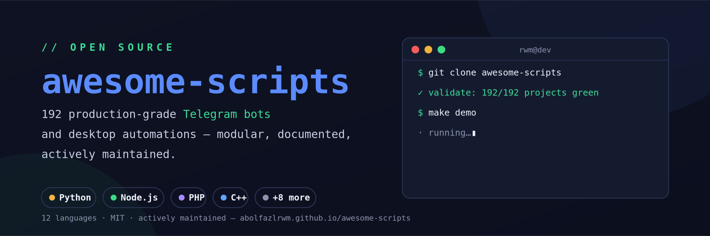
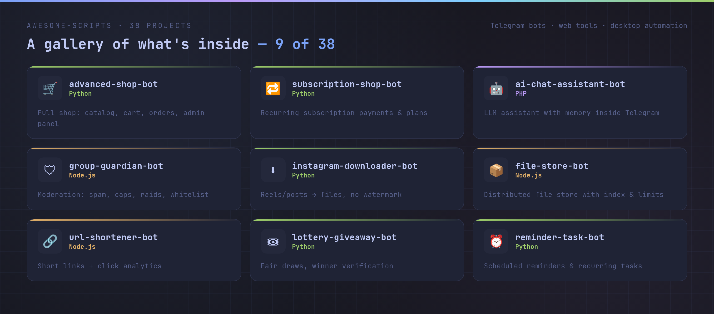
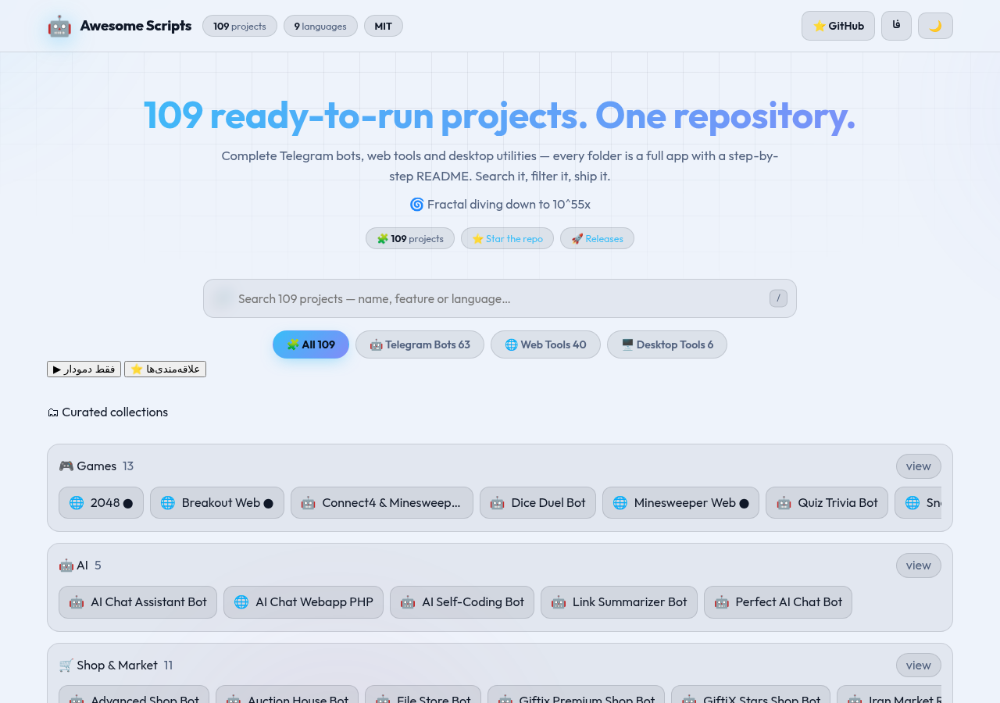
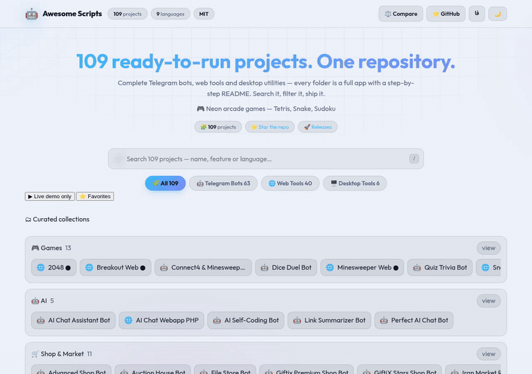
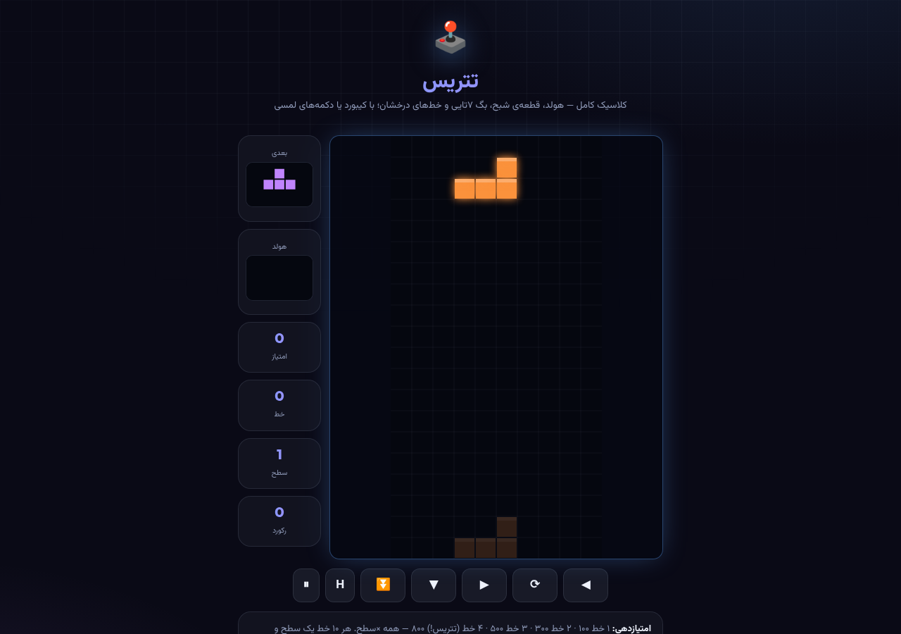
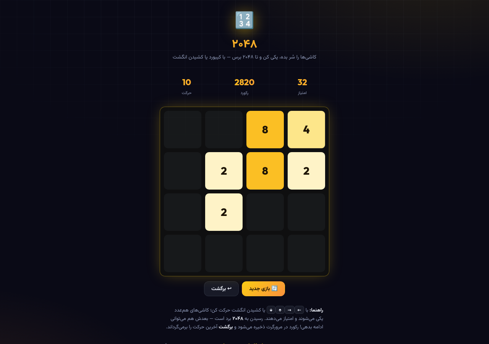
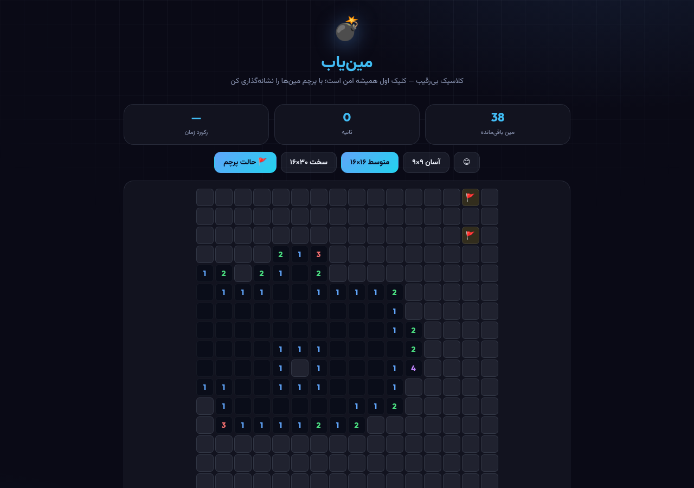
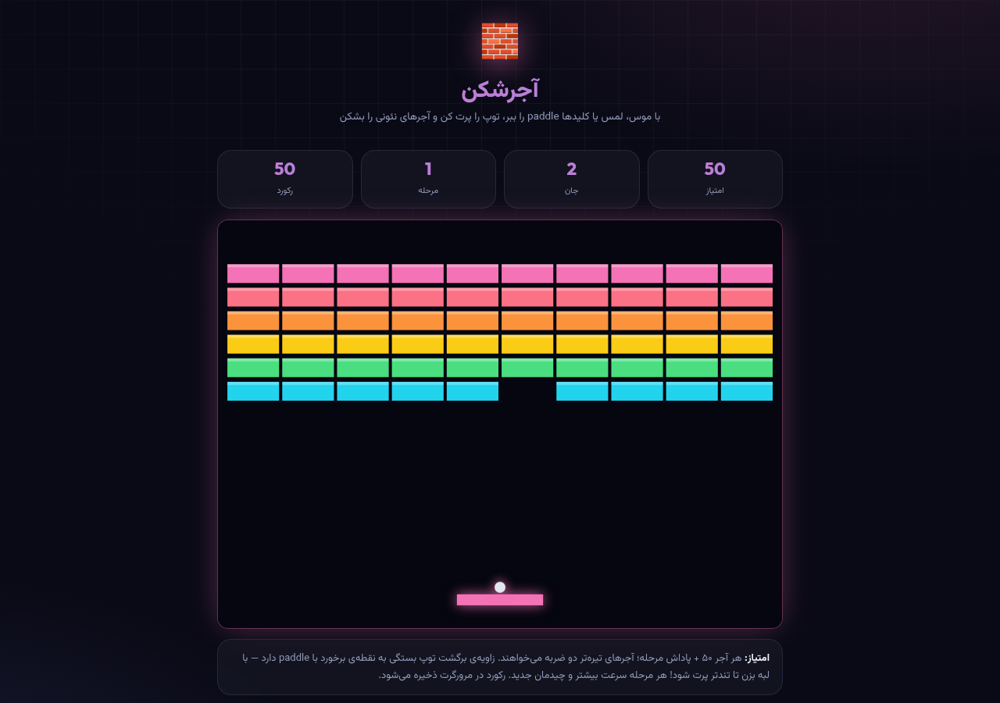
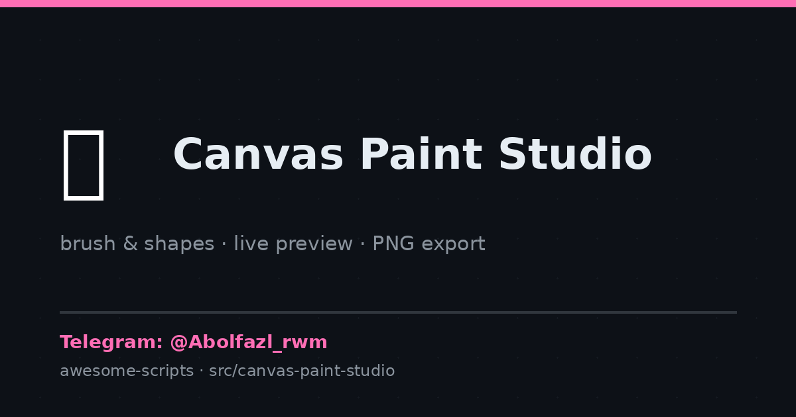
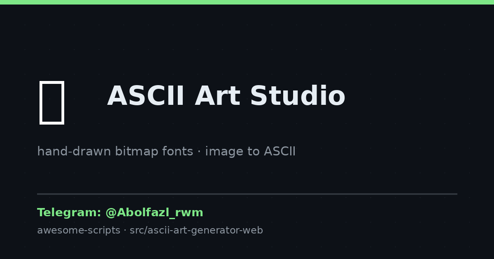

<div align="center">

# 🤖 Awesome Scripts

<p align="center"></p>
**192 complete, ready-to-run projects — Telegram bots, web tools & desktop utilities — each in its own folder with a step-by-step setup guide.**

<p align="center"></p>


[](https://github.com/Abolfazlrwm/awesome-scripts/actions/workflows/lint.yml)
[](https://github.com/Abolfazlrwm/awesome-scripts/actions/workflows/validate.yml)
[](https://github.com/Abolfazlrwm/awesome-scripts/releases/latest)
[](https://github.com/Abolfazlrwm/awesome-scripts/actions/workflows/release.yml)
[](https://github.com/Abolfazlrwm/awesome-scripts/actions/workflows/codeql.yml)


🌐 **English** · [**فارسی**](#farsi)

</div>

> [!NOTE]
> **Scope: community utility collection.** 192 small, practical scripts, bots
> and tools — breadth, not depth. This is not where I demonstrate engineering
> depth; the flagship projects are pinned on [my profile](https://github.com/Abolfazlrwm).

<a id="english"></a>

## 🌐 Live Gallery — گالری زنده

**[▶ Browse all projects interactively](https://abolfazlrwm.github.io/awesome-scripts/)** — live search, category/language filters, favorites and real in-modal previews. The site is built and deployed automatically by **GitHub Actions** (Pages) on every push.

<p align="center"><a href="https://abolfazlrwm.github.io/awesome-scripts/"></a></p>

**[▶ مشاهده‌ی زنده‌ی همه‌ی پروژه‌ها](https://abolfazlrwm.github.io/awesome-scripts/)** — جست‌وجوی زنده، فیلتر دسته/زبان، علاقه‌مندی‌ها و پیش‌نمایش واقعی داخل مودال؛ انتشار خودکار با **GitHub Actions** در هر push.
<p align="center"><a href="https://abolfazlrwm.github.io/awesome-scripts/"></a></p>

**⏱ 40-second walkthrough** — live search → in-modal product preview → the **⚖️ [Project Matrix](https://abolfazlrwm.github.io/awesome-scripts/compare.html)**: all 192 projects measured (files · lines of code · size) with advanced filters and side-by-side comparison of up to 4 projects.

**⏱ ویدیوی چهل‌ثانیه‌ای** — جست‌وجوی زنده → پیش‌نمایش محصول داخل مودال → **⚖️ [ماتریس پروژه‌ها](https://abolfazlrwm.github.io/awesome-scripts/compare.html)**: همه‌ی ۱۹۲ پروژه با تعداد فایل، خط کد و حجم + فیلترهای پیشرفته و مقایسه‌ی کنارِ‌هم تا ۴ پروژه.

**📲 PWA & shareable views** — the gallery installs as an app (service worker, offline shell) and every search/filter combo is a shareable URL — try `?q=tetris&demo=1` or `?fa=1`. The header has a 🎲 random-project button, a 🚀 latest-release chip and ⬇️ one-click ZIP download.

**📲 PWA و لینک‌های اشتراکی** — سایت به‌صورت اپ نصب می‌شود (Service Worker، کارکرد آفلاین) و هر ترکیب جست‌وجو/فیلتر یک URL قابل اشتراک است؛ مثلاً `?q=tetris&demo=1`. هدر سایت دکمه‌ی 🎲 پروژه‌ی تصادفی، چیپ 🚀 آخرین ریلیز و ⬇️ دانلود مستقیم ZIP دارد.

**🔍 Code Search** — grep-style search across **all 1,260 source files** (~419,000 lines) of every project: find any identifier, string or comment — e.g. [`aiogram`](https://abolfazlrwm.github.io/awesome-scripts/search.html?q=aiogram) — with direct links to the exact file and line on GitHub. The index is prebuilt and gzip-compressed (~5.3 MB, cached offline by the service worker).

**🔍 جست‌وجوی کد** — جست‌وجوی grep-مانند در **همه‌ی ۱٬۲۶۰ فایل سورس** (~۴۱۹ هزار خط) تمام پروژه‌ها: هر شناسه، رشته یا کامنت — مثلاً [`aiogram`](https://abolfazlrwm.github.io/awesome-scripts/search.html?q=aiogram) — با لینک مستقیم به فایل و خط دقیق در گیت‌هاب؛ ایندکس از قبل ساخته و فشرده شده (~۵.۳ مگابایت، با Service Worker آفلاین هم می‌ماند).

**📊 Stats & Growth** — [stats.html](https://abolfazlrwm.github.io/awesome-scripts/stats.html) measures the whole history straight from git: one data point per release tag (38 projects / 53k lines at v1.0.0 → 192 / 425k today), language share, top-15 biggest projects and the monthly commit pulse. Zero chart libraries — hand-rolled SVG, bilingual, offline.

**📊 آمار و رشد** — صفحه‌ی [stats.html](https://abolfazlrwm.github.io/awesome-scripts/stats.html) کل تاریخچه را مستقیم از گیت اندازه می‌گیرد: یک نقطه به‌ازای هر ریلیز (۳۸ پروژه/۵۳ هزار خط در v1.0.0 → ۱۹۲/۴۲۵ هزار خط امروز)، سهم زبان‌ها، ۱۵ پروژه‌ی بزرگ‌تر و ضربان ماهانه‌ی کامیت‌ها؛ بدون هیچ کتابخانه‌ی نمودار — SVG دست‌ساز، دوزبانه و آفلاین.


## 🎬 Try it in one click — محصولات شاخص

Six of the flagship web tools — every thumbnail is clickable: **▶ opens the live product**, **💻 opens the source code on GitHub**.

<table>
  <tr>
    <td align="center" width="33%"><a href="https://abolfazlrwm.github.io/awesome-scripts/web/tetris-web/"></a><br><b>Tetris Web</b><br><a href="https://abolfazlrwm.github.io/awesome-scripts/web/tetris-web/">▶ demo</a> · <a href="https://github.com/Abolfazlrwm/awesome-scripts/tree/main/web/tetris-web">💻 code</a></td>
    <td align="center" width="33%"><a href="https://abolfazlrwm.github.io/awesome-scripts/web/2048-web/"></a><br><b>2048</b><br><a href="https://abolfazlrwm.github.io/awesome-scripts/web/2048-web/">▶ demo</a> · <a href="https://github.com/Abolfazlrwm/awesome-scripts/tree/main/web/2048-web">💻 code</a></td>
    <td align="center" width="33%"><a href="https://abolfazlrwm.github.io/awesome-scripts/web/minesweeper-web/"></a><br><b>Minesweeper Web</b><br><a href="https://abolfazlrwm.github.io/awesome-scripts/web/minesweeper-web/">▶ demo</a> · <a href="https://github.com/Abolfazlrwm/awesome-scripts/tree/main/web/minesweeper-web">💻 code</a></td>
  </tr>
  <tr>
    <td align="center"><a href="https://abolfazlrwm.github.io/awesome-scripts/web/breakout-web/"></a><br><b>Breakout Web</b><br><a href="https://abolfazlrwm.github.io/awesome-scripts/web/breakout-web/">▶ demo</a> · <a href="https://github.com/Abolfazlrwm/awesome-scripts/tree/main/web/breakout-web">💻 code</a></td>
    <td align="center"><a href="https://abolfazlrwm.github.io/awesome-scripts/web/canvas-paint-studio/"></a><br><b>Canvas Paint Studio</b><br><a href="https://abolfazlrwm.github.io/awesome-scripts/web/canvas-paint-studio/">▶ demo</a> · <a href="https://github.com/Abolfazlrwm/awesome-scripts/tree/main/web/canvas-paint-studio">💻 code</a></td>
    <td align="center"><a href="https://abolfazlrwm.github.io/awesome-scripts/web/ascii-art-generator-web/"></a><br><b>ASCII Art Generator</b><br><a href="https://abolfazlrwm.github.io/awesome-scripts/web/ascii-art-generator-web/">▶ demo</a> · <a href="https://github.com/Abolfazlrwm/awesome-scripts/tree/main/web/ascii-art-generator-web">💻 code</a></td>
  </tr>
</table>

شش محصول شاخص از ۴۰ ابزار وب — هر عکس کلیک‌خور است: ▶ محصول زنده، 💻 سورس در گیت‌هاب. بقیه‌ی دموها در [گالری تعاملی](https://abolfazlrwm.github.io/awesome-scripts/) با فیلتر «▶ فقط دمودار».

## ✨ About

Every project here is a **complete, runnable application** — not a snippet. Projects are grouped by type — [`bots/`](./bots) (136 Telegram bots), [`web/`](./web) (49 browser tools) and [`desktop/`](./desktop) (7 utilities) — open any folder, follow its README, and you have a working bot, tool or site in minutes. The collection spans **12 languages** (Python, JavaScript, Node.js, PHP, C#, Java, C++, PowerShell, Lua, HTML/CSS/JS) and everything is released under MIT.

> 🧭 Prefer browsing? Open the **[interactive catalog](https://abolfazlrwm.github.io/awesome-scripts/)** — live search, category/language filters, dark mode and full Persian (RTL) mode. Stable versions are published under [Releases](https://github.com/Abolfazlrwm/awesome-scripts/releases).

## 🗂 Repository layout — ساختار مخزن

```text
awesome-scripts/
├── bots/        # 136 Telegram bots (Python · PHP · Node.js · Lua)
├── web/         # 49 browser tools — offline single-file HTML apps
├── desktop/     # 7 desktop utilities
├── index.html   # interactive live gallery (GitHub Pages)
├── compare.html # ⚖️ project matrix — per-project stats, filters, 4-way compare
├── search.html  # 🔍 grep-style code search across every source file
├── stats.html   # 📊 growth charts — releases, languages, commit pulse
├── data/        # catalog.json/js · stats.json/js · code-index/texts .json.gz — generated, do not edit
├── tools/       # catalog generator · validator · scaffolder · sitemap
├── assets/      # OG banner · favicons · gallery screenshot
└── .github/     # CI: lint · validate · link-check · CodeQL · release · Pages
```

ربات‌ها در `bots/`، ابزارهای وب در `web/` و ابزارهای دسکتاپ در `desktop/`؛ سایت تعاملی و مانیفست در ریشه، ابزارهای نگهداری در `tools/` و پایپ‌لاین‌های CI در `.github/`.

> 📬 **Contact / custom projects:** Telegram [@Abolfazl_rwm](https://t.me/Abolfazl_rwm)

## 🛡 Engineering practices — مهندسی واقعی، نه ادعا

| Gate | What runs | When |
| --- | --- | --- |
| ✅ **Validate** | all project folders: real README, runnable entry point, zero committed secrets | every push |
| 🔁 **Catalog check** | README tables ↔ generated catalog drift detection (`--check`) | every push |
| 🔗 **Link Check** | every demo + repo link in README/catalog must return HTTP 200 | push + weekly |
| 🧠 **CodeQL** | static security analysis for Python/JavaScript | push + weekly |
| 📦 **Release** | auto-generated release notes + full source ZIP per version tag | every tag |
| 🔄 **Dependabot** | GitHub Actions pinning & version updates | weekly |

Every version is tagged (`v1.0.0` → today), released with generated notes, and the gallery site is redeployed to GitHub Pages automatically on each push — the live site is never behind the code.

## 🚀 Quick start

```bash
git clone https://github.com/Abolfazlrwm/awesome-scripts.git
cd awesome-scripts/<bots|web|desktop>/<project-folder>
# open that folder's README.md and follow the setup steps
```

Most bots only need a token from [@BotFather](https://t.me/BotFather) and an admin ID from [@userinfobot](https://t.me/userinfobot).

## 📦 Catalog

### 🤖 Telegram bots — 136

| Project | Lang | What it does |
| --- | --- | --- |
| [life-simulator-bot](./bots/life-simulator-bot) | Python | Full life-simulation game — jobs & skills, bank cards, real estate, companies, free market, crime & jail |
| [city-builder-bot](./bots/city-builder-bot) | Python | City-building strategy game — tech tree, diplomacy & trade, happiness economy, random events |
| [world-war-game-bot](./bots/world-war-game-bot) | Python | Geopolitical war simulator — countries, NPC raids & nukes, oil/arms/stock markets, clans, VIP |
| [military-alliance-bot](./bots/military-alliance-bot) | Python | Military strategy game — land/air/navy forces, trade & war declarations, billion-cost alliances |
| [giftix-stars-shop-bot](./bots/giftix-stars-shop-bot) | Python | Stars/Premium/Gift/TON storefront — wallet & gateways, referrals, order tracking, tickets |
| [giftix-premium-shop-bot](./bots/giftix-premium-shop-bot) | Python | Full GiftiX storefront — Stars/Premium/Gifts/TON with live Nobitex rates, profit engine, referral commission, tickets |
| [member-tag-manager-bot](./bots/member-tag-manager-bot) | Python | Real member tags (setChatMemberTag), premium-emoji relay, personal invite links with join counters |
| [channel-translate-worker](./bots/channel-translate-worker) | JavaScript | Cloudflare Worker stamps fa/en/ru translate buttons onto channel posts (Gemini + Google fallback) |
| [perfect-ai-chat-bot](./bots/perfect-ai-chat-bot) | PHP | Chat-to-channel bridge — member messages forward into your channel, sessions, owner panel |
| [ai-self-coding-bot](./bots/ai-self-coding-bot) | PHP | Self-coding experiment — OpenRouter Llama-3 writes & appends PHP into its own bot file (owner-only) |
| [php-coin-manager-bot](./bots/php-coin-manager-bot) | PHP | Coin economy & view-order shop — balances, top-ups, admin panel, Jalali dates, zero dependencies |
| [url-shortener-php-bot](./bots/url-shortener-php-bot) | PHP | URL shortener in PHP & Python — TinyURL, flood control, block list, DB-editable texts, force join |
| [todo-miniapp-worker](./bots/todo-miniapp-worker) | JavaScript | ToDoList Mini App as one Cloudflare Worker — API + bot webhook + cron reminders + embedded frontend on D1 |
| [spotify-music-bot](./bots/spotify-music-bot) | Python | Spotify link & YouTube Music search downloader — 320 kbps with original cover art + ID3 tags |
| [voicecall-userbot](./bots/voicecall-userbot) | Python | VoiceChat userbot + admin panel — auto join, YouTube/music playback, playlists, live radio streams |
| [winland-giveaway-bot](./bots/winland-giveaway-bot) | Python | WinLand-style giveaways — multi-prize draws, referral points, mandatory channel join, admin panel |
| [post-manager-bot](./bots/post-manager-bot) | Python | Channel post manager with colored inline buttons (Bot API 7.10+ styles) and live preview |
| [channel-likes-bot](./bots/channel-likes-bot) | Python | Reposts anything sent to the bot into your channel with a live one-per-user like button |
| [likes-challenges-php-bot](./bots/likes-challenges-php-bot) | PHP | Channel growth suite — auto-likes, like/speed challenges, coin economy with card & Zibal payments, web installer |
| [telegram-selfbot-panel](./bots/telegram-selfbot-panel) | Python | 42+ feature selfbot — inline panel, live name clock, media saver, QR/logo, AI, scheduler |
| [pyrogram-selfbot-manager](./bots/pyrogram-selfbot-manager) | Python | Pyrogram account manager — phone login, live name clock (10 fonts), secretary & guards, session security |
| [multi-account-manager](./bots/multi-account-manager) | Python | Multi-account control center — sync mode, operation workers, per-account DBs, owner panel |
| [iran-market-rate-bot](./bots/iran-market-rate-bot) | Python | Free-market rates as rendered cards — USD, gold coins, crypto, converter, full list |
| [emoji-forge-bot](./bots/emoji-forge-bot) | Python | Custom emoji pack rebranding (TGS/WEBM) — pipeline, tests, systemd deploy |
| [starzify-shop-bot](./bots/starzify-shop-bot) | Python | Stars/Premium/Gifts/Crypto shop replica — wallet, referrals, admin panel |
| [v2ray-shop-bot](./bots/v2ray-shop-bot) | Python | V2Ray/OpenVPN config shop — card-to-card payments, wallet, admin panel |
| [php-bot-maker](./bots/php-bot-maker) | PHP | Bot-maker platform — users build bots, coin economy, marketplace with moderation |
| [channel-submission-bot](./bots/channel-submission-bot) | PHP | Users submit posts, admin approves → auto-published to the channel |
| [advanced-shop-bot](./bots/advanced-shop-bot) | Python | Full shop bot — product catalog, cart, coupons, card-to-card payment |
| [subscription-shop-bot](./bots/subscription-shop-bot) | Python | Automated subscription selling, lucky wheel, reseller system |
| [happydog-economy-bot](./bots/happydog-economy-bot) | Python | Group economy game — pets, fishing, factories, city hall, national leadership |
| [connect4-minesweeper-bot](./bots/connect4-minesweeper-bot) | Python | Connect-4 & Minesweeper group games with ranking and a leaderboard |
| [telethon-session-manager](./bots/telethon-session-manager) | Python | Multi-account automation with Telethon (join, reactions) |
| [ai-chat-assistant-bot](./bots/ai-chat-assistant-bot) | PHP | Chat with GPT / DeepSeek / Grok + full admin panel |
| [instagram-downloader-bot](./bots/instagram-downloader-bot) | Python | Instagram posts/reels/stories downloader with VIP membership |
| [premium-emoji-poster-cfworker](./bots/premium-emoji-poster-cfworker) | JavaScript | Channel posting with premium emojis — runs on Cloudflare Workers |
| [meow-point-bot](./bots/meow-point-bot) | Python | Cat-themed group economy — wars, bank, points |
| [group-guardian-bot](./bots/group-guardian-bot) | Node.js | Anti-spam, entry captcha, word filtering, auto-warnings |
| [file-store-bot](./bots/file-store-bot) | Node.js | File storage with dedicated download links |
| [price-ticker-bot](./bots/price-ticker-bot) | Node.js | Crypto prices, price alerts, auto channel updates |
| [url-shortener-bot](./bots/url-shortener-bot) | Node.js | Link shortening with click analytics |
| [youtube-downloader-bot](./bots/youtube-downloader-bot) | PHP | YouTube video/audio downloader |
| [uptime-monitor-bot](./bots/uptime-monitor-bot) | C# | Website/server uptime checks + HTML status page |
| [quiz-trivia-bot](./bots/quiz-trivia-bot) | Java | Group quiz competitions with a leaderboard |
| [rss-news-bot](./bots/rss-news-bot) | C++ | Auto-post new feed items to a channel |
| [translator-bot](./bots/translator-bot) | Node.js | Auto-translate messages |
| [support-ticket-bot](./bots/support-ticket-bot) | Python | Relay user messages ↔ a private support group |
| [digit-id-bot](./bots/digit-id-bot) | Python | Get any Telegram user's numeric ID |
| [reminder-task-bot](./bots/reminder-task-bot) | Python | One-time/daily reminders — task list with buttons, snooze, SQLite |
| [link-summarizer-bot](./bots/link-summarizer-bot) | Python | Summarize links & text — offline by default, upgradeable with an LLM |
| [code-share-bot](./bots/code-share-bot) | Python | Store, search & share code snippets with syntax highlighting |
| [digiato-article-bot](./bots/digiato-article-bot) | Python | Search & extract Digiato articles with pagination |
| [freedomnet-vpn-bot](./bots/freedomnet-vpn-bot) | Python | VPN config distribution — QR codes, server ping tests, admin panel |
| [forward-info-bot](./bots/forward-info-bot) | PHP | Reveal the original sender of forwarded messages |
| [lottery-giveaway-bot](./bots/lottery-giveaway-bot) | Python | Giveaways with mandatory join, referrals, admin panel |
| [poll-vote-bot](./bots/poll-vote-bot) | Python | Polls with live vote buttons, rendered result cards, CSV export — no framework |
| [wordle-fa-bot](./bots/wordle-fa-bot) | Python | Persian Wordle — 5-letter word of the day, 6 tries, emoji feedback, streaks & stats |
| [flashcard-srs-bot](./bots/flashcard-srs-bot) | Python | Spaced-repetition study bot — SM-2 scheduler, decks, grade buttons, progress |
| [expense-splitter-bot](./bots/expense-splitter-bot) | Python | Group cost sharing — live balances, equal/custom splits, fewest-transfers settle-up |
| [dice-duel-bot](./bots/dice-duel-bot) | Python | PvP wagered dice duels — animated 2d6 rolls, tie re-rolls, coins & leaderboard |
| [prayer-times-bot](./bots/prayer-times-bot) | Python | Offline prayer times for 30 Iranian cities — Geophysics method, Qibla bearing, /next countdown |
| [auction-house-bot](./bots/auction-house-bot) | Python | Live group auctions — one-tap bids, live post editing, anti-snipe timer, winner announcements |
| [fortune-teller-bot](./bots/fortune-teller-bot) | Python | Daily fortune card, zodiac vibes, pair compatibility & 3-dice reading — original texts, entertainment only |
| [proxy-scraper-bot](./bots/proxy-scraper-bot) | PHP | /start → 10 fresh MTProto proxies from a proxy API as tappable URL buttons — webhook bot, Telegram-IP allow-list |
| [anonymous-message-bot](./bots/anonymous-message-bot) | PHP | Anonymous messaging — personal /link per user, messages forwarded without sender identity, admin panel & mandatory channel join |
| [self-cli-php-bot](./bots/self-cli-php-bot) | PHP | MadelineProto v8 self-bot panel for your own account — name/bio tools, timers, forwards, weather; a userbot, run at your own risk |
| [tabchi-forwarder-bot](./bots/tabchi-forwarder-bot) | PHP | MadelineProto auto-forwarder — pipes new posts from your source channels to destinations, multi-tabche, media cache dirs |
| [esrrar-chat-bot](./bots/esrrar-chat-bot) | PHP | Anonymous two-way chat with the other party or the seller — admin broadcast, member gate, Jalali dates; ships a Telethon/Flask session runner |
| [php-uploader-bot](./bots/php-uploader-bot) | PHP | URL → Telegram uploader bot — MySQL storage, admin panel, per-message delete, Jalali dates, Telegram-IP allow-list |
| [channel-tools-bot](./bots/channel-tools-bot) | PHP | Channel-side utility bot — membership gate, member log, pin/edit/delete controls, on/off switch, transparent g-id link buttons |
| [telethon-tabchi-cli](./bots/telethon-tabchi-cli) | Python | Telethon tabchi CLI — auto-forwards posts between your channels, spambot check, FloodWait handling |
| [timed-lock-bot](./bots/timed-lock-bot) | PHP | Time-based auto-lock for groups/channels — lock windows per channel, inline channel manager, Telegram-IP allow-list |
| [group-broadcast-bot](./bots/group-broadcast-bot) | PHP | Broadcast the admin's message to every group the bot itself is a member of — check utilities, no database |
| [dio-selfbot](./bots/dio-selfbot) | Python | Pyrogram selfbot — time-aware bio/name (Tehran clock), mute/game toggles, saved-replies list |
| [story-downloader-bot](./bots/story-downloader-bot) | Python | Downloads Telegram stories by link or username — sudo admin, mandatory-channel config |
| [supertabchi-copy-bot](./bots/supertabchi-copy-bot) | Python | APScheduler post-copier — copy_message without the forward header, separate group/channel timers |
| [hxd-post-copier](./bots/hxd-post-copier) | Python | Lighter sibling post-copier — interactive first-run owner prompt, scheduled copies |
| [staking-deposit-bot](./bots/staking-deposit-bot) | PHP | Staking deposit flow — weekly-challenge countdown, wallet-address deposits, per-user step states |
| [duel-game-bot](./bots/duel-game-bot) | Python | Group duel game — challenge members, flavored results, SQLite stats, StringSession helper |
| [krals-selfbot](./bots/krals-selfbot) | Python | Pyrogram selfbot panel — second client, Tehran timezone, raw functions, admin/owner model |
| [self-reload-bot](./bots/self-reload-bot) | Python | Selfbot with hot module reload — pytube downloads, Enemy-list manager, profile tools |
| [pyrogram-self-plus](./bots/pyrogram-self-plus) | Python | Feature-rich selfbot — RexTester code execution, Wikipedia, YouTube tools, first-comment automation |
| [jackmor-selfbot](./bots/jackmor-selfbot) | Python | Teletips-based mega selfbot — anti-delete logging, autopic, media/logo tools (assets not committed) |
| [audio-tools-bot](./bots/audio-tools-bot) | PHP | Audio metadata & mp3 tools — getID3 extraction plus the bundled PHPMP3 class, stats and user checks |
| [anonymous-platform](./bots/anonymous-platform) | PHP | Full anonymous-chat platform — web user panel, Zarinpal payments, HTTPS web installer |
| [kaj-anonymous-bot](./bots/kaj-anonymous-bot) | PHP | Anonymous chat with per-character pricing — first 7 chars free, Zarinpal gateway, Jalali dates |
| [coin-bet-game-bot](./bots/coin-bet-game-bot) | PHP | Coin-flip betting game — balances, deposit/withdraw requests, transfers, admin panel (in-game currency only) |

| [chronicle-selfbot](./bots/chronicle-selfbot) | Python | CLI Telethon selfbot with a terminal panel and general userbot tooling |
| [cloudflare-manager-bot](./bots/cloudflare-manager-bot) | Python | Manage Cloudflare DNS/account from Telegram via the REST API |
| [anti-login-selfbot](./bots/anti-login-selfbot) | Python | Guard your session — `antilogin on/off` kills unknown active logins |
| [channel-username-tool](./bots/channel-username-tool) | Python | Bulk-create channels and claim usernames with FloodWait handling |
| [python-uploader-bot](./bots/python-uploader-bot) | Python | File uploader with an inline admin panel (captions, start message) |
| [hideme-chat-bot](./bots/hideme-chat-bot) | Python | Anonymous chat with gender picker, coin/cash referrals, admin panel |
| [save-media-bot](./bots/save-media-bot) | PHP | Mirror channel media into a storage channel with link previews |
| [parsi-support-bot](./bots/parsi-support-bot) | PHP | Support desk bot — user messages reach support, replies go straight back |
| [cloudflare-ip-bot](./bots/cloudflare-ip-bot) | PHP | Fetch and serve healthy Cloudflare edge IPs |
| [github-search-bot](./bots/github-search-bot) | Python | Search GitHub repos, read READMEs and trends inside Telegram |
| [media-compressor-bot](./bots/media-compressor-bot) | Python | Compress video (H.265) and images with ffmpeg |
| [quick-search-bot](./bots/quick-search-bot) | PHP | Minimal search bot — user text becomes a query, results come back |
| [telegram-post-worker](./bots/telegram-post-worker) | JavaScript | Serverless post manager on Cloudflare Workers — staged posts, targets, admin panel |
| [remote-admin-bot](./bots/remote-admin-bot) | Python | Remote-control connected accounts with file routing, admin-only |
| [telethon-pro-selfbot](./bots/telethon-pro-selfbot) | Python | Profile tools, reactions, group calls and cron scheduling on Telethon |
| [selfsaz-plugin-selfbot](./bots/selfsaz-plugin-selfbot) | Python | Telethon selfbot with a dynamic plugin loader and 87 ready plugins |
| [ultra-self-bot](./bots/ultra-self-bot) | Python | Lightweight Ultra Self V1.0 Telethon selfbot with a separate config |
| [hxd3-selfbot](./bots/hxd3-selfbot) | Python | Third lightweight iteration of the HxD Pyrogram family |
| [clock-bio-userbot](./bots/clock-bio-userbot) | Python | Live clock with colored hearts in your name/bio, auto-updated each minute |
| [tron-deposit-bot](./bots/tron-deposit-bot) | Python | TRON gateway bot — per-user wallets, TRX/Toman withdrawals, admin panel |
| [parsi-ai-chat-bot](./bots/parsi-ai-chat-bot) | PHP | Private AI chat with per-user usage counting and daily stats |
| [pirce-currency-bot](./bots/pirce-currency-bot) | PHP | Currency rates with half/double/refresh buttons and a `calc` command |
| [proxy-join-toolkit](./bots/proxy-join-toolkit) | PHP | Proxy bot + force-join check widget returning JSON |
| [channel-mirror-bot](./bots/channel-mirror-bot) | PHP | Auto-mirror posts from source channels into one target channel |
| [botbiso-wheel-game-bot](./bots/botbiso-wheel-game-bot) | PHP | Wheel-of-fortune coin game with rounds, referrals and an admin panel |
| [faker-profile-bot](./bots/faker-profile-bot) | Python | Faker(fa) profiles + channel joins across multiple accounts |
| [channel-media-manager-bot](./bots/channel-media-manager-bot) | PHP | Channel media manager — captions, auto-seen, timed deletion |
| [clash-clan-bot](./bots/clash-clan-bot) | PHP | Clan registration bot for Clash Royale / Clash of Clans |
| [nextpay-vpn-seller](./bots/nextpay-vpn-seller) | PHP | VPN subscription seller wired to the Nextpay gateway |
| [markov-text-model](./bots/markov-text-model) | Python | Markov-chain text model with a Wikipedia data receiver |
| [pinterest-downloader-bot](./bots/pinterest-downloader-bot) | PHP | Extract and send original images from Pinterest pins |
| [xshare2bot](./bots/xshare2bot) | PHP | Save & share Telegram posts with short links and view counts |
| [source-arz-selfbot](./bots/source-arz-selfbot) | Python | Telethon selfbot shipping 186 independent plugins |
| [ptb-group-manager-bot](./bots/ptb-group-manager-bot) | Python | Full group manager on PTB — admin panel, filters, account-age checks |
| [whisper-group-bot](./bots/whisper-group-bot) | Python | In-group whisper messages with unique IDs and logging |
| [virtual-number-shop](./bots/virtual-number-shop) | PHP | Virtual-number shop with a web installer, admin panel and payments |
| [madeline-tabchi-php](./bots/madeline-tabchi-php) | PHP | Full tabchi on MadelineProto v8 — admin panel, stats, broadcast |
| [blackdiamond-userbot](./bots/blackdiamond-userbot) | Lua | tdlua-based userbot with role levels, global bans and bundled libs |
| [currency-rate-php-bot](./bots/currency-rate-php-bot) | PHP | Currency bot with a calc command and a bootstrap web face |
| [lottery-account-php-bot](./bots/lottery-account-php-bot) | PHP | Lottery bot with LiteSpeed fast-finish responses and Jalali dates |
| [slow-bet-bot](./bots/slow-bet-bot) | PHP | Large single-file betting panel — balances, Jalali dates, admin tools |
| [slow-clan-game-bot](./bots/slow-clan-game-bot) | PHP | Clan game with per-room engines, gift codes and daily rewards |
| [slow-finder-bot](./bots/slow-finder-bot) | PHP | Phone finder by numeric ID with anti-spam cooldown and tutorials |
| [slow-like-bot](./bots/slow-like-bot) | PHP | Like system with hashed records and channel force-join |
| [slow-seen-bot](./bots/slow-seen-bot) | PHP | View/seen seller with a standalone ZarinPal payment panel (RTL) |
| [slow-uploader-bot](./bots/slow-uploader-bot) | PHP | Uploader with auto getMe identification, Jalali dates, fast responses |
| [mafia-game-bot](./bots/mafia-game-bot) | PHP | Mafia party game — 9/12-player modes, role distribution, day/night |
| [vak-sms-bot](./bots/vak-sms-bot) | PHP | Buy virtual numbers via the vak-sms service, read OTPs, cancel orders |
| [makoran-chat-bot](./bots/makoran-chat-bot) | PHP | Anonymous chat with random pairing, reports and an RTL payment panel |

### 🌐 Web tools — 49

| Project | Lang | What it does | Live demo |
| --- | --- | --- | --- |
| [wheel-of-actions](./web/wheel-of-actions) | HTML/CSS/JS | Spin-the-wheel task prioritizer | [demo](https://abolfazlrwm.github.io/awesome-scripts/web/wheel-of-actions/) |
| [twitter-media-api](./web/twitter-media-api) | PHP | Tweet URL → media JSON — guest-token auth, GraphQL TweetDetail, all photo/video variants |
| [ai-chat-webapp-php](./web/ai-chat-webapp-php) | PHP | Single-file OpenRouter chat web app — conversation history, Markdown, light/dark theme, RTL UI |
| [caller-lookup-app](./web/caller-lookup-app) | HTML/CSS/JS | Persian spam-caller lookup — search a number, see labels & community reports | [demo](https://abolfazlrwm.github.io/awesome-scripts/web/caller-lookup-app/) |
| [backend-dev-portfolio](./web/backend-dev-portfolio) | HTML/CSS/JS | Single-file dark portfolio for backend & bot developers — zero dependencies | [demo](https://abolfazlrwm.github.io/awesome-scripts/web/backend-dev-portfolio/) |
| [ton-nft-marketplace](./web/ton-nft-marketplace) | HTML/CSS/JS | TON Connect NFT marketplace UI — gallery, buy modal, fa/en language toggle | [demo](https://abolfazlrwm.github.io/awesome-scripts/web/ton-nft-marketplace/) |
| [solar-explorer-3d](./web/solar-explorer-3d) | HTML/CSS/JS | Interactive 3D solar system (Three.js) — time control, planet info | [demo](https://abolfazlrwm.github.io/awesome-scripts/web/solar-explorer-3d/) |
| [control-room-dashboard](./web/control-room-dashboard) | HTML/CSS/JS | Live simulated dashboard — bot status, real-time logs, FX rates | [demo](https://abolfazlrwm.github.io/awesome-scripts/web/control-room-dashboard/) |
| [qr-code-studio](./web/qr-code-studio) | HTML/CSS/JS | Custom QR codes — colors, gradients, logo, PNG/SVG export | [demo](https://abolfazlrwm.github.io/awesome-scripts/web/qr-code-studio/) |
| [world-clock-planner](./web/world-clock-planner) | HTML/CSS/JS | International meeting planner — shared time bar, day/night per city | [demo](https://abolfazlrwm.github.io/awesome-scripts/web/world-clock-planner/) |
| [tic-tac-toe-game](./web/tic-tac-toe-game) | HTML/CSS/JS | Classic tic-tac-toe against an AI | [demo](https://abolfazlrwm.github.io/awesome-scripts/web/tic-tac-toe-game/) |
| [mobile-app-intro-template](./web/mobile-app-intro-template) | HTML/CSS/JS | 12 responsive landing pages for mobile app promotion | [demo](https://abolfazlrwm.github.io/awesome-scripts/web/mobile-app-intro-template/) |
| [telegram-channel-landing-page](./web/telegram-channel-landing-page) | HTML/CSS/JS | Single-file landing page for Telegram channels & brands | [demo](https://abolfazlrwm.github.io/awesome-scripts/web/telegram-channel-landing-page/) |
| [jalali-date-tools](./web/jalali-date-tools) | HTML/CSS/JS | Persian calendar toolkit — converter, age, date-diff, Tehran clock (offline) | [demo](https://abolfazlrwm.github.io/awesome-scripts/web/jalali-date-tools/) |
| [color-palette-studio](./web/color-palette-studio) | HTML/CSS/JS | Palette generator — harmony rules, tints/shades, WCAG contrast lab, CSS/JSON/Tailwind export | [demo](https://abolfazlrwm.github.io/awesome-scripts/web/color-palette-studio/) |
| [drum-machine-web](./web/drum-machine-web) | HTML/CSS/JS | 16-step WebAudio drum machine — synthesized voices, BPM/swing, presets, save/load | [demo](https://abolfazlrwm.github.io/awesome-scripts/web/drum-machine-web/) |
| [typing-speed-race](./web/typing-speed-race) | HTML/CSS/JS | FA/EN typing test — per-char feedback, live WPM curve, localStorage history | [demo](https://abolfazlrwm.github.io/awesome-scripts/web/typing-speed-race/) |
| [sudoku-game-web](./web/sudoku-game-web) | HTML/CSS/JS | Sudoku with unique-solution generator — 4 difficulties, pencil notes, hints, solver | [demo](https://abolfazlrwm.github.io/awesome-scripts/web/sudoku-game-web/) |
| [ascii-art-generator-web](./web/ascii-art-generator-web) | HTML/CSS/JS | ASCII art studio — hand-drawn bitmap fonts for banners + image-to-ASCII converter | [demo](https://abolfazlrwm.github.io/awesome-scripts/web/ascii-art-generator-web/) |
| [canvas-paint-studio](./web/canvas-paint-studio) | HTML/CSS/JS | Browser paint app — brush & shapes with live preview, undo, quick swatches, PNG export | [demo](https://abolfazlrwm.github.io/awesome-scripts/web/canvas-paint-studio/) |
| [password-forge](./web/password-forge) | HTML/CSS/JS | Password & passphrase generator — entropy scoring, crack-time estimate, bulk mode, crypto API | [demo](https://abolfazlrwm.github.io/awesome-scripts/web/password-forge/) |
| [pomodoro-focus](./web/pomodoro-focus) | HTML/CSS/JS | Pomodoro timer — SVG dial, Web Worker tick, auto-cycling, WebAudio chime, daily stats | [demo](https://abolfazlrwm.github.io/awesome-scripts/web/pomodoro-focus/) |
| [regex-playground](./web/regex-playground) | HTML/CSS/JS | Live regex tester — glowing match highlight, capture-group table, presets, cheat sheet | [demo](https://abolfazlrwm.github.io/awesome-scripts/web/regex-playground/) |
| [snake-game-web](./web/snake-game-web) | HTML/CSS/JS | Neon snake game — touch/keyboard controls, accelerating loop, glow rendering, personal best | [demo](https://abolfazlrwm.github.io/awesome-scripts/web/snake-game-web/) |
| [fractal-explorer](./web/fractal-explorer) | HTML/CSS/JS | Mandelbrot & Julia explorer — deep zoom to 10^55x, smooth coloring, 5 palettes, PNG export | [demo](https://abolfazlrwm.github.io/awesome-scripts/web/fractal-explorer/) |
| [synthwave-keys](./web/synthwave-keys) | HTML/CSS/JS | Two-octave WebAudio synthesizer — 4 waveforms, live oscilloscope, recorder with playback | [demo](https://abolfazlrwm.github.io/awesome-scripts/web/synthwave-keys/) |
| [tetris-web](./web/tetris-web) | HTML/CSS/JS | Full Tetris — 7-bag randomizer, hold, ghost piece, line-flash animation, touch buttons | [demo](https://abolfazlrwm.github.io/awesome-scripts/web/tetris-web/) |
| [game-of-life-web](./web/game-of-life-web) | HTML/CSS/JS | Conway's Game of Life — famous pattern stamps, live painting, age colors and fading trails | [demo](https://abolfazlrwm.github.io/awesome-scripts/web/game-of-life-web/) |
| [pixel-art-studio](./web/pixel-art-studio) | HTML/CSS/JS | Pixel art editor — palette, flood fill, mirror symmetry, undo, crisp PNG export | [demo](https://abolfazlrwm.github.io/awesome-scripts/web/pixel-art-studio/) |
| [matrix-rain-web](./web/matrix-rain-web) | HTML/CSS/JS | Matrix rain — katakana/binary/Persian glyphs and a message mode that reveals your text | [demo](https://abolfazlrwm.github.io/awesome-scripts/web/matrix-rain-web/) |
| [noise-art-web](./web/noise-art-web) | HTML/CSS/JS | Generative art — Perlin-noise gradient fields and thousands of flow-field particles | [demo](https://abolfazlrwm.github.io/awesome-scripts/web/noise-art-web/) |
| [2048-web](./web/2048-web) | HTML/CSS/JS | Classic 2048 — animated sliding tiles, merge combos, undo and swipe controls | [demo](https://abolfazlrwm.github.io/awesome-scripts/web/2048-web/) |
| [minesweeper-web](./web/minesweeper-web) | HTML/CSS/JS | Minesweeper — three difficulties, safe first click, long-press flags, best times | [demo](https://abolfazlrwm.github.io/awesome-scripts/web/minesweeper-web/) |
| [breakout-web](./web/breakout-web) | HTML/CSS/JS | Neon breakout — three level layouts, angle-based paddle physics, particle bursts | [demo](https://abolfazlrwm.github.io/awesome-scripts/web/breakout-web/) |
| [markdown-editor-web](./web/markdown-editor-web) | HTML/CSS/JS | Live markdown editor — safe parser, toolbar, autosave and .md export | [demo](https://abolfazlrwm.github.io/awesome-scripts/web/markdown-editor-web/) |
| [json-formatter-web](./web/json-formatter-web) | HTML/CSS/JS | JSON formatter — pretty/minify, line-precise errors and a collapsible tree viewer | [demo](https://abolfazlrwm.github.io/awesome-scripts/web/json-formatter-web/) |
| [unit-converter-web](./web/unit-converter-web) | HTML/CSS/JS | Unit converter — length, mass, temperature, data and speed with instant math | [demo](https://abolfazlrwm.github.io/awesome-scripts/web/unit-converter-web/) |
| [text-diff-web](./web/text-diff-web) | HTML/CSS/JS | Text differ — LCS line diff plus word-level highlighting and a similarity score | [demo](https://abolfazlrwm.github.io/awesome-scripts/web/text-diff-web/) |
| [image-compressor-web](./web/image-compressor-web) | HTML/CSS/JS | Image compressor — quality/resize controls, before-after compare, 100% local | [demo](https://abolfazlrwm.github.io/awesome-scripts/web/image-compressor-web/) |
| [cron-explainer-web](./web/cron-explainer-web) | HTML/CSS/JS | Cron explainer — plain-Persian description plus the next five fire times | [demo](https://abolfazlrwm.github.io/awesome-scripts/web/cron-explainer-web/) |

| [js-practice-playground](./web/js-practice-playground) | JavaScript | Beginner JS exercises as a runnable playground — star pyramid/triangle builder and a number-guessing game | [demo](https://abolfazlrwm.github.io/awesome-scripts/web/js-practice-playground/) |
| [temp-mail-api](./web/temp-mail-api) | PHP | Single-file wrapper for the temp-mail.io v2 API — disposable inboxes and message reading, clean JSON output |
| [vpn-service-landing](./web/vpn-service-landing) | HTML/CSS | Persian VPN-service landing — remaining-service-days display, custom styling | [demo](https://abolfazlrwm.github.io/awesome-scripts/web/vpn-service-landing/) |
| [login-form-template](./web/login-form-template) | HTML/CSS | Persian RTL login form template — full Vazirmatn font family, modular SCSS sources | [demo](https://abolfazlrwm.github.io/awesome-scripts/web/login-form-template/) |
| [fake-avatar-fetcher](./web/fake-avatar-fetcher) | PHP | Fetch randomuser.me avatars, store them and return JSON |
| [arzdigital-price-api](./web/arzdigital-price-api) | PHP | Crypto price JSON API over ArzDigital with file caching |
| [wireguard-config-panel](./web/wireguard-config-panel) | HTML/CSS/JS | Single-file Persian panel for composing WireGuard configs |
| [public-api-suite](./web/public-api-suite) | PHP | Bundle of standalone JSON APIs — Digikala search, OCR, temp mail and more |
| [web-services-directory](./web/web-services-directory) | PHP | Web-services directory site with an admin panel and view stats |

### 🖥 Desktop tools — 7

| Project | Lang | What it does |
| --- | --- | --- |
| [downloads-organizer](./desktop/downloads-organizer) | PowerShell | Auto-sort Downloads by file type — with reports and full logging |
| [pyautogui-automation-demo](./desktop/pyautogui-automation-demo) | Python | Desktop automation CLI — auto-typing, screenshots, clicks (PyAutoGUI) |
| [system-monitor-gui](./desktop/system-monitor-gui) | Python | Live CPU/RAM/disk monitor with a PyQt6 GUI |
| [clipboard-history-manager](./desktop/clipboard-history-manager) | Python | Searchable clipboard history — pins, dedup, JSON persistence (tkinter) |
| [bulk-renamer-cli](./desktop/bulk-renamer-cli) | Python | Safe bulk file renamer — numbered templates, regex, dry-run default, undo log |
| [dupe-file-finder](./desktop/dupe-file-finder) | Python | Duplicate-file CLI — 3-phase hashing, wasted-space report, CSV export, safe delete |
| [c-practice-projects](./desktop/c-practice-projects) | C | Two C learning exercises — substring check with strstr, 50-digit big-number arithmetic; Code::Blocks projects |

> 🚧 More projects are on the way — hit **Star** / **Watch** to catch the new ones.

## 🧰 Repo tooling

The catalog is machine-checked — the README tables above are the single source of truth and everything else is generated from them:

```bash
# regenerate data/catalog.json + data/catalog.js after editing the README tables
python tools/generate_catalog.py

# CI mode — fails when README tables and catalog data drift apart
python tools/generate_catalog.py --check

# quality gate: every project folder must ship a README + runnable code, and no
# secrets (tokens, API keys, credential literals) may be committed anywhere
python tools/validate_projects.py

# rebuild the global code-search index consumed by search.html
python tools/generate_code_index.py

# rebuild the release-history dataset for stats.html
python tools/generate_stats_history.py
```

Both checks run automatically on every push and PR via the **Validate** workflow, and tagged
versions (`v*`) are turned into [GitHub Releases](https://github.com/Abolfazlrwm/awesome-scripts/releases)
with notes and a source ZIP by the **Release** workflow.

## 🤝 Contributing

Want to add a project or fix a bug? Read [CONTRIBUTING.md](./CONTRIBUTING.md), then open a [PR](https://github.com/Abolfazlrwm/awesome-scripts/compare) or an [issue](https://github.com/Abolfazlrwm/awesome-scripts/issues/new/choose).

## 📄 License

> **Usage policy — سیاست استفاده:** using, editing or redistributing any source in this repository requires keeping the `@Abolfazl_rwm` credit intact — redistribution without attribution is not permitted.

Released under the [MIT License](./LICENSE). If this collection saved you time, a ⭐ is always appreciated.

---

<a id="farsi"></a>

## 🇮🇷 نسخه فارسی

<div align="center">

### مجموعه‌ای از سورس‌های آماده و حرفه‌ای ربات تلگرام و ابزارهای جانبی

🌐 [**English**](#english) · **فارسی** · 🧭 [کاتالوگ تعاملی](https://abolfazlrwm.github.io/awesome-scripts/) · 🚀 [ریلیزها](https://github.com/Abolfazlrwm/awesome-scripts/releases)

</div>

> 📬 **ارتباط و سفارش پروژه:** تلگرام [@Abolfazl_rwm](https://t.me/Abolfazl_rwm)

### 📦 فهرست پروژه‌ها

#### 🤖 ربات‌های تلگرام (136)

| پروژه | زبان | توضیح کوتاه |
| --- | --- | --- |
| [🌆 شبیه‌ساز زندگی](./bots/life-simulator-bot) | Python | بازی کامل شبیه‌ساز زندگی — شغل و مهارت، بانک و کارت، املاک و ماشین، شرکت، بازار آزاد، جرم و زندان |
| [🏙 ربات شهرساز](./bots/city-builder-bot) | Python | بازی استراتژیک شهرسازی — درخت فناوری، دیپلماسی و تجارت، اقتصاد شادی، رویدادهای تصادفی و پنل ادمین |
| [🌍 ربات جنگ جهانی](./bots/world-war-game-bot) | Python | شبیه‌ساز ژئوپلیتیک — کشورسازی، حمله به NPC و حمله اتمی، بازار نفت/تسلیحات/سهام، کلن و VIP |
| [🎖 ربات نبرد و اتحاد نظامی](./bots/military-alliance-bot) | Python | استراتژی نظامی — نیروی زمینی/هوایی/دریایی، تجارت و اعلام جنگ، اتحادهای میلیاردی |
| [⭐ فروشگاه استارز GiftiX](./bots/giftix-stars-shop-bot) | Python | فروش استارز/پریمیوم/گیفت/TON — کیف پول و درگاه پرداخت، رفرال، پیگیری سفارش، تیکت و پنل مدیریت |
| [🛒 فروشگاه کامل GiftiX](./bots/giftix-premium-shop-bot) | Python | فروش استارز/پریمیوم/گیفت/تون با نرخ زنده‌ی نوبیتکس، موتور سود، کمیسیون رفرال و تیکت پشتیبانی |
| [🏷 مدیریت تگ اعضا](./bots/member-tag-manager-bot) | Python | تگ واقعی اعضا (setChatMemberTag)، ریلی ایموجی پرمیوم، لینک دعوت اختصاصی با شمارش ورود |
| [🌐 ترجمه‌گر پست کانال](./bots/channel-translate-worker) | JavaScript | دکمه‌های ترجمه fa/en/ru روی پست‌های کانال با Gemini و فالبک گوگل — همه روی Cloudflare Worker |
| [💬 چت عمومی کانال](./bots/perfect-ai-chat-bot) | PHP | پیام اعضا مستقیم در کانال فوروارد می‌شود؛ سشن چت، جوین اجباری و پنل مالک |
| [🤖 ربات خودساز AI](./bots/ai-self-coding-bot) | PHP | آزمایش خودنویسی: OpenRouter کد PHP تولید و به فایل ربات اضافه می‌کند — فقط مالک |
| [🪙 مدیریت سکه و سفارش](./bots/php-coin-manager-bot) | PHP | اقتصاد سکه و فروشگاه سفارش بازدید — شارژ موجودی، پنل ادمین، تاریخ شمسی، بدون وابستگی |
| [🔗 کوتاه‌کننده لینک PHP](./bots/url-shortener-php-bot) | PHP | دو نسخه PHP و پایتون — TinyURL، کنترل فلود، بلاک کاربر و متن‌های قابل ویرایش از پنل |
| [✅ تودولیست مینی‌اپ](./bots/todo-miniapp-worker) | JavaScript | مینی‌اپ تودولیست روی Cloudflare Worker — API + وب‌هوک ربات + یادآور کرونی + فرانت‌اند داخلی روی D1 |
| [🎧 دانلودر موزیک اسپاتیفای](./bots/spotify-music-bot) | Python | دانلود از لینک اسپاتیفای و جستجوی یوتیوب‌موزیک — کیفیت ۳۲۰ با کاور اورجینال و تگ ID3 |
| [🎙 یوزربات ویس‌چت](./bots/voicecall-userbot) | Python | یوزربات ویس‌چت + پنل ادمین — ورود خودکار، پخش موزیک/یوتیوب، پلی‌لیست هر گروه و رادیو زنده |
| [🎁 گیوای وین‌لند](./bots/winland-giveaway-bot) | Python | گیوای و قرعه‌کشی به سبک WinLand — چند گیوای همزمان، امتیاز رفرال، عضویت اجباری و پنل ادمین |
| [🎨 مدیریت پست رنگی](./bots/post-manager-bot) | Python | مدیریت پست کانال با دکمه‌های رنگی (استایل‌های Bot API 7.10+) و پیش‌نمایش زنده قبل از انتشار |
| [❤️ لایک پست کانال](./bots/channel-likes-bot) | Python | هر پیامی که به ربات بفرستی با دکمه‌ی لایک زنده در کانال منتشر می‌شود — هر کاربر فقط یک لایک |
| [❤️ لایک و چالش کانال](./bots/likes-challenges-php-bot) | PHP | لایک خودکار پست‌ها، چالش لایک و سرعتی، اقتصاد سکه با پرداخت کارت و زیبال، نصب‌کننده‌ی وب |
| [🎛 سلف‌بات پنل‌دار](./bots/telegram-selfbot-panel) | Python | سلف‌بات ۴۲+ قابلیت — پنل اینلاین، ساعت زنده روی اسم، ذخیره مدیا، QR/لوگو، AI، زمان‌بندی |
| [🤖 مدیریت سلف‌بات Pyrogram](./bots/pyrogram-selfbot-manager) | Python | مدیریت اکانت با لاگین شماره‌ای، ساعت زنده روی اسم با ۱۰ فونت، منشی و گاردها، امنیت سشن |
| [👥 مدیریت چند اکانت همزمان](./bots/multi-account-manager) | Python | مرکز کنترل چند اکانتی — حالت سینک، ورکرهای عملیات، دیتابیس هر اکانت، پنل مالک |
| [💸 نرخ لحظه‌ای بازار](./bots/iran-market-rate-bot) | Python | نرخ دلار/طلا/سکه/کریپتو با کارت تصویری زیبا، تبدیل ارز و لیست کامل بازار |
| [🎨 اموجی فورج AI](./bots/emoji-forge-bot) | Python | ری‌برند پک‌های ایموجی سفارشی (TGS/WEBM) با خروجی ZIP، تست و دیپلوی systemd |
| [⭐ فروشگاه استارز و گیفت](./bots/starzify-shop-bot) | Python | فروش استارز/پریمیوم/گیفت/کریپتو با کیف پول و رفرال — برند Abolfazl |
| [🌐 فروشگاه کانفیگ V2Ray](./bots/v2ray-shop-bot) | Python | فروش کانفیگ V2Ray/OpenVPN با پرداخت کارت‌به‌کارت، کیف پول و پنل ادمین |
| [🏭 ربات‌ساز PHP](./bots/php-bot-maker) | PHP | پلتفرم ربات‌ساز — کاربران ربات می‌سازند، اقتصاد سکه، بازارگاه خرید و فروش |
| [📮 ربات پست کانال](./bots/channel-submission-bot) | PHP | کاربر پست می‌فرستد، ادمین تأیید می‌کند و در کانال منتشر می‌شود |
| [🛍 ربات فروشگاهی پیشرفته](./bots/advanced-shop-bot) | Python | فروشگاه‌ساز کامل با تنوع محصول، سبد خرید، کوپن و پرداخت کارت‌به‌کارت |
| [💳 ربات فروش اشتراک/کانفیگ](./bots/subscription-shop-bot) | Python | فروش خودکار اشتراک از مخزن، گردونه شانس، سیستم نمایندگی |
| [🐕 هاپ‌داگ (ربات اقتصادی گروهی)](./bots/happydog-economy-bot) | Python | بازی اقتصادی کامل با سگ، ماهیگیری، کارخانه، شهرداری و رهبری ملی |
| [🎮 دوز و مین‌یاب](./bots/connect4-minesweeper-bot) | Python | بازی گروهی دوز (Connect4) و مین‌یاب با رنکینگ و لیدربورد |
| [🔐 مدیریت اکانت و سشن](./bots/telethon-session-manager) | Python | جوین و ری‌اکشن خودکار با چند اکانت تلگرام (Telethon) |
| [🧠 چت هوش مصنوعی](./bots/ai-chat-assistant-bot) | PHP | چت با GPT / DeepSeek / Grok به همراه پنل مدیریت کامل |
| [📥 دانلودر اینستاگرام](./bots/instagram-downloader-bot) | Python | دانلود پست/ریلز/استوری اینستاگرام با سیستم عضویت VIP |
| [🎨 پستر ایموجی پرمیوم](./bots/premium-emoji-poster-cfworker) | JavaScript | ارسال پست به کانال با ایموجی‌های پرمیوم، روی Cloudflare Worker |
| [🐱 ربات میو پوینت](./bots/meow-point-bot) | Python | بازی و اقتصاد گروهی با محوریت گربه‌ها، جنگ و بانک |
| [🛡️ نگهبان گروه](./bots/group-guardian-bot) | Node.js | ضدهرزنامه، کپچای ورود، فیلتر کلمه و اخطار خودکار |
| [📁 ذخیره فایل و لینک‌ساز](./bots/file-store-bot) | Node.js | ذخیره‌ی فایل و ساخت لینک اختصاصی دانلود |
| [💰 نرخ لحظه‌ای رمزارز](./bots/price-ticker-bot) | Node.js | قیمت رمزارز، هشدار قیمت، آپدیت خودکار کانال |
| [🔗 کوتاه‌کننده لینک](./bots/url-shortener-bot) | Node.js | کوتاه‌سازی لینک با آمار کلیک |
| [🎬 دانلودر یوتیوب](./bots/youtube-downloader-bot) | PHP | دانلود ویدیو/صدا از یوتیوب |
| [📡 مانیتور آپ‌تایم](./bots/uptime-monitor-bot) | C# | چک سایت/سرور + پنل وضعیت HTML |
| [🎯 کوییز و مسابقه](./bots/quiz-trivia-bot) | Java | مسابقه‌ی گروهی با لیدربورد |
| [📰 اعلان RSS](./bots/rss-news-bot) | C++ | پست خودکار مطالب جدید فید به کانال |
| [🌍 مترجم متن](./bots/translator-bot) | Node.js | ترجمه‌ی خودکار پیام‌ها |
| [🎫 پشتیبانی/تیکتینگ](./bots/support-ticket-bot) | Python | ریلی پیام کاربر ↔ گروه پشتیبانی |
| [🆔 دریافت آیدی عددی](./bots/digit-id-bot) | Python | دریافت آیدی عددی کاربران در تلگرام |
| [⏰ یادآوری و تسک روزانه](./bots/reminder-task-bot) | Python | یادآوری یک‌باره/روزانه، لیست تسک با دکمه، Snooze، ذخیره‌سازی SQLite |
| [📄 خلاصه‌ساز لینک و متن](./bots/link-summarizer-bot) | Python | خلاصه‌سازی لینک/متن — آفلاین به‌صورت پیش‌فرض، ارتقاپذیر با مدل زبانی |
| [🌟 اشتراک‌گذاری کد](./bots/code-share-bot) | Python | ذخیره، جستجو و اشتراک‌گذاری کدهای برنامه‌نویسی با رنگ‌بندی خودکار |
| [📰 جستجوگر مقالات دیجیاتو](./bots/digiato-article-bot) | Python | جستجو و استخراج مقاله از دیجیاتو با صفحه‌بندی |
| [🌐 آزادی‌نت (کانفیگ VPN)](./bots/freedomnet-vpn-bot) | Python | توزیع کانفیگ VPN با QR کد، تست پینگ سرورها و پنل مدیریت کامل |
| [🔍 شناسایی فرستنده‌ی فورواردی](./bots/forward-info-bot) | PHP | نمایش آیدی و نام فرستنده‌ی اصلی پیام‌های فوروارد شده |
| [🎰 قرعه‌کشی و گیوای](./bots/lottery-giveaway-bot) | Python | ساخت و مدیریت قرعه‌کشی با عضویت اجباری، رفرال و پنل مدیریت کامل |
| [🗳 نظرسنجی و رأی‌گیری](./bots/poll-vote-bot) | Python | نظرسنجی با دکمه‌های رأی زنده، کارت تصویری نتایج و خروجی CSV — بدون فریم‌ورک |
| [🟩 وردل فارسی](./bots/wordle-fa-bot) | Python | حدس کلمه‌ی ۵ حرفی روزانه در ۶ تلاش — بازخورد رنگی، برد متوالی و آمار کامل |
| [🎓 فلش‌کد فارسی](./bots/flashcard-srs-bot) | Python | مطالعه با تکرار فاصله‌دار (SM-2) — کالجک‌ها، دکمه‌های نمره‌دهی و پیشرفت یادگیری |
| [💰 خرج‌شمار گروهی](./bots/expense-splitter-bot) | Python | تقسیم هزینه‌های گروهی — مانده زنده، سهم مساوی/منتخب و تسویه با کمترین حواله |
| [🎲 نبرد تاس](./bots/dice-duel-bot) | Python | دوئل تاس با شرط سکه — انیمیشن انداختن، مساوی دوباره، سکه روزانه و جدول برترین‌ها |
| [🕌 اوقات شرعی](./bots/prayer-times-bot) | Python | اوقات شرعی آفلاین برای ۳۰ شهر ایران — روش ژئوفیزیک، زاویه قبله و شمارش معکوس تا اذان بعدی |
| [🔨 خانه‌ی مزایده](./bots/auction-house-bot) | Python | مزایده‌ی زنده‌ی گروهی — پیشنهاد تک‌ضربه‌ای، پست زنده، ضد اسنایپ و اعلام خودکار برنده |
| [🔮 فال‌گر شوخ](./bots/fortune-teller-bot) | Python | فال روزانه، طالع برج‌ها، سوزنی دو نفر و فال سه‌تاسی — متن‌های اورجینال، فقط سرگرمی |
| [🛰 ربات اسکراپر پروکسی](./bots/proxy-scraper-bot) | PHP | با /start ده پروکسی MTProto تازه از API می‌گیرد و به‌صورت دکمه‌ی لینک نشان می‌دهد — وب‌هوک با محدودسازی IP تلگرام |
| [🕵️ پیام ناشناس](./bots/anonymous-message-bot) | PHP | برای هر کاربر لینک اختصاصی می‌سازد؛ بقیه ناشناس پیام می‌دهند و پیام‌ها بدون هویت فرستنده می‌رسند — پنل مدیر و عضویت اجباری |
| [🪪 پنل سلف CLI](./bots/self-cli-php-bot) | PHP | پنل سلف MadelineProto برای اکانت خودت — ابزارهای نام/بیو، تایمر، فوروارد و آب‌وهوا؛ یوزربات، با مسئولیت خودت |
| [🔁 تبچی فروارد](./bots/tabchi-forwarder-bot) | PHP | فوروارد خودکار پست‌های کانال‌های مبدأ به مقصدها با MadelineProto — پشتیبانی چند تبچه و پوشه‌های کش مدیا |
| [💬 چت ناشناس اسرار](./bots/esrrar-chat-bot) | PHP | چت دوطرفه‌ی ناشناس با کاربر مقابل یا فروشنده — پیام همگانی، دروازه‌ی عضویت، تاریخ شمسی؛ همراه رانر Telethon/Flask |
| [📤 آپلودر PHP](./bots/php-uploader-bot) | PHP | لینک بده، فایل را در تلگرام بگیر — MySQL، پنل ادمین، حذف پیام از کانال، تاریخ شمسی و اجازه‌ی IP تلگرام |
| [🛠 ابزار کانال PHP](./bots/channel-tools-bot) | PHP | دروازه‌ی عضویت، دفتر اعضا، کنترل پین/ادیت/حذف پیام، کلید روشن/خاموش و دکمه‌های لینک شفاف — تک‌فایل و بدون دیتابیس |
| [🔁 تبچی CLI تلثون](./bots/telethon-tabchi-cli) | Python | فوروارد خودکار پست بین کانال‌های خودت با Telethon — چک اسپم‌بات و مدیریت FloodWait |
| [⏱ قفل زمان‌دار](./bots/timed-lock-bot) | PHP | قفل و بازکردن خودکار گروه/کانال در بازه‌ی زمانی مشخص — مدیریت کانال‌ها با اینلاین‌کیبورد |
| [📣 همگانی به گروه‌ها](./bots/group-broadcast-bot) | PHP | پیام ادمین را به همه‌ی گروه‌هایی که ربات عضو است می‌فرستد — سبک و بدون دیتابیس |
| [🌟 سلف DIO](./bots/dio-selfbot) | Python | سلف‌بات پروفایل‌محور — بیو و نام زمان‌دار با ساعت تهران و حالت‌های mute/game |
| [📸 دانلودر استوری](./bots/story-downloader-bot) | Python | دانلود استوری تلگرام با لینک یا یوزرنیم — سودو و کانال‌های اجباری |
| [🔁 سوپرتبچی](./bots/supertabchi-copy-bot) | Python | کپی پست‌های مبدأ به مقصدها با APScheduler و تایمرهای جداگانه‌ی گروه/کانال |
| [🧲 کپی‌کن HxD](./bots/hxd-post-copier) | Python | نسخه‌ی جمع‌وجورتر کپی‌کن پست — ست‌آپ تعاملی در اولین اجرا |
| [🪙 واریز استیکینگ](./bots/staking-deposit-bot) | PHP | جریان واریز و شمارش معکوس چالش هفتگی — آدرس کیف‌پول و وضعیت گام‌به‌گام کاربر |
| [⚔️ دوئل گروهی](./bots/duel-game-bot) | Python | بازی دوئل بین اعضای گروه — نتایج متنوع، آمار SQLite و اسکریپت StringSession |
| [🐺 سلف کرالز](./bots/krals-selfbot) | Python | پنل سلف Pyrogram با کلاینت دوم، تایم‌زون تهران و raw functions |
| [🔧 سلف ری‌لود](./bots/self-reload-bot) | Python | سلف با ری‌لود زنده‌ی ماژول‌ها — دانلود یوتیوب، لیست Enemy و ابزار پروفایل |
| [➕ سلف پلاس](./bots/pyrogram-self-plus) | Python | سلف پرامکانات — اجرای کد با RexTester، ویکی‌پدیا، ابزار یوتیوب و کامنت خودکار |
| [🃏 سلف جک‌مور](./bots/jackmor-selfbot) | Python | مگا-سلف بر پایه‌ی Teletips — ضدحذف، اتو-پیک، ابزار مدیا و ساخت لوگو |
| [🎧 ابزار صدا](./bots/audio-tools-bot) | PHP | متادیتای صوت با getID3 و پردازش mp3 با PHPMP3 — آمار و چک کاربر |
| [🕵️ پلتفرم ناشناس](./bots/anonymous-platform) | PHP | پلتفرم کامل چت ناشناس — پنل کاربری وب، پرداخت زرین‌پال و نصاب تحت وب |
| [💬 چت ناشناس کاج](./bots/kaj-anonymous-bot) | PHP | چت ناشناس با قیمت per-حرف (۷ حرف مجانی) — درگاه زرین‌پال و تاریخ شمسی |
| [🎲 شرط سکه](./bots/coin-bet-game-bot) | PHP | بازی شرط سکه‌ای با MySQL — موجودی، برداشت، انتقال و پنل ادمین (فقط ارز درون‌بازی) |

| [🧵 سلف Chronicle](./bots/chronicle-selfbot) | Python | سلف CLI با پنل ترمینال و ابزارهای عمومی یوزربات |
| [🌩 مدیریت کلودفلر](./bots/cloudflare-manager-bot) | Python | مدیریت DNS و اکانت کلودفلر از تلگرام با REST API |
| [🛡 محافظ نشست](./bots/anti-login-selfbot) | Python | قطع نشست‌های ناشناس اکانت با antilogin روشن/خاموش |
| [🏷 یوزرنیم کانال](./bots/channel-username-tool) | Python | ساخت گروهی کانال و گرفتن یوزرنیم با مدیریت خطاها |
| [📤 آپلودر پایتونی](./bots/python-uploader-bot) | Python | آپلودر فایل با پنل ادمین و کپشن دلخواه |
| [🕵 چت ناشناس HideMe](./bots/hideme-chat-bot) | Python | چت تصادفی با جنسیت، رفال سکه/پول و پنل پیشرفته |
| [💾 ذخیره مدیا](./bots/save-media-bot) | PHP | فوروارد مدیای کانال‌ها به کانال ذخیره با پیش‌نمایش لینک |
| [📮 پشتیبانی پارسی](./bots/parsi-support-bot) | PHP | دفتر پشتیبانی — پیام کاربر به پشتیبانی، پاسخ مستقیم به کاربر |
| [☁️ IP سالم کلودفلر](./bots/cloudflare-ip-bot) | PHP | استخراج و ارسال IPهای سالم کلودفلر |
| [🔎 جستجوی گیت‌هاب](./bots/github-search-bot) | Python | جستجوی ریپو، خواندن README و ترندها داخل تلگرام |
| [🗜 فشرده‌ساز مدیا](./bots/media-compressor-bot) | Python | فشرده‌سازی ویدیو H.265 و تصویر با ffmpeg |
| [⚡ جستجوگر کوچک](./bots/quick-search-bot) | PHP | ربات PHP مینیمال جستجو با پاسخ سریع |
| [📦 پست Worker](./bots/telegram-post-worker) | JavaScript | مدیریت پست بدون سرور روی Cloudflare Workers |
| [🎛 کنترل ریموت](./bots/remote-admin-bot) | Python | مدیریت ریموت اکانت‌های متصل با دسترسی ادمین |
| [🧰 سلف حرفه‌ای Telethon](./bots/telethon-pro-selfbot) | Python | ابزار پروفایل، واکنش، تماس گروهی و زمان‌بندی cron |
| [🧩 سلف پلاگین SelfSaz](./bots/selfsaz-plugin-selfbot) | Python | لودر پلاگین با ۸۷ پلاگین آماده، سکه و گزارش باگ |
| [⚡ سلف Ultra](./bots/ultra-self-bot) | Python | سلف سبک Telethon با کانفیگ جدا — Ultra Self V1.0 |
| [🧪 سلف HxD3](./bots/hxd3-selfbot) | Python | نسخه‌ی سوم سبک خانواده‌ی HxD روی Pyrogram |
| [🕰 ساعت زنده در بیو](./bots/clock-bio-userbot) | Python | ساعت با قلب‌های رنگی در نام/بیو، به‌روزرسانی هر دقیقه |
| [💠 درگاه ترون](./bots/tron-deposit-bot) | Python | کیف پول ترون per-user، برداشت ترون/تومان و پنل ادمین |
| [🤖 چت هوشمند پارسی](./bots/parsi-ai-chat-bot) | PHP | چت AI خصوصی با شمارش مصرف و آمار روزانه |
| [💱 نرخ ارز Pirce](./bots/pirce-currency-bot) | PHP | دکمه‌های نصف/دوبل/بروزرسانی نرخ و دستور calc |
| [🧲 پروکسی و جوین](./bots/proxy-join-toolkit) | PHP | ربات پروکسی‌یاب + ویجت چک عضویت با خروجی JSON |
| [🪞 آینه کانال](./bots/channel-mirror-bot) | PHP | بازنشر خودکار پست کانال‌های مبدأ به کانال مقصد |
| [🎡 گردونه BotBiso](./bots/botbiso-wheel-game-bot) | PHP | گردونه‌ی سکه با دورها، زیرمجموعه‌گیری و پنل مدیریت |
| [🎭 پروفایل Faker](./bots/faker-profile-bot) | Python | پروفایل تصادفی فارسی و عضویت چند اکانت با Telethon |
| [📼 مدیر مدیای کانال](./bots/channel-media-manager-bot) | PHP | کپشن، سین خودکار، حذف زمان‌دار مدیا و تبلیغ |
| [🏰 ثبت‌نام کلن](./bots/clash-clan-bot) | PHP | ثبت‌نام کلن Clash با قوانین و تصویر بازیکن |
| [🛰 فروش اشتراک Nextpay](./bots/nextpay-vpn-seller) | PHP | فروش اشتراک VPN با درگاه Nextpay و قیمت یورویی |
| [🧠 مدل مارکوف](./bots/markov-text-model) | Python | زنجیره‌ی مارکوف با دریافت دیتا از ویکی‌پدیا |
| [📌 دانلودر پینترست](./bots/pinterest-downloader-bot) | PHP | استخراج و ارسال تصویر اصلی پین‌های پینترست |
| [🔗 XShare2](./bots/xshare2bot) | PHP | ذخیره و اشتراک پست با لینک کوتاه و آمار بازدید |
| [🧱 سلف Source-Arz](./bots/source-arz-selfbot) | Python | یوزربات Telethon با ۱۸۶ پلاگین مستقل |
| [👮 مدیر گروه PTB](./bots/ptb-group-manager-bot) | Python | پنل ادمین، فیلترها، سن اکانت و ماژول نرخ ارز |
| [🤫 نجوا](./bots/whisper-group-bot) | Python | پیام خصوصی داخل گروه با شناسه‌ی یکتا و لاگ |
| [📱 فروشگاه شماره مجازی](./bots/virtual-number-shop) | PHP | نصب‌کننده‌ی وب، پنل مدیریت و بخش پرداخت |
| [📣 تبچی MadelineProto](./bots/madeline-tabchi-php) | PHP | تبچی کامل PHP با پنل، آمار و ارسال همگانی |
| [🖤 BlackDiamond Lua](./bots/blackdiamond-userbot) | Lua | یوزربات tdlua با سطوح دسترسی، بن گلوبال و کتابخانه‌ها |
| [📈 نرخ ارز PHP](./bots/currency-rate-php-bot) | PHP | استعلام و calc ارز با رابط وب bootstrap |
| [🎟 قرعه‌کشی PHP](./bots/lottery-account-php-bot) | PHP | قرعه‌کشی سریع LiteSpeed با تاریخ شمسی |
| [🎲 شرط‌بندی SlowBet](./bots/slow-bet-bot) | PHP | پنل کامل شرط‌بندی در یک فایل PHP |
| [🗡 بازی قبیله SlowCreate](./bots/slow-clan-game-bot) | PHP | قبیله، کد هدیه، امتیاز روزانه و شرط‌بندی درون‌بازی |
| [🔍 جستجوی شماره](./bots/slow-finder-bot) | PHP | جستجوی شماره با ID عددی، ضد-اسپم و آموزش تصویری |
| [👍 لایک SlowLike](./bots/slow-like-bot) | PHP | سامانه لایک با هش یکتا و عضویت اجباری |
| [👁 فروش بازدید](./bots/slow-seen-bot) | PHP | فروش سین با پنل پرداخت زرین‌پال و طراحی RTL |
| [🚀 آپلودر Slow](./bots/slow-uploader-bot) | PHP | آپلودر PHP با getMe خودکار و تاریخ شمسی |
| [🕵️‍♂️ مافیا](./bots/mafia-game-bot) | PHP | بازی مافیا ۹ و ۱۲ نفره با شب/روز و توزیع نقش |
| [☎️ شماره vak-sms](./bots/vak-sms-bot) | PHP | خرید شماره مجازی و خواندن OTP از وب‌سرویس |
| [💬 چت Makoran](./bots/makoran-chat-bot) | PHP | چت ناشناس با گزارش تخلف و پنل پرداخت RTL |

#### 🌐 ابزارهای وب (49)

| پروژه | زبان | توضیح کوتاه |
| --- | --- | --- |
| [🎡 Wheel of Actions](./web/wheel-of-actions) · [دمو زنده](https://abolfazlrwm.github.io/awesome-scripts/web/wheel-of-actions/) | HTML/CSS/JS | ابزار وب برای اولویت‌بندی و چرخوندن تسک‌های روزانه |
| [🐦 API مدیا توییتر](./web/twitter-media-api) | PHP | لینک توییت → JSON مدیا — guest-token، GraphQL و همه‌ی نسخه‌های عکس/ویدیو |
| [💬 چت هوش مصنوعی وب](./web/ai-chat-webapp-php) | PHP | چت‌اپ تک‌فایلی با OpenRouter — تاریخچه گفتگوها، Markdown، تم روشن/تیره و رابط فارسی |
| [📱 مزاحم‌یاب](./web/caller-lookup-app) · [دمو زنده](https://abolfazlrwm.github.io/awesome-scripts/web/caller-lookup-app/) | HTML/CSS/JS | جستجوی شماره و نمایش برچسب‌های مزاحم و گزارش‌های کاربران |
| [🧑‍💻 رزومه بک‌اند](./web/backend-dev-portfolio) · [دمو زنده](https://abolfazlrwm.github.io/awesome-scripts/web/backend-dev-portfolio/) | HTML/CSS/JS | رزومه‌ی تک‌فایلی تیره برای توسعه‌دهنده بک‌اند و ربات‌نویس |
| [💎 مارکت‌پلیس NFT تون](./web/ton-nft-marketplace) · [دمو زنده](https://abolfazlrwm.github.io/awesome-scripts/web/ton-nft-marketplace/) | HTML/CSS/JS | اتصال TON Connect، گالری و خرید NFT با سوییچ فارسی/انگلیسی |
| [🪐 کاوشگر سه‌بعدی منظومه شمسی](./web/solar-explorer-3d) · [دمو زنده](https://abolfazlrwm.github.io/awesome-scripts/web/solar-explorer-3d/) | HTML/CSS/JS | شبیه‌سازی سه‌بعدی تعاملی منظومه شمسی با Three.js، کنترل سرعت زمان و پنل اطلاعات سیارات |
| [🎛 اتاق فرمان](./web/control-room-dashboard) · [دمو زنده](https://abolfazlrwm.github.io/awesome-scripts/web/control-room-dashboard/) | HTML/CSS/JS | داشبورد زنده‌ی شبیه‌سازی‌شده از وضعیت ربات‌ها، لاگ لحظه‌ای و نرخ ارز |
| [🔳 QR Code Studio](./web/qr-code-studio) · [دمو زنده](https://abolfazlrwm.github.io/awesome-scripts/web/qr-code-studio/) | HTML/CSS/JS | ساخت QR سفارشی با رنگ/گرادینت/لوگو و خروجی PNG/SVG |
| [🌍 World Clock Planner](./web/world-clock-planner) · [دمو زنده](https://abolfazlrwm.github.io/awesome-scripts/web/world-clock-planner/) | HTML/CSS/JS | برنامه‌ریزی جلسات بین‌المللی با نوار زمان مشترک و نمایش روز/شب هر شهر |
| [❌⭕ بازی دوز (OX)](./web/tic-tac-toe-game) · [دمو زنده](https://abolfazlrwm.github.io/awesome-scripts/web/tic-tac-toe-game/) | HTML/CSS/JS | بازی دوز کلاسیک تک‌نفره در برابر هوش مصنوعی |
| [📱 قالب معرفی اپلیکیشن](./web/mobile-app-intro-template) · [دمو زنده](https://abolfazlrwm.github.io/awesome-scripts/web/mobile-app-intro-template/) | HTML/CSS/JS | ۱۲ قالب لندینگ‌پیج ریسپانسیو برای معرفی و دانلود اپلیکیشن موبایل |
| [📢 صفحه فرود کانال تلگرام](./web/telegram-channel-landing-page) · [دمو زنده](https://abolfazlrwm.github.io/awesome-scripts/web/telegram-channel-landing-page/) | HTML/CSS/JS | لندینگ‌پیج تک‌فایلی و مدرن برای معرفی کانال یا برند تلگرامی |
| [🗓 تقویم جلالی](./web/jalali-date-tools) · [دمو زنده](https://abolfazlrwm.github.io/awesome-scripts/web/jalali-date-tools/) | HTML/CSS/JS | تبدیل شمسی/میلادی، محاسبه سن، فاصله دو تاریخ و ساعت تهران — کاملاً آفلاین |
| [🎨 استودیو پالت رنگ](./web/color-palette-studio) · [دمو زنده](https://abolfazlrwm.github.io/awesome-scripts/web/color-palette-studio/) | HTML/CSS/JS | ساخت پالت با قواعد هماهنگی، طیف تیره/روشن، آزمایشگاه کنتراست WCAG و خروجی CSS/JSON/Tailwind |
| [🥁 سینت درام](./web/drum-machine-web) · [دمو زنده](https://abolfazlrwm.github.io/awesome-scripts/web/drum-machine-web/) | HTML/CSS/JS | درام‌ماشین ۱۶ استپه با WebAudio — صداهای سنتز‌شده، BPM/سوینگ، پریست و ذخیره الگو |
| [⌨️ مسابقه‌ی تایپ](./web/typing-speed-race) · [دمو زنده](https://abolfazlrwm.github.io/awesome-scripts/web/typing-speed-race/) | HTML/CSS/JS | تست سرعت تایپ فارسی/انگلیسی — رنگ‌بندی حرف‌به‌حرف، نمودار زنده WPM و تاریخچه نتایج |
| [🔢 سودوکو](./web/sudoku-game-web) · [دمو زنده](https://abolfazlrwm.github.io/awesome-scripts/web/sudoku-game-web/) | HTML/CSS/JS | سودوکو با سازنده‌ی جواب یکتا — ۴ سطح سختی، یادداشت مدادی، راهنما و حل‌کننده |
| [🔤 هنر ASCII](./web/ascii-art-generator-web) · [دمو زنده](https://abolfazlrwm.github.io/awesome-scripts/web/ascii-art-generator-web/) | HTML/CSS/JS | بنر ASCII با فونت‌های bitmap دست‌ساز + تبدیل تصویر به ASCII با کنترل عرض و کنتراست |
| [🖌 بوم نقاشی](./web/canvas-paint-studio) · [دمو زنده](https://abolfazlrwm.github.io/awesome-scripts/web/canvas-paint-studio/) | HTML/CSS/JS | اپ نقاشی مرورگری — قلم و شکل با پیش‌نمایش زنده، برگشت ۲۵ مرحله‌ای و خروجی PNG |
| [🔐 جعبه‌جنگل پسورد](./web/password-forge) · [دمو زنده](https://abolfazlrwm.github.io/awesome-scripts/web/password-forge/) | HTML/CSS/JS | تولید پسورد و عبارت‌عبور قوی — سنجش آنتروپی زنده، برآورد زمان شکستن و حالت گروهی با crypto API |
| [🍅 تایمر تمرکز](./web/pomodoro-focus) · [دمو زنده](https://abolfazlrwm.github.io/awesome-scripts/web/pomodoro-focus/) | HTML/CSS/JS | تایمر پومودورو — حلقه‌ی پیشرفت SVG، تیک Web Worker، چرخه‌ی خودکار و آمار روزانه |
| [🧪 زمین بازی Regex](./web/regex-playground) · [دمو زنده](https://abolfazlrwm.github.io/awesome-scripts/web/regex-playground/) | HTML/CSS/JS | تست زنده‌ی Regex — هایلایت درخشان تطبیق‌ها، جدول گروه‌های capture و پترن‌های آماده |
| [🐍 مار نئونی](./web/snake-game-web) · [دمو زنده](https://abolfazlrwm.github.io/awesome-scripts/web/snake-game-web/) | HTML/CSS/JS | بازی مار نئونی — کنترل لمسی/کیبورد، سرعت فزاینده و رکورد شخصی |
| [🌀 کاوشگر فرکتال](./web/fractal-explorer) · [دمو زنده](https://abolfazlrwm.github.io/awesome-scripts/web/fractal-explorer/) | HTML/CSS/JS | کاوش ماندلبروت و ژولیا — زوم عمیق، رنگ‌آمیزی نرم و خروجی PNG |
| [🎹 کیبورد سینتی‌سایزر](./web/synthwave-keys) · [دمو زنده](https://abolfazlrwm.github.io/awesome-scripts/web/synthwave-keys/) | HTML/CSS/JS | سینتی‌سایزر دو اکتاوی WebAudio — اسکوپ زنده، ضبط و پخش |
| [🕹 تتریس](./web/tetris-web) · [دمو زنده](https://abolfazlrwm.github.io/awesome-scripts/web/tetris-web/) | HTML/CSS/JS | تتریس کامل — بگ ۷تایی، هولد، قطعه‌ی شبح و دکمه‌های لمسی |
| [🦠 بازی زندگی](./web/game-of-life-web) · [دمو زنده](https://abolfazlrwm.github.io/awesome-scripts/web/game-of-life-web/) | HTML/CSS/JS | ماشین سلولی Conway — الگوهای معروف، نقاشی زنده و ردپای رنگی |
| [🎨 استودیو پیکسل‌آرت](./web/pixel-art-studio) · [دمو زنده](https://abolfazlrwm.github.io/awesome-scripts/web/pixel-art-studio/) | HTML/CSS/JS | ادیتور پیکسلی — پالت، سطل رنگ، قرینه و خروجی PNG شارپ |
| [🌧 بارش ماتریکس](./web/matrix-rain-web) · [دمو زنده](https://abolfazlrwm.github.io/awesome-scripts/web/matrix-rain-web/) | HTML/CSS/JS | باران نئونی گلیف‌ها با حالت «نمایان شدن پیام تو» |
| [🌌 هنر نویز](./web/noise-art-web) · [دمو زنده](https://abolfazlrwm.github.io/awesome-scripts/web/noise-art-web/) | HTML/CSS/JS | هنر مولد — میدان گرادینتی پرلین و جریان هزاران ذره |
| [🎮 بازی ۲۰۴۸](./web/2048-web) · [دمو زنده](https://abolfazlrwm.github.io/awesome-scripts/web/2048-web/) | HTML/CSS/JS | کلاسیک ۲۰۴۸ — انیمیشن سُر خوردن کاشی‌ها، برگشت حرکت و سوایپ لمسی |
| [💣 مین‌یاب](./web/minesweeper-web) · [دمو زنده](https://abolfazlrwm.github.io/awesome-scripts/web/minesweeper-web/) | HTML/CSS/JS | سه سختی، کلیک اول امن، پرچم با نگه‌داشتن انگشت و رکورد زمان |
| [🧱 آجرشکن](./web/breakout-web) · [دمو زنده](https://abolfazlrwm.github.io/awesome-scripts/web/breakout-web/) | HTML/CSS/JS | آجرشکن نئونی — سه مرحله، فیزیک زاویه‌ای پدل و انفجار ذرات |
| [📝 ویرایشگر مارک‌داون](./web/markdown-editor-web) · [دمو زنده](https://abolfazlrwm.github.io/awesome-scripts/web/markdown-editor-web/) | HTML/CSS/JS | پیش‌نمایش زنده، نوار ابزار، ذخیره‌ی خودکار و دانلود فایل |
| [🧾 فرمت‌کننده JSON](./web/json-formatter-web) · [دمو زنده](https://abolfazlrwm.github.io/awesome-scripts/web/json-formatter-web/) | HTML/CSS/JS | فرمت، فشرده‌سازی، خطای دقیق سطر/ستون و نمای درختی جمع‌شونده |
| [📐 مبدل واحدها](./web/unit-converter-web) · [دمو زنده](https://abolfazlrwm.github.io/awesome-scripts/web/unit-converter-web/) | HTML/CSS/JS | طول، جرم، دما، داده و سرعت — تبدیل لحظه‌ای با ضرایب SI |
| [🔍 مقایسه‌گر متن](./web/text-diff-web) · [دمو زنده](https://abolfazlrwm.github.io/awesome-scripts/web/text-diff-web/) | HTML/CSS/JS | دیف خط به خط با LCS، هایلایت کلمه‌ای و امتیاز شباهت |
| [🖼️ فشرده‌ساز تصویر](./web/image-compressor-web) · [دمو زنده](https://abolfazlrwm.github.io/awesome-scripts/web/image-compressor-web/) | HTML/CSS/JS | کیفیت/ابعاد، مقایسه‌ی قبل و بعد — پردازش کامل محلی |
| [⏰ توضیح‌گر Cron](./web/cron-explainer-web) · [دمو زنده](https://abolfazlrwm.github.io/awesome-scripts/web/cron-explainer-web/) | HTML/CSS/JS | توضیح فارسی عبارت cron و ۵ اجرای بعدی |

| [🧪 زمین تمرین JS](./web/js-practice-playground) · [دمو زنده](https://abolfazlrwm.github.io/awesome-scripts/web/js-practice-playground/) | JavaScript | تمرین‌های مبتدی جاوااسکریپت به‌صورت زمین بازی قابل اجرا — سازنده‌ی مثلث/هرم ستاره‌ای و بازی حدس عدد |
| [📮 میل موقت](./web/temp-mail-api) | PHP | wrapper تک‌فایلی روی API میل موقت temp-mail.io — صندوق یک‌بارمصرف با خروجی JSON |
| [🛡 لندینگ VPN](./web/vpn-service-landing) · [دمو زنده](https://abolfazlrwm.github.io/awesome-scripts/web/vpn-service-landing/) | HTML/CSS | لندینگ فارسی سرویس VPN — نمایش باقی‌مانده‌ی سرویس با استایل اختصاصی |
| [🔐 فرم ورود فارسی](./web/login-form-template) · [دمو زنده](https://abolfazlrwm.github.io/awesome-scripts/web/login-form-template/) | HTML/CSS | قالب فرم ورود RTL با فونت وزیرمتن و SCSS ماژولار |
| [🖼 آواتار تصادفی](./web/fake-avatar-fetcher) | PHP | سرویس PHP آواتار تصادفی randomuser با خروجی JSON |
| [📊 قیمت ارز API](./web/arzdigital-price-api) | PHP | API قیمت ارز دیجیتال با کش فایل ۵ دقیقه‌ای |
| [🧾 پنل WireGuard](./web/wireguard-config-panel) | HTML/CSS/JS | صفحه‌ی تک‌فایلی فارسی ساخت کانفیگ WireGuard |
| [🧫 مجموعه API](./web/public-api-suite) | PHP | بسته APIهای مستقل — دیجی‌کالا، OCR، ایمیل موقت و… |
| [🗂 دایرکتوری وب‌سرویس](./web/web-services-directory) | PHP | سایت مرجع وب‌سرویس‌ها با پنل مدیریت و آمار بازدید |

#### 🖥 ابزارهای دسکتاپ (7)

| پروژه | زبان | توضیح کوتاه |
| --- | --- | --- |
| [🗂 مرتب‌کننده پوشه Downloads](./desktop/downloads-organizer) | PowerShell | دسته‌بندی خودکار فایل‌های Downloads بر اساس نوع، با گزارش و لاگ کامل |
| [🖱 ابزار اتوماسیون دسکتاپ](./desktop/pyautogui-automation-demo) | Python | تایپ خودکار، اسکرین‌شات و کلیک با PyAutoGUI از طریق آرگومان‌های خط‌فرمان |
| [🖥 مانیتور سیستم](./desktop/system-monitor-gui) | Python | نمایش زنده مصرف CPU/RAM/Disk و اطلاعات سیستم با رابط گرافیکی PyQt6 |
| [📁 تغییرنام گروهی](./desktop/bulk-renamer-cli) | Python | تغییرنام امن گروهی فایل‌ها — قالب شماره‌دار، regex، پیش‌نمایش پیش‌فرض و لاگ بازگشت |
| [📋 تاریخچه کلیپ‌بورد](./desktop/clipboard-history-manager) | Python | تاریخچه‌ی قابل‌جستجوی کلیپ‌بورد با سنجاق، حذف تکراری و ذخیره‌سازی JSON |
| [🧬 یافتن فایل تکراری](./desktop/dupe-file-finder) | Python | یابنده‌ی فایل تکراری با هش سه‌مرحله‌ای، گزارش فضای هدررفته، خروجی CSV و حذف امن |
| [🧮 تمرین‌های C](./desktop/c-practice-projects) | C | دو تمرین کلاسیک C — تشخیص زیررشته با strstr و محاسبات اعداد ۵۰ رقمی |

> 🚧 در حال توسعه و افزودن سورس‌های جدید هستم — با **Star** و **Watch** از پروژه‌های تازه باخبر شوید.

### 🧰 ابزارهای مخزن

کاتالوگ به‌صورت ماشینی کنترل می‌شود — جدول‌های README بالا تنها منبع حقیقت هستند و بقیه از روی آن‌ها تولید می‌شوند:

```bash
# بعد از ویرایش جدول‌های README، داده‌های کاتالوگ را دوباره بساز
python tools/generate_catalog.py

# حالت CI — اگر README و داده‌های کاتالوگ ناهماهنگ باشند خطا می‌دهد
python tools/generate_catalog.py --check

# دروازه کیفیت: هر پوشه‌ی پروژه باید README + کد قابل اجرا داشته باشد و
# هیچ توکن یا کلید مخفی‌ای در هیچ‌جای مخزن نباشد
python tools/validate_projects.py

# ایندکس جست‌وجوی کد را برای search.html از نو بساز
python tools/generate_code_index.py

# مجموعه‌داده‌ی تاریخچه‌ی ریلیزها را برای stats.html از نو بساز
python tools/generate_stats_history.py
```

هر دو چک به‌صورت خودکار روی هر پش و PR با ورک‌فلو **Validate** اجرا می‌شوند و تگ‌های نسخه (`v*`) با ورک‌فلو **Release** به [ریلیز گیت‌هاب](https://github.com/Abolfazlrwm/awesome-scripts/releases) با یادداشت و فایل ZIP تبدیل می‌شوند.

### 🚀 شروع سریع

1. پوشه‌ی پروژه‌ی مورد نظرت رو باز کن
2. فایل `README.md` همون پوشه رو بخون — راهنمای نصب گام‌به‌گام همون‌جاست
3. مقادیر لازم (توکن ربات، آیدی ادمین و ...) رو طبق راهنما وارد کن و اجرا کن

### ⚙️ پیش‌نیازهای عمومی

- برای پروژه‌های Python: نسخه‌ی 3.8 به بالا
- برای دریافت توکن ربات: [@BotFather](https://t.me/BotFather)
- برای دریافت آیدی عددی: [@userinfobot](https://t.me/userinfobot)

### 🤝 مشارکت

می‌خوای یک پروژه‌ی جدید اضافه کنی یا باگی رو فیکس کنی؟ راهنمای کامل مشارکت رو در [CONTRIBUTING.md](./CONTRIBUTING.md) بخون. برای گزارش باگ یا پیشنهاد پروژه‌ی جدید هم می‌تونی از بخش [Issues](https://github.com/Abolfazlrwm/awesome-scripts/issues/new/choose) استفاده کنی.

### ⚠️ سلب مسئولیت

این سورس‌ها صرفاً برای توسعه‌ی شخصی و استفاده‌ی آزمایشی منتشر شده‌اند. مسئولیت استفاده از هر ربات (رعایت قوانین تلگرام، حریم خصوصی کاربران و قوانین محلی) بر عهده‌ی استفاده‌کننده است.

### 📄 لایسنس

> **سیاست استفاده:** استفاده، ویرایش و بازنشر هر سورس از این مخزن فقط با ذکر منبع مجاز است — اعتبار `@Abolfazl_rwm` را حذف نکنید.

همه‌ی سورس‌ها تحت لایسنس [MIT](./LICENSE) منتشر شده‌اند. اگر این مجموعه برات مفید بود، یک ⭐ برای پروژه خیلی انرژی‌بخش است 🙌

---

## ⭐ Star History

[](https://star-history.com/#Abolfazlrwm/awesome-scripts&Date)

---

<div align="center">

Maintained by [@Abolfazl_rwm](https://t.me/Abolfazl_rwm) · نگهداری و توسعه توسط [@Abolfazl_rwm](https://t.me/Abolfazl_rwm) برای جامعه‌ی توسعه‌دهندگان تلگرام و مردم ایران 🇮🇷

</div>
