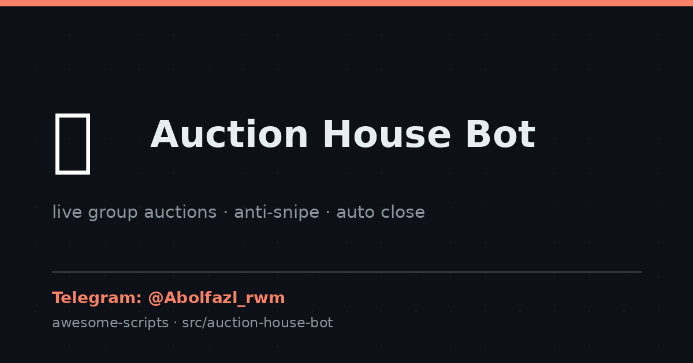

# 🔨 Auction House Bot — خانه‌ی مزایده

<!-- Telegram: @Abolfazl_rwm -->

<p align="center"></p>

**Live timed auctions for Telegram groups — members tap a button to raise the bid by the minimum increment, the auction post edits itself in real time, an anti-snipe rule extends the last 30 seconds, and a background watcher announces the winner automatically.**

مزایده‌ی زنده و تایمردار داخل گروه: اعضا با دکمه قیمت را بالا می‌برند، پست مزایده لحظه‌ای به‌روز می‌شود، قانون ضد اسنایپ ۳۰ ثانیه‌ی آخر را تمدید می‌کند و یک نگهبان پس‌زمینه‌ای برنده را اعلام می‌کند.

## ✨ Features

- 🔨 **One open auction per group** — `/newauction قیمت عنوان` with `— 15m` duration and `step 2000` increment options
- 💰 **One-tap bidding** — every tap raises the price by exactly one increment; no typing needed
- 🎬 **Live post** — the auction message edits in place: current price, leader, next step, minutes left
- ⏱ **Anti-snipe** — a bid inside the last 30 s extends the timer by 30 s
- 📜 **Bid history** — top 10 bids with timestamps (`سابقه` button)
- 🏁 **Auto-close** — asyncio watcher closes expired auctions and announces the winner (no JobQueue dependency)
- 🏆 **Buyer leaderboard** — wins + total spend; `/cancel` guardrails (creator-only, and only with zero bids)

## 🚀 Setup — نصب و اجرا

```bash
cd src/auction-house-bot
pip install -r requirements.txt
# set your token inside bot.py  →  BOT_TOKEN = ""
python bot.py
```

## ⚙️ Configuration — تنظیمات

| Variable | File | Description |
| --- | --- | --- |
| `BOT_TOKEN` | `bot.py` | bot token from [@BotFather](https://t.me/BotFather) |
| `DEFAULT_MINUTES` | `bot.py` | auction duration (10) |
| `DEFAULT_STEP` | `bot.py` | minimum bid increment in tomans (5,000) |
| `ANTI_SNIPE_SECONDS` | `bot.py` | last-second extension window (30) |

Commands: `/start` · `/newauction قیمت عنوان [— 15m] [step N]` · `/auctions` · `/cancel` · `/top`

## 📬 Contact — تماس

[https://t.me/Abolfazl_rwm](https://t.me/Abolfazl_rwm) — Abolfazl
