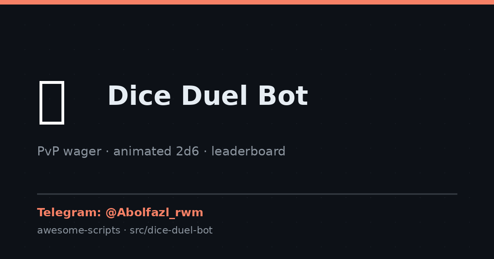

# 🎲 Dice Duel Bot — نبرد تاس

<!-- Telegram: @Abolfazl_rwm -->

<p align="center"></p>

**A PvP wagered dice game — challenge a friend, accept with one button, watch the animated 2d6 roll-off and win the whole pot. Ties re-roll automatically. Coins, daily bonus, win streaks and a leaderboard included.**

بازی نبرد تاس با شرط سکه: به دوستت چالش بده، با یک دکمه قبول کند، انیمیشن انداختن تاس را ببین و کل سکه‌ها را ببر. مساوی خودکار دوباره می‌افتد. سکه‌ی روزانه، رکورد برد متوالی و جدول برترین‌ها هم دارد.

## ✨ Features

- ⚔️ **Duels** — `/duel مبلغ` posts a challenge; reply to someone to target them, or anyone can accept first
- 🎬 **Roll animation** — the bot edits the message a few times with random faces before the real roll (suspense!)
- ⚖️ **Tie handling** — equal sums re-roll until a winner
- 🪙 **Coin economy** — starting balance, daily bonus, zero-floor protection, wager reserved before rolling
- 🏆 **Stats** — win/loss + rate, current & best streak, top-10 leaderboard by coins
- 💾 SQLite storage; no external services

## 🚀 Setup — نصب و اجرا

```bash
cd src/dice-duel-bot
pip install -r requirements.txt
# set your token inside bot.py  →  BOT_TOKEN = ""
python bot.py
```

## ⚙️ Configuration — تنظیمات

| Variable | File | Description |
| --- | --- | --- |
| `BOT_TOKEN` | `bot.py` | bot token from [@BotFather](https://t.me/BotFather) |
| `START_COINS` | `bot.py` | balance for new players (500) |
| `DAILY_BONUS` | `bot.py` | coins claimed once per Tehran day (250) |
| `ANIMATION_TICKS` | `bot.py` | suspense edits before the real roll (3) |

Commands: `/start` · `/duel مبلغ` · `/daily` · `/balance` · `/top`

## 📬 Contact — تماس

[https://t.me/Abolfazl_rwm](https://t.me/Abolfazl_rwm) — Abolfazl
