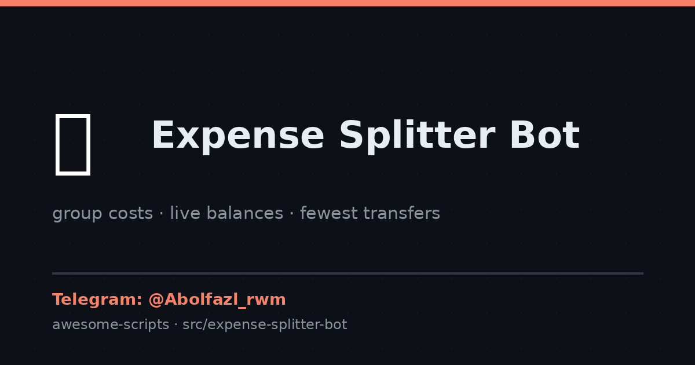

# 💰 Expense Splitter Bot — خرج‌شمار گروهی

<!-- Telegram: @Abolfazl_rwm -->

<p align="center"></p>

**Group expense sharing for Telegram groups — track who paid what during a trip, shared flat or office, see running balances, and settle up with the fewest possible bank transfers using a minimum-cash-flow solver.**

تقسیم هزینه‌های گروهی داخل تلگرام — برای سفر، خوابگاه یا دفتر: اعضا عضو می‌شوند، خرج‌ها ثبت می‌شود، مانده‌ی هر نفر زنده به‌روز می‌شود و <code>/settle</code> کمترین تعداد حواله برای تسویه‌ی کامل را حساب می‌کند.

## ✨ Features

- 🧳 **Trip sessions** — one open session per group (`/newtrip`, `/join`, `/closetrip`)
- 🧾 **Expenses** — `/expense مبلغ یادداشت` split equally among all members, or list specific members to split among; payer always shares; rounding remainder stays with the payer
- 📊 **Live balances** — who should receive / who owes, updated on every entry
- 🤝 **Minimal transfers** — greedy min-cash-flow matcher in `/settle` (fewest payments to square everything)
- 🧮 Persian-formatted amounts with thousand separators (۱۲٬۳۴۵)
- 💾 SQLite, integer tomans (no float rounding errors), group-only commands

## 🚀 Setup — نصب و اجرا

```bash
cd src/expense-splitter-bot
pip install -r requirements.txt
# set your token inside bot.py  →  BOT_TOKEN = ""
python bot.py
```

## ⚙️ Configuration — تنظیمات

| Variable | File | Description |
| --- | --- | --- |
| `BOT_TOKEN` | `bot.py` | bot token from [@BotFather](https://t.me/BotFather) |
| amount unit | `bot.py` | integer tomans by default — change labels freely |

Commands: `/start` · `/newtrip عنوان` · `/join` · `/expense مبلغ یادداشت [@user…]` · `/balances` · `/settle` · `/history` · `/closetrip`

## 📬 Contact — تماس

[https://t.me/Abolfazl_rwm](https://t.me/Abolfazl_rwm) — Abolfazl


## 🔒 ذکر منبع

> 📬 **Telegram:** [@Abolfazl_rwm](https://t.me/Abolfazl_rwm)

استفاده، ویرایش و بازنشر این سورس **فقط با ذکر منبع** مجاز است — حذف یا تغییر این اعتبار مجاز نیست.