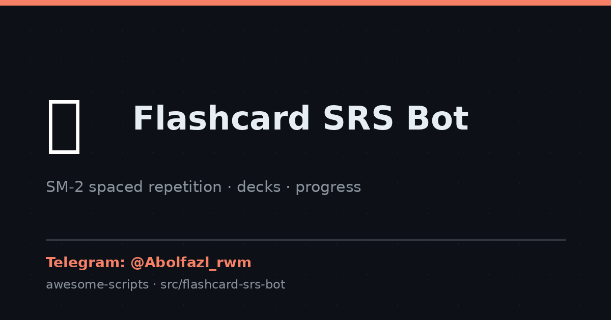

# 🎓 Flashcard SRS Bot — فلش‌کد فارسی

<!-- Telegram: @Abolfazl_rwm -->

<p align="center"></p>

**A spaced-repetition study bot: create decks, add front/back cards, and study with an SM-2 scheduler — the bot brings every card back right before you would forget it. Track due counts and learned-card progress per deck.**

ربات مطالعه با سیستم تکرار فاصله‌دار (SRS): کالجک بساز، کارت جلو/عین اضافه کن و با الگوریتم SM-2 مطالعه کن — هر کارت دقیقاً قبل از فراموشی سر می‌سد. آمار سررسید و یادگیری هر کالجک را هم نشان می‌دهد.

## ✨ Features

- 🗂 **Decks** — create multiple decks per user (`/newdeck`), each with its own schedule
- 🃏 **Cards** — `/add جلو | عین` one-liner card creation
- 🧠 **SM-2 scheduler** — grade after every answer:
  - 🔁 forgot → review in 10 minutes, ease drops, reps reset
  - 😰 hard / 🙂 good / 😎 easy → interval × 1.2 / ease / ease×1.3
  - first success graduates a card to 1–8 hours, later recalls scale to days
- 📊 **Progress** — total / due now / learned (interval ≥ 21 days) per deck
- 🇮🇷 Persian UI with Persian digits; SQLite storage; zero external services

## 🚀 Setup — نصب و اجرا

```bash
cd src/flashcard-srs-bot
pip install -r requirements.txt
# set your token inside bot.py  →  BOT_TOKEN = ""
python bot.py
```

## ⚙️ Configuration — تنظیمات

| Variable | File | Description |
| --- | --- | --- |
| `BOT_TOKEN` | `bot.py` | bot token from [@BotFather](https://t.me/BotFather) |
| `LEARNED_DAYS` | `bot.py` | interval threshold for counting a card as learned (21) |
| `GRADES` | `bot.py` | the four grading buttons shown after each answer |

Commands: `/start` · `/newdeck نام` · `/add جلو | عین` · `/study [نام]` · `/decks` · `/progress`

## 📬 Contact — تماس

[https://t.me/Abolfazl_rwm](https://t.me/Abolfazl_rwm) — Abolfazl
