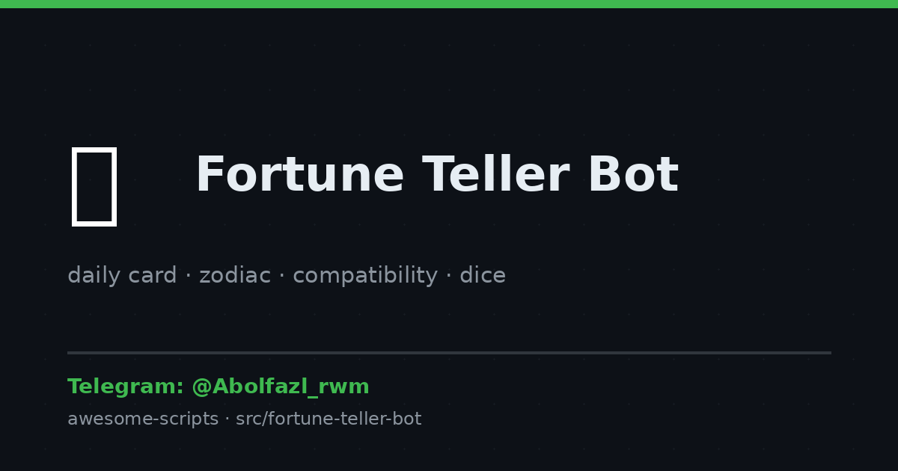

# 🔮 Fortune Teller Bot — فال‌گر شوخ

<!-- Telegram: @Abolfazl_rwm -->

<p align="center"></p>

**A fun, fully-offline fortune bot: a daily fortune card that stays the same all day (seeded by user + Tehran date), zodiac-of-the-day vibes, pair compatibility with a reply, and a 3-dice reading. All fortune texts are original — entertainment only, no real divination.**

فال و طالع‌بینی سرگرم‌کننده و کاملاً آفلاین: کارت فال روزانه که تا شب ثابت می‌ماند، طالع برج‌ها، سوزنی دو نفر با reply و فال سه‌تاسی. تمام متن‌ها اورجینال‌اند — فقط برای سرگرمی.

## ✨ Features

- 🎴 **Daily فال** — 36 original cards; deterministic per user + Tehran-day (like a real daily), lucky number + color of the day
- ♒ **Zodiac vibes** — 12 signs with a hand-written one-liner for today; `/zodiac جدی`
- 💘 **Compatibility** — reply to someone and `/sooti` for a percentage + fun verdict (stable per pair per day)
- 🎲 **3-dice reading** — ⚀⚁⚂ roll with a matched message
- 🔒 **One فال per day** — enforced in SQLite; asks again → same card
- ⚠️ Clearly labeled *entertainment only* everywhere

## 🚀 Setup — نصب و اجرا

```bash
cd src/fortune-teller-bot
pip install -r requirements.txt
# set your token inside bot.py  →  BOT_TOKEN = ""
python bot.py
```

## ⚙️ Configuration — تنظیمات

| Variable | File | Description |
| --- | --- | --- |
| `BOT_TOKEN` | `bot.py` | bot token from [@BotFather](https://t.me/BotFather) |
| `CARDS` | `bot.py` | the 36 original fortune cards — add your own freely |
| `ZODIAC` | `bot.py` | sign name + daily vibe line per sign |

Commands: `/start` · `/fal` · `/zodiac نام‌برج` · `/sooti` (reply) · `/dicefal`

## 📬 Contact — تماس

[https://t.me/Abolfazl_rwm](https://t.me/Abolfazl_rwm) — Abolfazl
