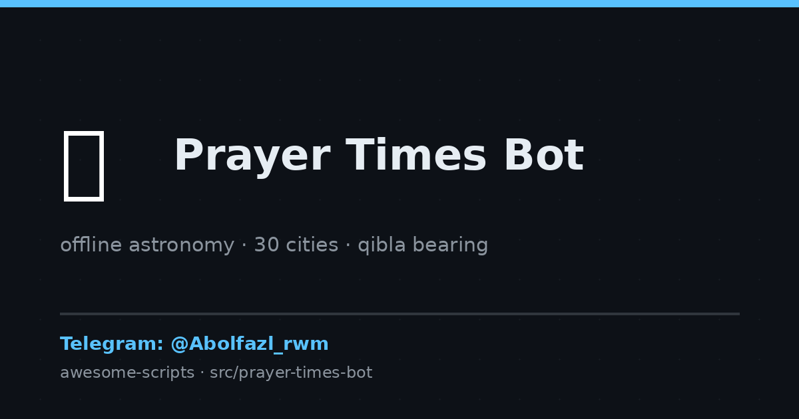

# 🕌 Prayer Times Bot — اوقات شرقی

<!-- Telegram: @Abolfazl_rwm -->

<p align="center"></p>

**A fully offline prayer-times bot for 30 Iranian cities — sunrise, Fajr, Dhuhr, Asr, Maghrib, Isha, religious midnight and the Qibla bearing, all computed locally from standard solar-position astronomy. No API, no network.**

اوقات شرعی برای ۳۰ شهر ایران — کاملاً آفلاین: طلوع، اذان صبح/ظهر/عصر/مغرب/عشا، نیمه‌شب شرعی و زاویه‌ی قبله، همه با محاسبه‌ی نجومی محلی. بدون هیچ API یا سرویس خارجی.

## ✨ Features

- 🧮 **Offline astronomy** — NOAA-style solar declination + equation of time; verified against published Tehran tables (Nov: sunrise ≈ 6:41, sunset ≈ 16:58)
- 🇮🇷 **Iranian convention** — Fajr 17.7° / Isha 14° (Tehran Institute of Geophysics), Shafi Asr (shadow factor 1), Ja'fari religious midnight
- 🗺 **30 cities** — Tehran, Mashhad, Isfahan, Tabriz, Shiraz, … with inline city picker
- 🧭 **Qibla** — canonical great-circle bearing to the Kaaba (Tehran ≈ 218°) with compass direction
- ⏳ **/next** — countdown to the next event; handles the after-Isha window
- 🔢 Persian digits & RTL-friendly output

## 🚀 Setup — نصب و اجرا

```bash
cd src/prayer-times-bot
pip install -r requirements.txt
# set your token inside bot.py  →  BOT_TOKEN = ""
python bot.py
```

## ⚙️ Configuration — تنظیمات

| Variable | File | Description |
| --- | --- | --- |
| `BOT_TOKEN` | `bot.py` | bot token from [@BotFather](https://t.me/BotFather) |
| `CITIES` | `bot.py` | city → (lat, lng) map — add any city with its coordinates |
| `FAJR_ANGLE` / `ISHA_ANGLE` | `bot.py` | twilight angles (default 17.7° / 14° — Iranian standard) |

Commands: `/start` · `/times [شهر]` · `/next [شهر]` · `/qibla [شهر]`

## 📬 Contact — تماس

[https://t.me/Abolfazl_rwm](https://t.me/Abolfazl_rwm) — Abolfazl


## 🔒 ذکر منبع

> 📬 **Telegram:** [@Abolfazl_rwm](https://t.me/Abolfazl_rwm)

استفاده، ویرایش و بازنشر این سورس **فقط با ذکر منبع** مجاز است — حذف یا تغییر این اعتبار مجاز نیست.