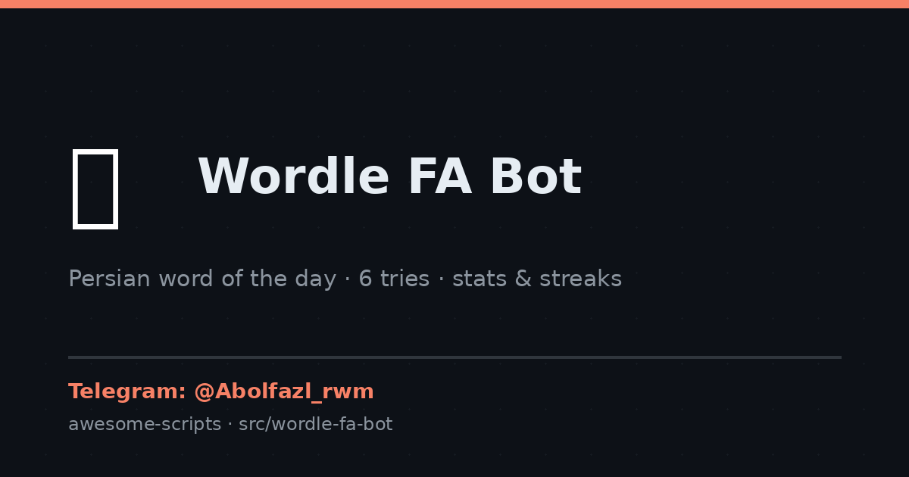

# 🟩 Wordle FA Bot — وردل فارسی

<!-- Telegram: @Abolfazl_rwm -->

<p align="center"></p>

**A Persian Wordle game bot — guess the 5-letter word of the day in 6 attempts, with classic 🟩🟨⬛ feedback, streaks and per-user statistics. Fully offline: no external word APIs.**

بازی محبوب حدس کلمه به زبان فارسی برای تلگرام — هر روز یک کلمه‌ی ۵ حرفی برای همه، ۶ تلاش، بازخورد رنگی، برد متوالی و آمار کامل هر کاربر. یک حالت تمرین تصادفی هم دارد که بی‌نهایت بازی میده و روی آمار اثر نمی‌گذارد.

## ✨ Features

- 📅 **Word of the day** — one 5-letter Persian word per Tehran-date, identical for every player; one game per day per user
- 🎲 **Unlimited practice mode** — random words anytime, never touches stats
- 🟩🟨⬛ **Classic scoring** — exact hit / present elsewhere / miss, with correct duplicate-letter handling
- 📊 **Stats** — games, win rate, current & best streak, and a 1–6 guess distribution bar chart
- 🇮🇷 **Persian-first UX** — Persian digits (۱۲۳), RTL-friendly boards, ی/ک normalization (Arabic variants accepted)
- 💾 SQLite storage, zero external word lists or services

## 🚀 Setup — نصب و اجرا

```bash
cd src/wordle-fa-bot
pip install -r requirements.txt
# set your token inside bot.py  →  BOT_TOKEN = ""
python bot.py
```

## ⚙️ Configuration — تنظیمات

| Variable | File | Description |
| --- | --- | --- |
| `BOT_TOKEN` | `bot.py` | bot token from [@BotFather](https://t.me/BotFather) |
| `WORDS` | `bot.py` | the 5-letter Persian word pool (65 curated words; extend freely) |
| `MAX_ATTEMPTS` | `bot.py` | guesses per game (default 6) |

Commands: `/start` · `/play` (daily) · `/random` · `/stats`

## 📬 Contact — تماس

[https://t.me/Abolfazl_rwm](https://t.me/Abolfazl_rwm) — Abolfazl
