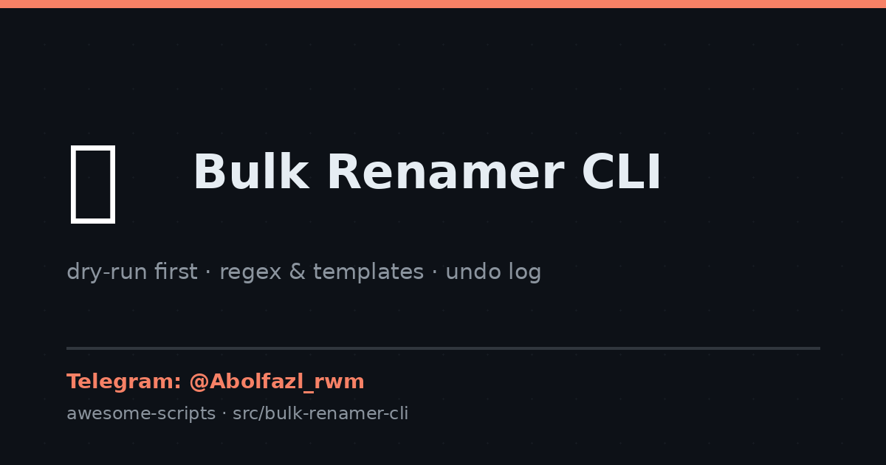

# 📁 Bulk Renamer CLI — تغییرنام گروهی امن

<!-- Telegram: @Abolfazl_rwm -->

<p align="center"></p>

**A safe, preview-first bulk file renamer: numbered templates, find/replace with regex, case folding, accent stripping, extension filters — dry-run is the default and every apply writes an undo log you can roll back.**

ابزار خط فرمانی برای تغییرنام گروهی فایل‌ها با فلسفه‌ی «اول ببین، بعد اجرا کن»: قالب شماره‌دار، جست‌وجو/جایگزینی با پشتیبانی regex، یکدست‌سازی حروف، حذف اعراب و فیلتر پسوند. پیش‌فرض فقط پیش‌نمایش است و هر اجرای واقعی یک لاگ بازگشت می‌سازد.

## ✨ Features

- 🔍 **Dry-run by default** — shows exactly `old → new`; nothing touches disk until `--apply`
- 🔢 **Numbered templates** — `--template "trip_{n:03}"` with `{n}` `{orig}` `{ext}` `{date}` placeholders
- 🔁 **Find/replace** — literal by default, `--regex` for power moves (`--find "IMG_\d+" --replace "shot_" --regex`)
- 🧹 **Name hygiene** — `--lower/--upper`, `--strip-accents` (café→cafe), `--sep` to replace spaces
- 🛡 **Conflict detection** — renames race or overwrite targets → the whole run aborts safely
- ↩️ **Undo log** — every `--apply` writes a JSON log; `--undo log.json` restores previous names
- 🐍 Python 3.9+, stdlib only, single file

## 🚀 Setup — نصب و اجرا

```bash
cd src/bulk-renamer-cli
python bulk_renamer.py <dir> --help          # all options
# preview first (no changes):
python bulk_renamer.py ./photos --ext jpg --template "trip_{n:03}"
# execute + get undo log:
python bulk_renamer.py ./photos --ext jpg --template "trip_{n:03}" --apply
# roll back if needed:
python bulk_renamer.py --undo rename-undo-<timestamp>.json
```

## ⚙️ Examples — نمونه‌ها

```bash
# IMG_0102.jpg → shot_0102.jpg, strip accents, dashes instead of spaces
python bulk_renamer.py . --find IMG_ --replace shot_ --strip-accents --sep -

# lowercase everything recursively 2 levels deep
python bulk_renamer.py ./Docs --lower --depth 2

# regex: squeeze whitespace runs into one dash
python bulk_renamer.py . --find "\s+" --replace "-" --regex
```

## 📬 Contact — تماس

[https://t.me/Abolfazl_rwm](https://t.me/Abolfazl_rwm) — Abolfazl


## 🔒 ذکر منبع

> 📬 **Telegram:** [@Abolfazl_rwm](https://t.me/Abolfazl_rwm)

استفاده، ویرایش و بازنشر این سورس **فقط با ذکر منبع** مجاز است — حذف یا تغییر این اعتبار مجاز نیست.