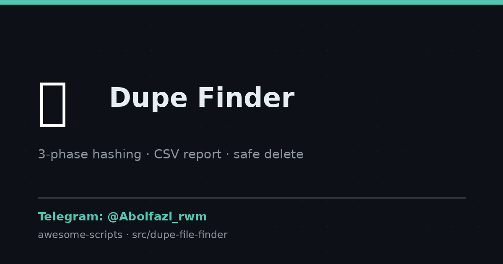

# 🧬 Dupe Finder — یافتن فایل تکراری

<!-- Telegram: @Abolfazl_rwm -->

<p align="center"></p>

**A fast duplicate-file CLI: groups files by size → partial hash → full hash so large folders stay quick, shows wasted space per group, exports a CSV report, and can delete extras safely — dry-run by default, deletion paths logged.**

ابزار خط فرمانی یافتن فایل‌های تکراری: گروه‌بندی سه‌مرحله‌ای حجم → هش جزئی → هش کامل برای سرعت روی پوشه‌های بزرگ، گزارش فضای بلااستفاده، خروجی CSV و حذف امن با پیش‌نمایش پیش‌فرض.

## ✨ Features

- 🧬 **3-phase pipeline** — size buckets → 64 KB partial MD5 → full SHA-256/SHA-1/MD5; identical-size files never get fully hashed unless they pass the partial pass
- 👁 **Dry-run default** — prints `keep`/`delete` per path; the shortest path in each group is kept
- 🗑 **Safe delete** — `--apply` writes a log of removed paths
- 📄 **CSV report** — group, status, path, size, hash
- 🎯 **Filters** — `--ext jpg png`, `--min-size`, `--depth` recursion levels
- 🐍 Python 3.9+, stdlib only, single file

## 🚀 Setup — نصب و اجرا

```bash
cd src/dupe-file-finder
python dupe_finder.py <dir>                      # preview
python dupe_finder.py ~/Photos --ext jpg --depth 5 --csv report.csv
python dupe_finder.py ~/Photos --apply           # actually delete extras
```

## 📬 Contact — تماس

[https://t.me/Abolfazl_rwm](https://t.me/Abolfazl_rwm) — Abolfazl
