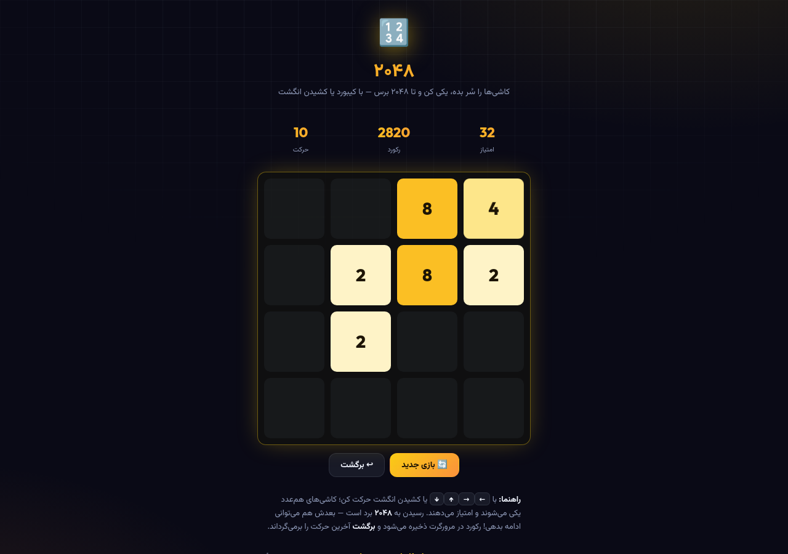

# 🔢 2048 — بازی ۲۰۴۸

<!-- Telegram: @Abolfazl_rwm -->

<p align="center"></p>

**The classic 2048 with real sliding-tile animation — line-compression merge logic, undo, swipe controls, best score — in one offline HTML file.**

کلاسیک ۲۰۴۸ با انیمیشن واقعی سُر خوردن کاشی‌ها، منطق ادغام خطی، برگشت حرکت، سوایپ لمسی و رکورد — همه در یک فایل HTML آفلاین.

[](https://abolfazlrwm.github.io/awesome-scripts/src/2048-web/)

## ✨ Features

- 🎬 **Real slide animation** — each tile is a persistent DOM element moved by CSS `transform` transitions; merges pop
- 🧮 **Classic line compression** — every row/column resolves independently toward the move direction (double merges in one swipe work exactly like the original)
- ↩ **Undo** — restores the state before the last *effective* move (no-op taps don't pollute the stack)
- 👆 **Swipe controls** — pointer-based, works on touch; arrow keys on desktop
- 🏆 **Best score** in localStorage, win-at-2048 overlay with "keep playing" mode
- 🔒 Zero dependencies, works offline from `file://`

## 🚀 Demo / اجرا

```bash
cd src/2048-web
python3 -m http.server 8080   # or just open index.html
```

## 📬 Contact — تماس

[https://t.me/Abolfazl_rwm](https://t.me/Abolfazl_rwm) — Abolfazl
