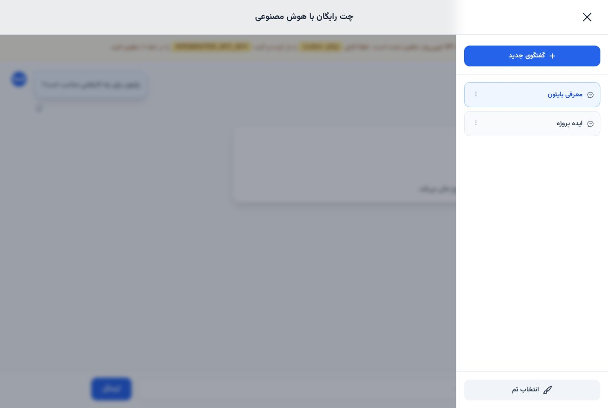

# 💬 AI Chat Web App — چت‌اپ هوش مصنوعی

> 📬 **Telegram:** [@Abolfazl_rwm](https://t.me/Abolfazl_rwm)

A **single-file PHP chat web app** powered by OpenRouter — a JSON API proxy (`?action=chat`) plus a polished RTL chat UI: conversation sidebar with rename/delete, localStorage history, Markdown rendering with `marked.js`, one-click copy buttons, light/dark themes with a picker modal, all in the Vazirmatn font.

چت‌اپ وب تک‌فایلی با PHP و OpenRouter — پروکسی JSON (`?action=chat`) به‌همراه رابط فارسی راست‌چین: سایدبار گفتگوها با تغییر نام و حذف، ذخیره‌ی تاریخچه در مرورگر، رندر Markdown، دکمه‌ی کپی پیام، تم روشن/تیره با مودال انتخاب تم و فونت وزیرمتن.



---

## ✨ Features — امکانات

| | |
| --- | --- |
| 🤖 **OpenRouter proxy** | server-side cURL call to `openrouter.ai/api/v1` — the API key never reaches the browser |
| 💭 **Multi-chat history** | conversations persisted in `localStorage`, auto-titled, rename & delete with menus |
| 🌗 **Theme picker** | light/dark toggle with persistence and a dedicated picker modal |
| 📝 **Markdown answers** | replies render as Markdown (code blocks, lists, quotes) via `marked.js` |
| 📋 **Copy buttons** | per-message copy with animated tick feedback (clipboard API + fallback) |
| 🧭 **RTL-first UI** | Vazirmatn font, RTL layout, mobile-friendly drawer sidebar |
| 🛡 **Safe errors** | API failures surface as inline error bubbles with full server details |

## 🚀 Setup — نصب و اجرا

1. کلید API خود را از [openrouter.ai](https://openrouter.ai) بگیرید.
2. در ابتدای `index.php` مقدار `OPENROUTER_API_KEY` را جایگزین `YOUR_OPENROUTER_API_KEY_HERE` کنید (و در صورت نیاز `MODEL_NAME` را عوض کنید).
3. فایل را روی هر هاست PHP 7.4+ با افزونه‌ی `curl` آپلود کنید و در مرورگر باز کنید — همین.

```php
define('OPENROUTER_API_KEY', 'YOUR_OPENROUTER_API_KEY_HERE');
define('MODEL_NAME', 'openrouter/free');
```

> نکته: این پروژه به PHP نیاز دارد، بنابراین دموی آن روی GitHub Pages قرار ندارد.

## 📁 Files — فایل‌ها

```
ai-chat-webapp-php/
├── index.php            # پروکسی API + کل رابط چت (HTML/CSS/JS)
└── docs/preview.jpg
```

## 🧠 How it works — معماری

- **One endpoint**: `GET ?action=chat` answers `POST` JSON (`{messages: [...]}`) by proxying to OpenRouter with `HTTP-Referer`/`X-Title` headers and returning the raw completion JSON — or a structured error.
- **Client state**: the chat list, active conversation and theme live in `localStorage`, so refreshes and offline browsing never lose history.
- **Escape-first rendering**: user text is always HTML-escaped before insertion; only AI replies pass through Markdown parsing.

## 📄 License — لایسنس

MIT — see the repository root.
