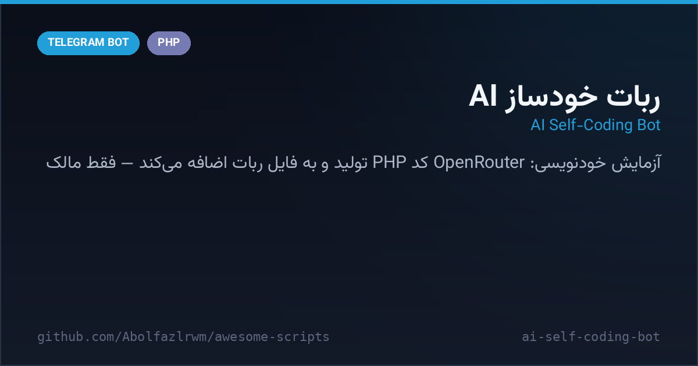

# 🤖 AI Self-Coding Bot — ربات خودساز با هوش مصنوعی

A wild experiment: a PHP Telegram bot that **writes its own code**. Message the owner bot starting with its name — «قابلیت جدید اضافه کن…» or «ارور لاگ رو بررسی کن» — and it calls OpenRouter (Llama-3-70B), gets new PHP back, and appends it into its own `bot.php`, then reports back. Bug-fix mode even feeds the host `error_log` tail to the model.

یک آزمایش جالب: ربات تلگرام PHP که کد خودش را خودش می‌نویسد — پیام‌تان را با نام ربات شروع کنید («قابلیت جدید…» یا «ارور لاگ رو بررسی کن»)؛ ربات به OpenRouter وصل می‌شود (Llama-3-70B)، PHP می‌گیرد و به انتهای `bot.php` خودش اضافه می‌کند و نتیجه را گزارش می‌دهد. حالت رفع باگ حتی انتهای error_log هاست را هم برای مدل می‌فرستد.



---

## ✨ Features — امکانات

| | |
| --- | --- |
| 🧠 **Self-modifying loop** | instruction → LLM → generated PHP appended into the running bot file |
| 🔍 **Error-log awareness** | «ارور لاگ» keyword pulls the last 10 `error_log` lines into the prompt |
| 🩹 **Bug-fix mode** | «اصلاح / باگ / خرابه» asks the model to patch instead of extend |
| 🧩 **Append-only safety** | prompt forces the model to emit only the new `if`-block, never rewrite the file |
| 👑 **Owner-only gate** | messages must come from `OWNER_ID` and start with the bot name |
| 🔌 **OpenRouter + Llama-3-70B** | swap model/API with two constants |

## 🚀 Setup — نصب و اجرا

```bash
cd src/ai-self-coding-bot
export BOT_TOKEN="123:ABC..."       # توکن ربات
export OWNER_ID="123456789"         # فقط مالک می‌تواند برنامه‌نویسی کند
export OPENROUTER_KEY="sk-or-..."   # در farhad.php یا متغیر محیطی
# وبهوک را روی farhad.php ست کنید (کنترلر اصلی):
curl "https://api.telegram.org/bot<TOKEN>/setWebhook?url=https://<host>/farhad.php"
```

حالا در پیوی ربات بنویسید: «پسرم فرهاد یک دستور /help جدید اضافه کن» — و بقیه‌اش با AI!

## 📁 Files — فایل‌ها

```
ai-self-coding-bot/
├── farhad.php           # کنترلر: درخواست → OpenRouter → تزریق کد
├── bot.php              # فایل هدف که AI کدش را کامل می‌کند
└── docs/preview.png
```

## 🧠 How it works — معماری

- **Target-file pattern**: `TARGET_FILE` keeps the AI-written code separate from the controller so a bad patch never kills the webhook.
- **Context injection**: the current `bot.php` source is sent as prompt context so the model knows which helpers exist.
- **Disclaimer**: executing model-written PHP is powerful and risky — run it only on a sandbox host you can reset.

## 📄 License — لایسنس

MIT — see the repository root.
