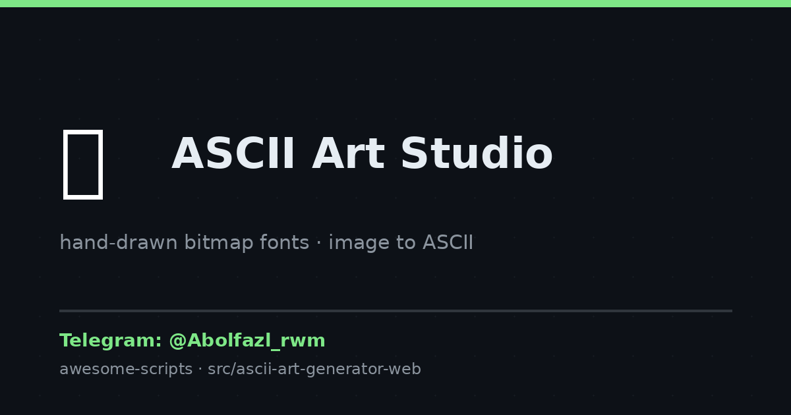

# 🔤 ASCII Art Studio — هنر ASCII

<!-- Telegram: @Abolfazl_rwm -->

<p align="center"></p>

**Turn text into ASCII banners and images into ASCII art — with my own hand-drawn bitmap fonts, three style presets, luminance-mapped image conversion, inversion, copy & download. Single file, offline.**

متن → بنر ASCII و تصویر → هنر ASCII — با فونت‌های bitmap دست‌ساز، سه سبک خروجی، تبدیل تصویر با نگاشت روشنایی، خروجی معکوس، کپی و دانلود. تک‌فایل و آفلاین.

[](https://abolfazlrwm.github.io/awesome-scripts/src/ascii-art-generator-web/)

## ✨ Features

- 🅱 **Hand-drawn bitmap fonts** — 5×5 block and 6×5 shadow glyph sets (A–Z, 0–9) designed pixel-by-pixel in this repo
- 🖼 **Image → ASCII** — drag & drop, adjustable width (40–220 chars) and contrast, perceptual luminance weights (0.2126/0.7152/0.0722), alpha blending, 3 char ramps + inversion
- ✦ **Stars style** — symbolic output mode
- 📋 **Copy / download .txt** for both tabs
- 🔒 Images never leave the browser (canvas, FileReader) — zero dependencies

## 🚀 Demo / اجرا

```bash
cd src/ascii-art-generator-web
python3 -m http.server 8080   # or just open index.html
```

## 📬 Contact — تماس

[https://t.me/Abolfazl_rwm](https://t.me/Abolfazl_rwm) — Abolfazl
