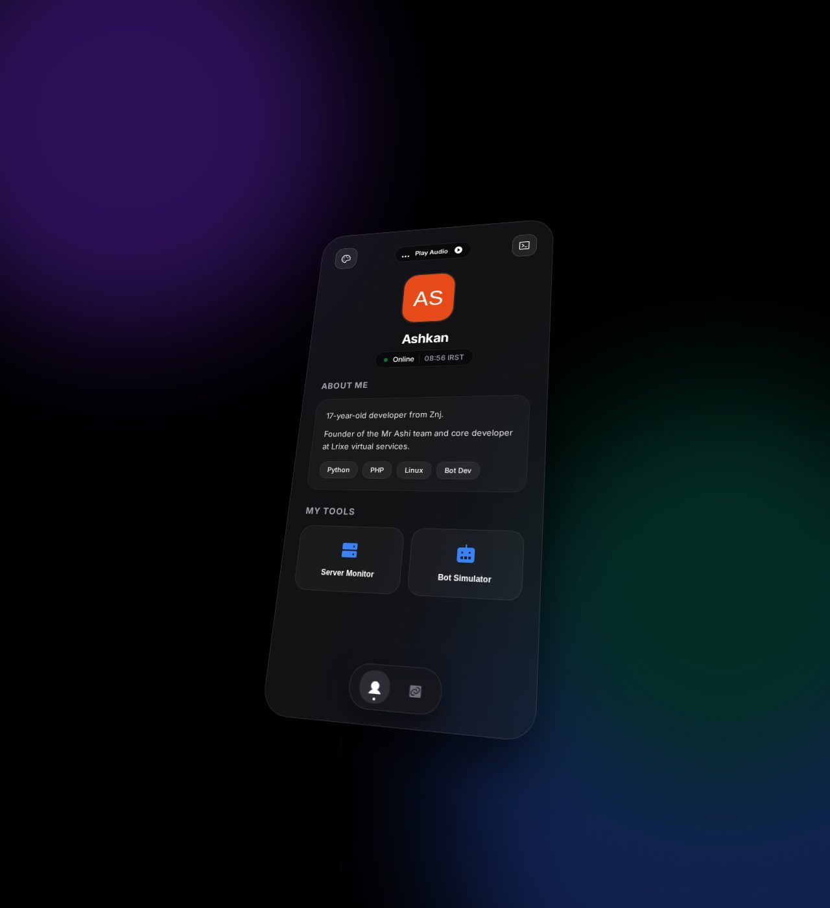

# 🧑‍💻 Backend Dev Portfolio — رزومه‌ی تک‌فایلی توسعه‌دهنده بک‌اند

> 📬 **Telegram:** [@Abolfazl_rwm](https://t.me/Abolfazl_rwm)

A zero-dependency **single-file portfolio** for backend / bot developers — hero section, about, tools & skills, contact links, all in one dark responsive `index.html` you can drop on any static host (GitHub Pages, cPanel, S3).

رزومه‌ی تک‌فایلی و بدون وابستگی برای توسعه‌دهندگان بک‌اند و ربات‌نویس — بخش معرفی، ابزارها و مهارت‌ها و راه‌های ارتباطی در یک `index.html` تیره و ریسپانسیو که روی هر هاست استاتیک مستقیم بالا می‌آید.

  
[**Live demo**](https://abolfazlrwm.github.io/awesome-scripts/src/backend-dev-portfolio/)

---

## ✨ Features — امکانات

| | |
| --- | --- |
| 📄 **Truly single file** | HTML + CSS + JS in one document — no build, no CDN, no assets folder |
| 🧑‍💼 **About / Tools / Connect sections** | clean anchor navigation |
| 📱 **Responsive dark UI** | looks right on phones and desktops |
| 🚪 **Built-in gate** | optional "Access Denied" splash you can flip for private mode |
| ⚡ **Instant deploy** | push to GitHub Pages and share the link as your resume |

## 🚀 Setup — نصب و اجرا

```bash
cd src/backend-dev-portfolio
python3 -m http.server 8080    # پیش‌نمایش محلی
# انتشار: فقط پوشه را روی هر هاست استاتیک بگذارید
```

## 📁 Files — فایل‌ها

```
backend-dev-portfolio/
├── index.html           # کل رزومه
└── docs/preview.png
```

## 🧠 How it works — معماری

- **Edit-and-ship**: replace name, tool cards and links at the top of the file — no other files to touch.
- **Progressive content**: sections render even with JS disabled; JS only adds polish.
- **Personal template**: generated from a real developer's resume — make it yours in minutes.

## 📄 License — لایسنس

MIT — see the repository root.
