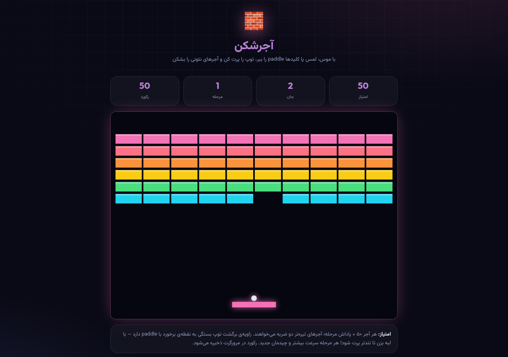

# 🧱 Breakout — آجرشکن

<!-- Telegram: @Abolfazl_rwm -->

<p align="center"></p>

**Neon Breakout with real physics — angle-based paddle rebounds, three level layouts, tough two-hit bricks, particle explosions and screen shake — in one offline HTML file.**

آجرشکن نئونی با فیزیک واقعی — بازتاب زاویه‌ای از پدل، سه چیدمان مرحله، آجرهای دو‌ضربه، انفجار ذرات و لرزش صفحه — همه در یک فایل HTML آفلاین.

[](https://abolfazlrwm.github.io/awesome-scripts/src/breakout-web/)

## ✨ Features

- 🎯 **Angle-based rebounds** — hit position on the paddle sets the return angle, edge hits launch sharper; speed creeps up every bounce (capped)
- 🧱 **Three level layouts** — solid wall, checkerboard and wide pyramid, with 2-HP armored bricks (semi-transparent shell)
- ✨ **Juice** — particle bursts on every brick kill, screen shake, glowing ball trail via canvas shadow
- 🎮 **Three input modes** — mouse/touch follow, or ←/→ keys; click or Space to launch, P to pause
- 💚 **3 lives + scoring** — 50/brick, +15 for armor damage, level-clear bonuses; best score persisted
- 🔒 Zero dependencies, works offline from `file://`

## 🚀 Demo / اجرا

```bash
cd src/breakout-web
python3 -m http.server 8080   # or just open index.html
```

## 📬 Contact — تماس

[https://t.me/Abolfazl_rwm](https://t.me/Abolfazl_rwm) — Abolfazl
