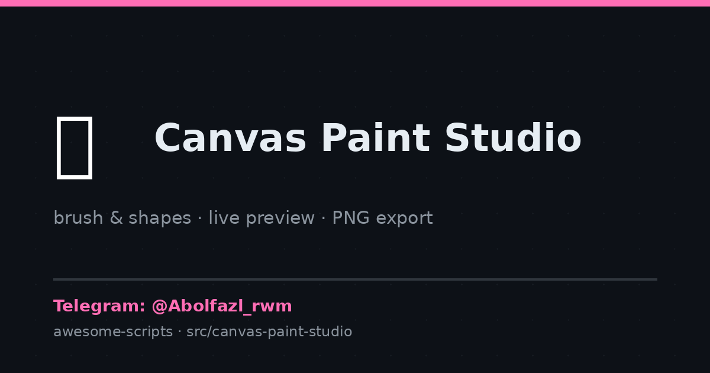

# 🖌 Canvas Paint Studio — بوم نقاشی

<!-- Telegram: @Abolfazl_rwm -->

<p align="center"></p>

**A tiny but complete browser paint app — brush, eraser, line/rectangle/circle with live previews, flood-fill background, 25-step undo, quick swatches and PNG export. Single file, offline.**

اپ نقاشی کوچک اما کامل — قلم، پاک‌کن، خط/مستطیل/دایره با پیش‌نمایش زنده، رنگ‌آمیزی زمینه، برگشت ۲۵ مرحله‌ای، پالت رنگ سریع و خروجی PNG. تک‌فایل و آفلاین.

[](https://abolfazlrwm.github.io/awesome-scripts/src/canvas-paint-studio/)

## ✨ Features

- ✏️ **6 tools** — brush, eraser (2.5× size), line, rectangle, circle (radius from drag), background fill
- 🌈 **Rainbow brush** — hue cycles along the stroke with a soft glow
- ✨ **Glow brush** — neon shadow-blur in the selected color
- 🦋 **4-way symmetry mode** — every stroke is mirrored horizontally & vertically around the canvas center
- 👻 **Live shape preview** — shape tools restore a snapshot each move so the preview never smudges the drawing
- ↩️↪️ **Undo & redo stacks** — up to 30 steps each, `Ctrl+Z` / `Ctrl+Y`
- 🌓 white/black background switch; 🎨 color picker + 10 quick swatches; DPR-aware crisp rendering
- ⌨️ **Keyboard shortcuts** — B/E/R/G/L/D/C/F tools, `S` symmetry, `[` `]` brush size
- 💾 **PNG export** via `canvas.toDataURL`; Pointer Events for mouse & touch; zero dependencies

## 🚀 Demo / اجرا

```bash
cd src/canvas-paint-studio
python3 -m http.server 8080   # or just open index.html
```

## 📬 Contact — تماس

[https://t.me/Abolfazl_rwm](https://t.me/Abolfazl_rwm) — Abolfazl
