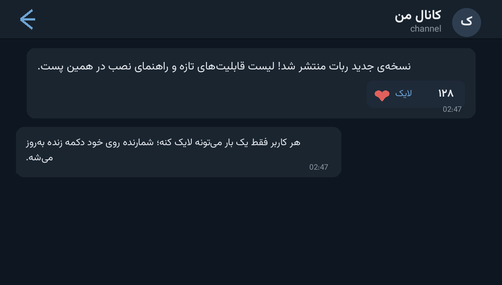

# ❤️ Channel Likes Bot — ربات پست کانال با دکمه‌ی لایک

> 📬 **Telegram:** [@Abolfazl_rwm](https://t.me/Abolfazl_rwm)

A Telethon-powered bot that turns **anything you send it** into a channel post with
a live **❤ like button** — every user can like once, the counter on the button
updates in place, and all likes are stored in SQLite.

ربات مبتنی بر Telethon که هر چیزی که برایش بفرستی را به‌شکل پست کانال با **دکمه‌ی لایک
زنده** منتشر می‌کند — هر کاربر یک بار لایک می‌زند، شمارنده روی خود دکمه به‌روز می‌شود و همه‌چیز در SQLite ذخیره می‌شود.



---

## ✨ Features — امکانات

| | |
| --- | --- |
| 📨 **Send-to-post pipeline** | forward or send any text/photo/video to the bot → it is published to your channel instantly |
| ❤️ **Live like button** | inline `❤ N` button; the count is edited on the same message after every like |
| 🙋 **One like per user** | SQLite `UNIQUE(message_id, user_id)` — double likes answer *“already liked”* |
| 🖼 **Media passthrough** | photos, videos and documents are reposted with their media intact |
| 💾 **SQLite storage** | `likes.db` keeps posts and per-user likes — counts survive restarts |
| 🪶 **Lightweight** | one small file, Telethon + stdlib only |

## 🚀 Setup — نصب و اجرا

```bash
cd src/channel-likes-bot
python3 -m venv venv && source venv/bin/activate
pip install -r requirements.txt
```

Fill the config block at the top of `bot.py`:

```python
API_ID = 0        # از my.telegram.org (API development tools)
API_HASH = ""     # API HASH از my.telegram.org
BOT_TOKEN = ""    # توکن ربات از @BotFather

CHANNEL_ID = 0    # آیدی عددی کانال مقصد (مثل -1001234567890)
ADMIN_ID = 0      # آیدی عددی ادمین (اختیاری)
```

```bash
python bot.py
```

> 📌 The bot must be an **admin** (posting) in the target channel. The first run
> creates `bot_session` — keep it private.
>
> 📌 ربات باید در کانال مقصد **ادمین با اجازه‌ی ارسال** باشد. فایل `bot_session` ساخته‌شده در اجرای اول را محرمانه نگه دارید.

## 📁 Files — فایل‌ها

```
channel-likes-bot/
├── bot.py              # the whole bot (post pipeline + like callbacks)
├── requirements.txt    # telethon
└── docs/preview.png    # demo screenshot
```

## 🧠 How it works — معماری

- **Hybrid Telethon client**: the same client signs in as the **bot token** — MTProto
  access means the like button can be *edited* after creation (plain Bot API buttons
  can't be re-rendered with fresh counts without extra calls).
- **Like flow**: callback data `like:<message_id>` → check `likes` table → insert →
  update counter → `msg.edit(buttons=…)`. Failure to edit never breaks the vote.
- **Media-safe repost**: text and media are sent independently, so photo/video posts
  keep their captions.

## 📄 License — لایسنس

MIT — see the repository root.
