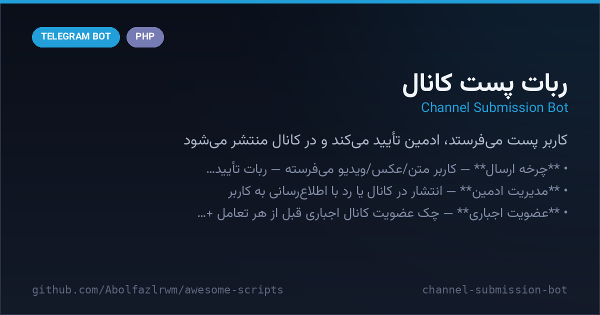

# 📮 Channel Submission Bot

A single-file PHP bot (`bot.php`, no database needed) that turns a Telegram channel into a **community-powered posting wall**: users send their post to the bot, the admin reviews it, and approved posts get published to the channel. Includes mandatory channel join, per-user state machine, editable bot texts and file-based JSON storage.



## ✨ Features

- 📨 **Submit flow** — user sends text/photo/video → bot confirms «received» → admin gets inline **Publish / Reject** buttons
- ✅ **Admin moderation** — publish to the channel or reject with feedback; user is notified either way
- 🔒 **Force join gate** — membership of `FORCE_CHANNEL` is checked before any interaction, with a «check again» button
- 📣 **Channel notice** — posts published with a customizable caption template
- 📝 **Editable texts** — every bot message (`start_text`, `tell_text`, `received_text`, `published_text`, `cancel_text`, `force_join_text`) lives in `config.json` and can be edited from the admin panel
- 💾 **File storage** — `users_data.json` (per-user state) + `config.json` — zero DB setup
- 🧱 **Single file** — drop `bot.php` on any PHP host with cURL, set webhook, done

## 🚀 Quick start

1. Edit the config block at the top of `bot.php`:

```php
$BOT_TOKEN     = "PUT_BOT_TOKEN_HERE";       // token from @BotFather
$ADMIN_ID      = 0;                          // your numeric ID, e.g. 123456789
$CHANNEL       = "@your_channel";            // target channel (with @)
$FORCE_CHANNEL = "@your_force_channel";      // force-join channel (with @)
```

2. Upload to a PHP host (cURL enabled) and set the webhook:

```
https://api.telegram.org/bot<TOKEN>/setWebhook?url=https://your-domain/path/bot.php
```

3. Add the bot as **administrator** to `CHANNEL` (post permission) — done.

## 🔄 Flow diagram

```text
User                    Bot                       Admin
  │  send post text/media │                          │
  ├──────────────────────►│  force-join gate ✔       │
  │  «پیامت دریافت شد»    ├──────────────────────────►│ review
  │                       │  [✅ انتشار] [❌ لغو]      │
  │                       │◄──────────────────────────┤ publish
  │  «منتشر شد ❤️»        ├──── post + caption ───────► CHANNEL
```

<details>
<summary><b>🇮🇷 نسخه فارسی</b></summary>

# 📮 ربات دریافت پست برای کانال

ربات PHP تک‌فایلی (بدون دیتابیس) که کانالت رو به **دیوار پست‌گذاری جمعی** تبدیل می‌کنه: کاربر پستش رو به ربات می‌فرسته، ادمین بررسی می‌کنه و پست‌های تأییدشده در کانال منتشر می‌شن. عضویت اجباری، ماشین وضعیت هر کاربر، متن‌های قابل ویرایش و ذخیره‌سازی JSON.

## ✨ امکانات

- 📨 **چرخه ارسال** — کاربر متن/عکس/ویدیو می‌فرسته → ربات تأیید می‌کنه → برای ادمین دکمه‌های **انتشار/لغو** میان
- ✅ **مدیریت ادمین** — انتشار در کانال یا رد با اطلاع‌رسانی به کاربر
- 🔒 **عضویت اجباری** — چک عضویت کانال اجباری قبل از هر تعامل + دکمه «بررسی مجدد»
- 📣 **کپشن انتشار** قابل تنظیم
- 📝 **متن‌های قابل ویرایش** — همه پیام‌ها در `config.json` و از پنل ادمین قابل تغییر
- 💾 **ذخیره فایل** — `users_data.json` + `config.json`؛ بدون دیتابیس
- 🧱 **تک‌فایل** — روی هر هاست PHP با cURL

## 🚀 راه‌اندازی سریع

۱) بلوک تنظیمات بالای `bot.php` را پر کن:

```php
$BOT_TOKEN     = "PUT_BOT_TOKEN_HERE";       // توکن از @BotFather
$ADMIN_ID      = 0;                          // آیدی عددی خودت، مثلا 123456789
$CHANNEL       = "@your_channel";            // کانال انتشار (با @)
$FORCE_CHANNEL = "@your_force_channel";      // کانال عضویت اجباری (با @)
```

۲) روی هاست آپلود کن و وبهوک ست کن:

```
https://api.telegram.org/bot<TOKEN>/setWebhook?url=https://دامنه/مسیر/bot.php
```

۳) ربات را **ادمین کانال** `CHANNEL` کن (اجازه پست) — تمام!

## 🔴 فیکس این نسخه

- ❌ خط `$ADMIN_ID = ایدی _عددی_*;` **خطای syntax** بود → ✅ با مقدار نمونه و کامنت فارسی درست شد؛ همین‌طور placeholderهای خوانا برای بقیه مقادیر.
- 🔒 بررسی‌شده: هیچ توکن یا داده شخصی داخل فایل نیست.

</details>

<div align="center">

**Maintained by [@Abolfazl_rwm](https://t.me/Abolfazl_rwm)** · MIT License

</div>
