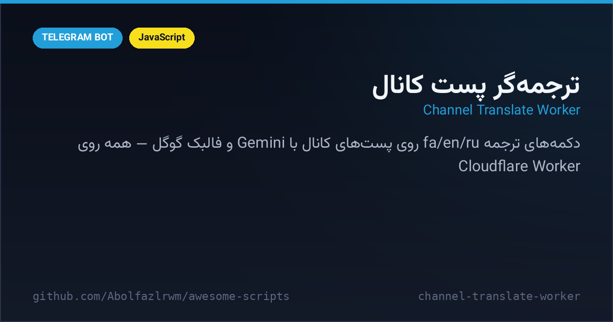

# 🌐 Channel Translate Worker — ربات ترجمه‌گر پست کانال (Cloudflare)

A **Cloudflare Worker** that adds live translate buttons to any channel post — forward a post to the bot, it stamps 🇮🇷 / 🇬🇧 / 🇷🇺 buttons under the original in your channel, and readers get instant Gemini-powered translations (Google fallback). Full owner panel, user accounts, per-user Gemini API keys and force-join — all state in Workers KV.

یک Cloudflare Worker که دکمه‌های ترجمه زنده به پست‌های کانال اضافه می‌کند — پست را به پیوی ربات فوروارد کن؛ زیر همان پست در کانال دکمه‌های ترجمه می‌نشیند و خواننده‌ها ترجمه‌ی فوری با Gemini (با فالبک گوگل) می‌گیرند. پنل مالک، حساب کاربری، API اختصاصی و جوین اجباری — همه‌ی داده‌ها در KV.



---

## ✨ Features — امکانات

| | |
| --- | --- |
| 🈯 **Per-post translate buttons** | forward a post → fa/en/ru buttons edited onto the original channel message |
| 🧠 **Gemini 1.5 Flash** | per-user API keys (free from Google AI Studio), graceful Google-translate fallback |
| 📡 **Auto channel detection** | `my_chat_member` updates register/unregister channels the bot admins |
| 👑 **Owner panel** | user management, pending-join approvals, force-join channel config |
| 🔐 **User accounts** | register/login flows with KV sessions, per-user dashboard & API manager |
| 🔒 **Force join** | configurable channel gate with re-check button |
| ⚡ **Zero backend** | one `worker.js` — webhook, UI and cron in a single Worker + KV binding |

## 🚀 Setup — نصب و اجرا

```bash
cd src/channel-translate-worker
npm i -g wrangler
wrangler kv namespace create YARAAV_DB   # آیدی KV را در wrangler.toml بگذار
# TELEGRAM_TOKEN را ست کن:
wrangler secret put TELEGRAM_TOKEN
# داخل worker.js مقدار OWNER_ID را آیدی خودت بگذار
wrangler deploy
# در نهایت وبهوک:
curl "https://api.telegram.org/bot<TOKEN>/setWebhook?url=https://<worker>.workers.dev"
```

## 📁 Files — فایل‌ها

```
channel-translate-worker/
├── worker.js            # کل ربات: وبهوک، پنل، موتور ترجمه
├── wrangler.toml        # کانفیگ Worker + بایندینگ KV
└── docs/preview.png
```

## 🧠 How it works — معماری

- **editMessageReplyMarkup** stamps the translate row onto the forwarded post — no repost, original stays untouched.
- **Answer bubbles**: translations arrive as callback alerts (≤180 chars) — instant and spam-free.
- **KV data model**: `channels_<uid>`, `apis_<uid>`, `state_<uid>`, `user_uname_<login>` — TTL-free JSON values with a 10-minute state expiry.

## 📄 License — لایسنس

MIT — see the repository root.
