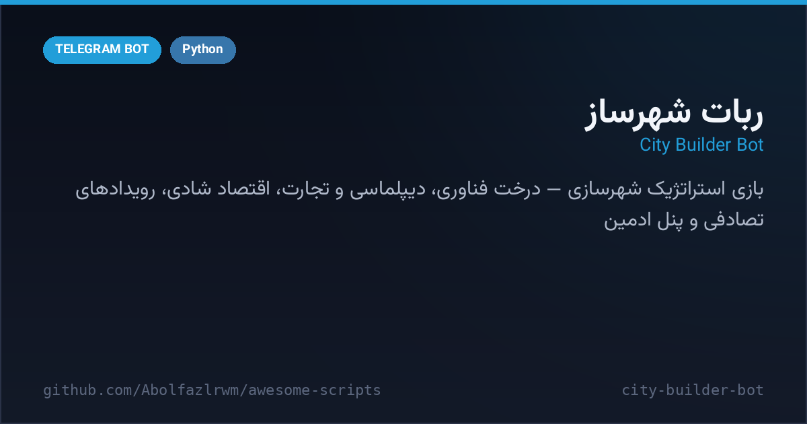

# 🏙 City Builder Bot — ربات شهرساز

A deep **city-building strategy game** for Telegram — one big Python file on SQLite. Grow a settlement from a village into a metropolis: research a technology tree, balance happiness against taxes, construct buildings with realistic costs, sign diplomacy and trade agreements with other mayors, and roll with random world events.

بازی استراتژیک شهرسازی برای تلگرام در یک فایل پایتون روی SQLite — درخت فناوری، شادی و مالیات، ساخت‌وساز، دیپلماسی و قرارداد تجارت با شهردارهای دیگر و رویدادهای تصادفی.



---

## ✨ Features — امکانات

| | |
| --- | --- |
| 🔬 **Technology tree** | upgradeable techs with per-level costs that unlock production and defense bonuses |
| 🤝 **Diplomacy** | send / accept / reject proposals, trade agreements checked before trades |
| 🎯 **Daily missions** | generated per day with progress tracking and rewards |
| 😊 **Happiness system** | tax and building choices move a happiness modifier over the whole economy |
| 🏗 **Construction** | cost scaling per building with atomic resource deduction — no double-spend races |
| 📦 **Storage & population caps** | resources clamp to warehouse capacity, population to housing |
| 🎲 **Random events** | world events trigger on a schedule and shake every city |
| 🛠 **Admin panel** | inline panel for stats, tuning and player support |
| 🧱 **Hardened SQLite** | custom `safer_sqlite_connect` (WAL + busy timeout) survives restarts cleanly |

## 🚀 Setup — نصب و اجرا

```bash
cd src/city-builder-bot
python3 -m venv venv && source venv/bin/activate
pip install -r requirements.txt
cp .env.example .env   # BOT_TOKEN و OWNER_ID را پر کن
python bot.py
```

تنظیمات از متغیرهای محیطی خوانده می‌شود (`.env`) — توکن از @BotFather و آیدی مالک از @userinfobot.

## 📁 Files — فایل‌ها

```
city-builder-bot/
├── bot.py               # کل بازی: مدل داده، تکنولوژی، دیپلماسی، پنل ادمین
├── requirements.txt
├── .env.example
└── docs/preview.png
```

## 🧠 How it works — معماری

- **State in SQLite**: players, cities, buildings, techs, missions and diplomacy all live in `city_builder.db`; every mutation is transactional.
- **Deterministic cost curve**: `calculate_construction_cost` scales price by level so the economy never trivializes.
- **Event engine**: `check_and_trigger_event` rolls world events into game logs so mayors see *why* their numbers moved.

## 📄 License — لایسنس

MIT — see the repository root.
