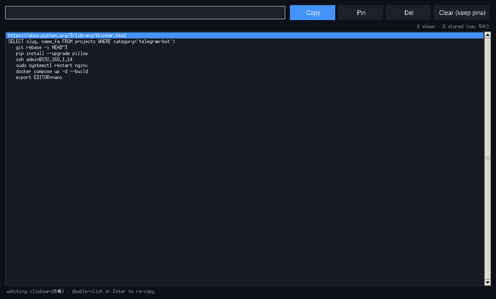

# 📋 Clipboard History Manager — مدیریت تاریخچه‌ی کلیپ‌بورد

A lightweight **desktop clipboard manager** (tkinter, stdlib + `pyperclip`) that keeps
a searchable history of everything you copy — snippets, links, commands, card numbers
you keep re-typing — and lets you re-copy, pin or clean it with one click.

مدیریت‌گر سبک کلیپ‌بورد برای دسکتاپ که از هر چیزی که کپی می‌کنید تاریخچه‌ی قابل‌جستجو نگه می‌دارد — با امکان کپی مجدد، سنجاق‌کردن موارد مهم و پاک‌سازی یک‌کلیکی.

---



## ✨ Features — امکانات

| | |
| --- | --- |
| 👀 **Background watching** | polls the clipboard every 0.8 s — copies from *any* app land here |
| 🔎 **Instant search** | type to filter; duplicates move to the top instead of piling up |
| 📌 **Pins** | favorites survive “Clear all” and stay on top |
| 💾 **Persistence** | last 500 entries saved to `~/.clipboard_history.json` |
| ⌨️ **Shortcuts** | `Ctrl+F` search · `Enter`/double-click re-copy · `Del` delete |
| 🌓 **Clean dark UI** | native tkinter — no browser, no Electron, ~120 KB of code |

## 🚀 Setup — نصب و اجرا

```bash
cd src/clipboard-history-manager
python3 -m venv venv && source venv/bin/activate     # Windows: venv\Scripts\activate
pip install -r requirements.txt
python clipboard_manager.py
```

> Linux users: `pyperclip` may need `xclip` (`sudo apt install xclip`) or `wl-clipboard` on Wayland.
>
> در لینوکس ممکن است به `xclip` (X11) یا `wl-clipboard` (Wayland) نیاز باشد.

## 📁 Files — فایل‌ها

```
clipboard-history-manager/
├── clipboard_manager.py   # app + HistoryStore (import-safe, testable)
├── requirements.txt
└── README.md
```

## 🧠 How it works — معماری

- `HistoryStore` (pure logic, JSON-backed) is fully separated from the GUI — it is
  covered by headless tests: dedup, move-to-top, pinning, search, limits, corrupted
  files, persistence round-trip.
- `App` polls with `pyperclip.paste()`, skips empty/unchanged clips, and re-renders
  the listbox on every change.
- Clipboard images are ignored (text only) by design — the tool is for snippets.

- منطق `HistoryStore` از رابط گرافیکی جداست و با تست‌های بدون‌GUI پوشش داده شده:
  حذف تکراری، سنجاق، جستجو، محدودیت ۵۰۰ آیتم و بازیابی از فایل خراب.
- تصاویر کلیپ‌بورد عمداً نادیده گرفته می‌شوند — این ابزار برای متن و کد است.

## 🔧 Customization — شخصی‌سازی

- History location: set `CLIPBOARD_HISTORY_FILE` env var.
- Polling interval: `POLL_MS` constant.
- Colors: constants at the top of the file (`BG`, `ACCENT`, …).

## 📄 License — لایسنس

MIT — see the repository root.
