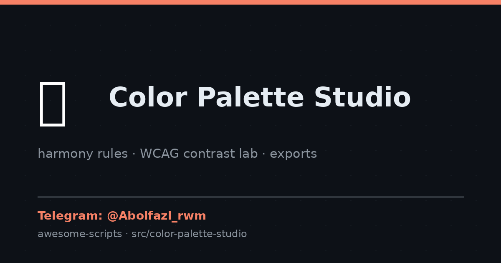

# 🎨 Color Palette Studio

<!-- Telegram: @Abolfazl_rwm -->

<p align="center"></p>

**A designer-grade color palette tool in a single HTML file — harmony-rule generation, tints & shades, a WCAG 2.1 contrast lab, one-click HEX/RGB/HSL copy and CSS / JSON / Tailwind / SCSS export. 100% offline.**

استودیو ساخت پالت رنگ در یک فایل HTML — تولید پالت با قواعد هماهنگی، طیف تیره و روشن، آزمایشگاه کنتراست WCAG، کپی سریع HEX/RGB/HSL و خروجی CSS / JSON / Tailwind / SCSS. کاملاً آفلاین و بدون وابستگی.

## ✨ Features

- 🎛 **Harmony modes** — analogous, complementary, split-complementary, triadic, tetradic, monochromatic (HSL math on a base color)
- 🔒 **Lock swatches** — keep favorites while re-rolling the rest; 🎲 random base or press <kbd>Space</kbd>
- 🌗 **Tints & shades** — a 9-step lightness ladder per swatch
- ⚫ **Contrast lab** — WCAG 2.1 relative-luminance ratios against white, black and the darkest/lightest palette colors, with AA / AAA badges and dark/light text recommendations
- 📋 **Copy anything** — hex chips, rgb/hsl lines and every tint/shade bar copy on click
- 📦 **Exports** — CSS custom properties, JSON (with rgb+hsl), Tailwind config (`brand-100…`), SCSS map
- 🌘 Dark UI, zero dependencies, works from `file://`

## 🚀 Setup — اجرا

```bash
cd src/color-palette-studio
# open index.html in any browser, or serve it:
python3 -m http.server 8080   # → http://localhost:8080
```

No build step, no network calls — the whole tool is one file.

## 📬 Contact — تماس

[https://t.me/Abolfazl_rwm](https://t.me/Abolfazl_rwm) — Abolfazl
