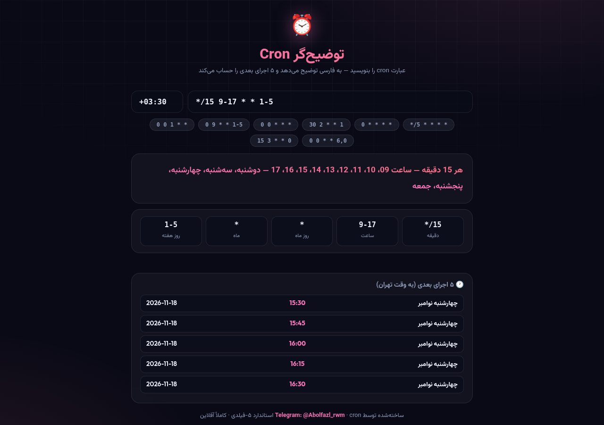

# ⏰ Cron Explainer — توضیح‌گر Cron

<!-- Telegram: @Abolfazl_rwm -->

<p align="center"></p>

**A cron explainer that renders any 5-field expression in plain Persian and computes the next five fire times — in one offline HTML file.**

توضیح‌گر cron که هر عبارت ۵-فیلدی را به فارسی ساده می‌گوید و ۵ اجرای بعدی را حساب می‌کند — همه در یک فایل HTML آفلاین.

[](https://abolfazlrwm.github.io/awesome-scripts/src/cron-explainer-web/)

## ✨ Features

- 🗣 **Plain-Persian descriptions** — «هر ۱۵ دقیقه — ساعت ۹ تا ۱۷ — دوشنبه تا جمعه» built field by field
- 🧮 **Next-fire calculator** — fast-skip minute scan (month → day → hour → minute) returns the next 5 runs with weekday names
- 🧩 **Full syntax** — `*`, lists, ranges, steps (`*/15`, `9-17`, `1-5`), and the cron `7 == Sunday` weekday rule
- 🕐 **Timezone box** — default Tehran `+03:30`, adjustable to any offset
- 📋 **8 ready presets** (every 5 min, workdays 9 am, first of month, …) — one click to load
- ✅ **Verified in QA** against Python `datetime` (Monday 02:30 Tehran matched exactly) — the weekday-`*` bug found in testing was fixed
- 🔒 Zero dependencies, works offline from `file://`

## 🚀 Demo / اجرا

```bash
cd src/cron-explainer-web
python3 -m http.server 8080   # or just open index.html
```

## 📬 Contact — تماس

[https://t.me/Abolfazl_rwm](https://t.me/Abolfazl_rwm) — Abolfazl
