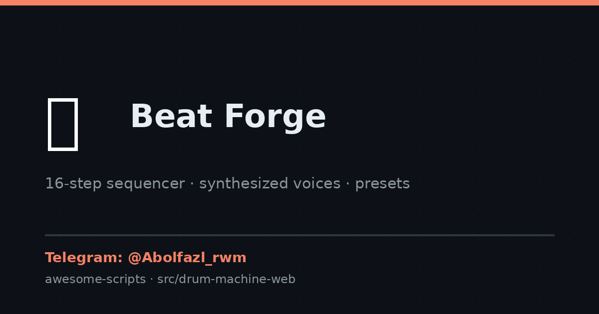

# 🥁 Drum Machine — Beat Forge

<!-- Telegram: @Abolfazl_rwm -->

<p align="center"></p>

**A 16-step drum machine in a single HTML file — every voice (kick, snare, hi-hats, clap, tom) is synthesized live with the Web Audio API, no samples, no assets, no build step. BPM, swing, per-track preview, 4 hand-written presets, randomizer and localStorage save/load.**

سینت درام ۱۶ استپه در یک فایل HTML — همه‌ی صداها با Web Audio به‌صورت زنده سنتز می‌شوند؛ بدون سمپل و فایل صوتی. کنترل BPM و سوینگ، پریست‌های آماده، تصادفی‌ساز و ذخیره/بازیابی الگو.

## ✨ Features

- 🎚 **6 synthesized voices** — pitch-swept sine kick & tom, filtered-noise snare/hi-hats, 4-burst clap — all generated in code
- 🕹 **16-step grid** — click cells to program, blue outline = playhead, strong beats highlighted
- 🎛 **BPM 60–200 · swing 0–60%** — odd 16ths delayed for groove; master volume with compressor
- 🥁 **4 presets** — Four-on-floor, Boom-bap, Trap, House break (auto-plays so first click makes music)
- 🎲 **Randomize** — per-track density weights for musical results
- 💾 **Save/Load** — pattern + BPM + swing persist in localStorage
- ⌨️ <kbd>Space</kbd> toggles playback · works from `file://`, zero dependencies

## 🚀 Setup — اجرا

```bash
cd src/drum-machine-web
# open index.html in any modern browser, or serve it:
python3 -m http.server 8080   # → http://localhost:8080
```

## 📬 Contact — تماس

[https://t.me/Abolfazl_rwm](https://t.me/Abolfazl_rwm) — Abolfazl
