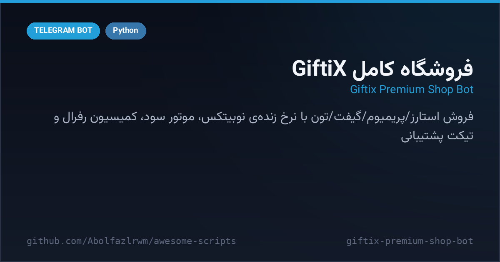

# 🛒 GiftiX Premium Shop Bot — فروشگاه کامل GiftiX

> 📬 **Telegram:** [@Abolfazl_rwm](https://t.me/Abolfazl_rwm)

A complete **digital-goods storefront** in one Python file — sell **Telegram Stars, Premium plans, star gifts and TON** with live Nobitex rate pulling, a configurable profit-margin engine, card-to-card top-ups with receipt approval, discount balance, a referral commission engine with points and gift rewards, support tickets, order tracking IDs and a full admin panel (broadcast, prices, daily limits, profit tuning).

فروشگاه کامل کالای دیجیتال در یک فایل پایتون — فروش **استارز، پریمیوم، گیفت استارزی و تون** با نرخ لحظه‌ای نوبیتکس، درصد سود قابل تنظیم، شارژ کیف پول کارت‌به‌کارت با تایید رسید، موجودی تخفیف، سیستم زیرمجموعه‌گیری با کمیسیون و جایزه، تیکت پشتیبانی، کد پیگیری سفارش و پنل مدیریت کامل (پیام همگانی، قیمت‌ها، سقف روزانه، تنظیم سود).



---

## ✨ Features — امکانات

| | |
| --- | --- |
| 🛍 **4 product lines** | Stars, Premium (3/6/12 months), 17 star gifts and TON — each priced from live base rates |
| 📈 **Profit engine** | `PROFIT_PERCENT` per product; `recalc_prices()` rebuilds all prices from Nobitex rates |
| 💱 **Live TON rate** | pulls USD/TON from the Nobitex market API, with manual price override from the panel |
| 💳 **Card top-ups** | receipt photo → admin approve/reject, per-user daily limit with carry-over refund |
| 🎁 **Discount balance** | referral commission (5%) accrues as discount and can be applied on any invoice |
| 👥 **Referral engine** | unique links, per-purchase commission, points system redeemable for gift rewards |
| 🎫 **Support tickets** | direct relay to support with admin reply flow |
| 🧾 **Order tracking** | every order gets a tracking ID with a public status lookup |
| 🛠 **Admin panel** | on/off switch, broadcast, price editor, profit editor, daily-limit editor, users list |
| 🕐 **Tehran timezone** | daily resets and timestamps follow Asia/Tehran (with jdatetime fallback) |

## 🚀 Setup — نصب و اجرا

```bash
cd src/giftix-premium-shop-bot
python3 -m venv venv && source venv/bin/activate
pip install -r requirements.txt
cp .env.example .env   # BOT_TOKEN و ADMIN_CHAT_ID را پر کن
python bot.py
```

- توکن ربات از [@BotFather](https://t.me/BotFather) و آیدی عددی ادمین از [@userinfobot](https://t.me/userinfobot).
- کانال عضویت اجباری، کانال گزارش سفارش و نام کاربری پشتیبانی در ابتدای `bot.py` قابل تنظیم‌اند.
- قیمت پایه‌ها به‌صورت خودکار از نوبیتکس تازه‌سازی می‌شوند؛ سود هر محصول از پنل ادمین تغییر می‌کند.

## 📁 Files — فایل‌ها

```
giftix-premium-shop-bot/
├── bot.py               # کل فروشگاه: قیمت‌گذاری، سفارش‌ها، رفرال، تیکت، پنل ادمین
├── requirements.txt
├── .env.example
└── docs/preview.png
```

## 🧠 How it works — معماری

- **Price engine**: `recalc_prices()` rebuilds Stars/Gift/Premium/TON prices from `BASE_*` constants plus the configured profit percent — the admin only ever edits percentages and base rates.
- **Atomic JSON storage**: state is written to `giftix_data.json` through a temp-file + `os.replace` so a crash never truncates the database.
- **Forced join gate**: membership of the required channel is checked with `get_chat_member`; the check fails open and logs a warning when the bot is not an admin there.

## 📄 License — لایسنس

MIT — see the repository root.
