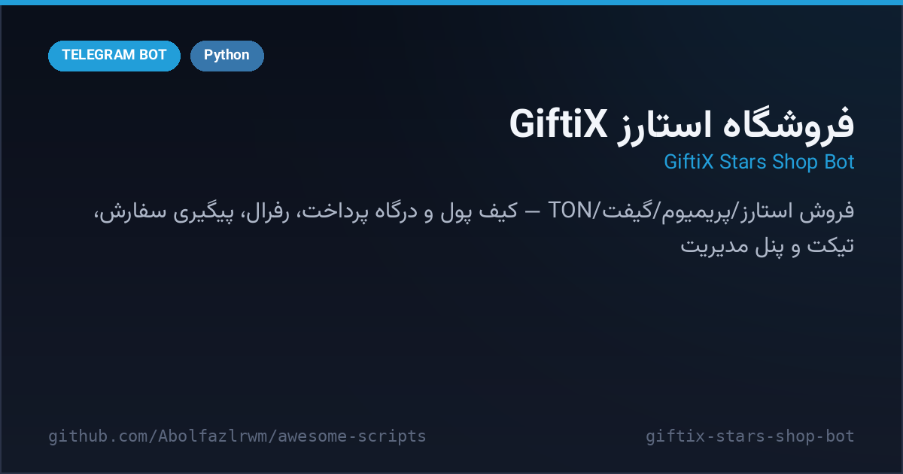

# ⭐ GiftiX Stars Shop Bot — ربات فروشگاه استارز GiftiX

A **digital-goods storefront** for Telegram — sell Telegram Stars, Premium subscriptions, gifts and TON from one bot. SQLModel/SQLAlchemy data model, wallet with payment-gateway deposits, referral rewards, order tracking IDs, support tickets, surveys, backups and a complete admin panel.

فروشگاه‌ساز کالای دیجیتال برای تلگرام — فروش استارز، پریمیوم، گیفت و TON با کیف پول و درگاه پرداخت، سیستم رفرال، شناسه پیگیری سفارش، تیکت پشتیبانی، نظرسنجی، بکاپ و پنل مدیریت کامل. (نسخه‌ی فعلی با متن انگلیسی اجرا می‌شود؛ جدول TEXTS برای ترجمه‌ی فارسی آماده است.)



---

## ✨ Features — امکانات

| | |
| --- | --- |
| 🛍 **4 product lines** | Telegram Stars, Premium (1/3/6/12 months), Gifts, TON — priced per unit with profit margin |
| 💳 **Wallet & gateways** | deposits with daily limits, Zarinpal / Aqayepardakht / NowPayment adapters |
| 🧾 **Orders** | tracking-ID orders with status map (pending → paid → processing → done), admin notifications |
| 👥 **Referral engine** | unique referral codes, per-referral bonuses, survey rewards |
| 🎫 **Support tickets** | open/track tickets answered from the admin panel |
| 📊 **Admin panel** | stats, users, orders, transactions, tickets, broadcast, prices, backup toggle |
| 🗄 **Real ORM** | SQLAlchemy declarative models (User, Order, Transaction, Ticket, Backupup, AdminLog) on SQLite |
| 🌍 **i18n-ready** | TEXTS table with format-kwargs; ship any language by adding a dict |

## 🚀 Setup — نصب و اجرا

```bash
cd src/giftix-stars-shop-bot
python3 -m venv venv && source venv/bin/activate
pip install -r requirements.txt
export BOT_TOKEN="123:ABC..."   # یا در .env
python bot.py
```

> توجه: رشته‌های fa/ar در فایل سورس اصلی خراب شده بود و بازیابی نشد؛ ربات با متن انگلیسی اجرا می‌شود و برای فارسی‌سازی کافی است `TEXTS["fa"]` را دوباره پر کنید.

## 📁 Files — فایل‌ها

```
giftix-stars-shop-bot/
├── bot.py               # کل فروشگاه: مدل‌ها، درگاه‌ها، سفارش‌ها، پنل ادمین
├── requirements.txt
├── .env.example
└── docs/preview.png
```

## 🧠 How it works — معماری

- **Price engine**: `get_price()` applies a configurable profit percent over base rates per product type and quantity.
- **Gateway layer**: `PAYMENT_GATEWAYS` dict enables Zarinpal / Aqayepardakht merchant IDs; deposits land in the wallet with daily caps.
- **Order lifecycle**: `status_map` renders localized status; every order carries a random 10-char tracking ID shown to buyer and admins.

## 📄 License — لایسنس

MIT — see the repository root.
