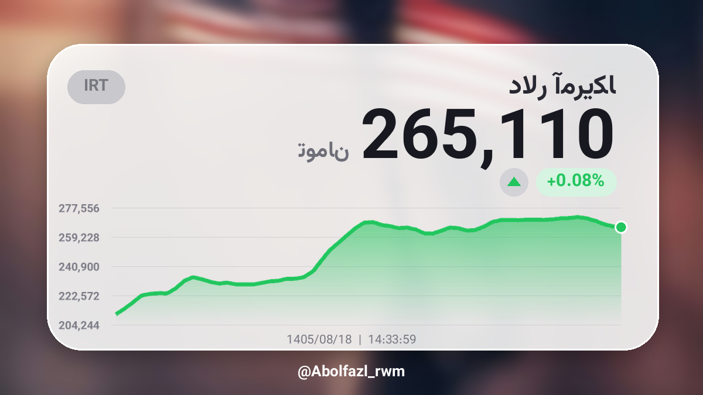
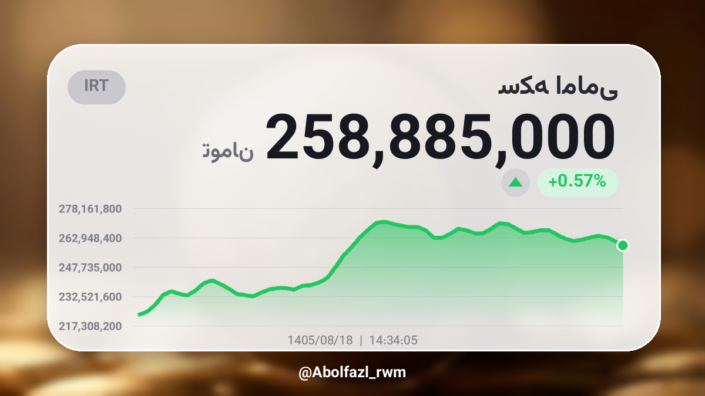
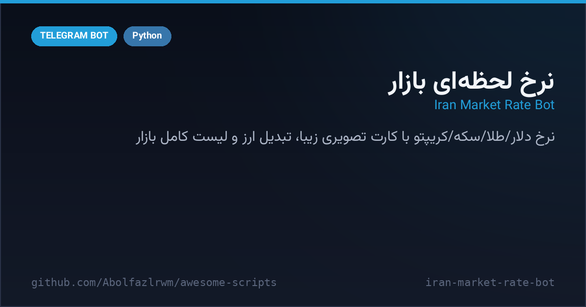

# 💸 Iran Market Rate Bot

A Telegram bot that answers any price question in **Persian natural text** and replies with a **beautiful rendered card** — glass panel, smooth chart, change pill, Jalali date and an AI-generated background per asset. Covers 25+ instruments: free-market USD/EUR/GBP/…, Iranian gold coins (Emami, Bahar, half, quarter, gram), gold 18k/24k, silver, gold ounce, USDT and major cryptos.




<p align="center"><i>Real outputs — rendered from live market data (2026-11-09)</i></p>



## ✨ Highlights

- 💬 **Zero-UI natural input** — just write `دلار`, `100 یورو`, `2 سکه`, `۰٫۵ بیتکوین`, `100 تومن دلار` (convert) or `نرخ ارز` (full list)
- 🖼 **Rendered price cards** — 1200×675 PNG with area chart from real history, % change pill, IRT badge, Jalali date/time and your custom footer signature
- 📋 **Full market list** — grouped sections (currencies / gold & coins / crypto) as a tall image + text fallback
- 🔁 **Currency converter** — any asset ⇄ any asset with toman/dollar equivalents
- 🧮 **Bonus calculator** — any arithmetic message (`25*4+10`) gets answered instantly
- ⚡ **Smart data layer** — 3 mirror sources with cache (20 s), per-symbol history cache (1 h), unit normalization (IRR/USD → toman), robust Persian/Arabic digit & word normalization
- 🎨 **Asset art** — per-asset AI-generated backgrounds cached for 7 days with an elegant gradient fallback (works fully offline)
- 🔤 **Persian typography** — Vazirmatn fonts auto-downloaded, Arabic reshaper + bidi shaping
- 🛡 **Hardened parsing** — AST-based safe expression evaluation, no eval, input length guards

## 🚀 Quick start

```bash
cd iran-market-rate-bot
python3 -m venv .venv && . .venv/bin/activate
pip install -r requirements.txt
cp .env.example .env      # BOT_TOKEN (and optional FOOTER)
python main.py
```

1. Create a bot with [@BotFather](https://t.me/BotFather) → put the token in `.env`.
2. Optional: set `FOOTER=@YourHandle` — it is printed on every rendered image.
3. Send any price question to your bot. Fonts download automatically on first run.

## 📖 Examples

| You send | Bot replies with |
| --- | --- |
| `دلار` | USD card + toman/dollar text |
| `100 یورو` | Card for 100 EUR |
| `2 سکه` | Emami coin card ×2 |
| `100 تومن دلار` / `100 تون دلار` | Conversion card |
| `نرخ ارز` / `لیست کامل` | Full market list image |
| `25*4+10` | `25×4+10=110` |

<details>
<summary><b>🇮🇷 نسخه فارسی</b></summary>

# 💸 ربات نرخ لحظه‌ای بازار ایران

رباتی که هر سؤال قیمتی رو با **متن فارسی خودمونی** می‌گیری و با یه **کارت تصویری خوشگل** جواب می‌ده — پنل شیشه‌ای، نمودار نرم، درصد تغییر، تاریخ شمسی و پس‌زمینه‌ی اختصاصی هر دارایی. پشتیبانی از ۲۵+ مورد: دلار/یورو/پوند بازار آزاد، سکه امامی/بهار/نیم/ربع/گرمی، طلای ۱۸ و ۲۴، نقره، اونس، تتر و رمزارزهای اصلی.


<p align="center"><i>خروجی واقعی — رندرشده از دیتای زنده بازار</i></p>

## ✨ قابلیت‌ها

- 💬 **ورودی آزاد فارسی** — بنویس `دلار`، `100 یورو`، `2 سکه`، `۰٫۵ بیتکوین`، `100 تومن دلار` (تبدیل) یا `نرخ ارز` (لیست کامل)
- 🖼 **کارت قیمتی رندرشده** — PNG با نمودار واقعی تاریخچه، درصد تغییر، تاریخ شمسی و امضای دلخواه تو
- 📋 **لیست کامل بازار** — سه بخش (ارزها / طلا و سکه / ارز دیجیتال) به‌صورت تصویر بلند + نسخه متنی
- 🔁 **تبدیل ارز** — هر ارز ⇄ هر ارز با معادل تومان/دلار
- 🧮 **ماشین‌حساب هدیه** — هر عبارت ریاضی (`25*4+10`) جواب فوری می‌گیره
- ⚡ **لایه دیتا هوشمند** — ۳ منبعmirror با کش ۲۰ ثانیه، کش تاریخچه هر نماد ۱ ساعت، نرمال‌سازی ارقام فارسی/عربی
- 🎨 **هنر هر دارایی** — پس‌زمینه AI با کش ۷ روزه و فال‌بک گرادینت شیک (کاملاً آفلاین هم کار می‌کنه)
- 🔤 **تایپوگرافی فارسی** — فونت وزیرمتن خودکار دانلود می‌شه، شکل‌دهی حروف با arabic-reshaper + bidi
- 🛡 **پارس امن** — ارزیابی عبارت با AST بدون eval و گاردهای طول ورودی

## 🚀 راه‌اندازی سریع

```bash
cd iran-market-rate-bot
python3 -m venv .venv && . .venv/bin/activate
pip install -r requirements.txt
cp .env.example .env      # BOT_TOKEN (و اختیاری FOOTER)
python main.py
```

1. از [@BotFather](https://t.me/BotFather) یک ربات بساز و توکنش رو در `.env` بگذار.
2. اختیاری: `FOOTER=@YourHandle` — امضای پایین همه کارت‌هاست.
3. هر سؤال قیمتی رو به ربات بفرست. فونت‌ها در اولین اجرا خودکار دانلود می‌شن.

## 📖 مثال‌ها

| می‌فرستی | ربات جواب می‌ده |
| --- | --- |
| `دلار` | کارت دلار + متن تومان/دلار |
| `100 یورو` | کارت ۱۰۰ یورو |
| `2 سکه` | کارت سکه امامی ×۲ |
| `100 تومن دلار` | کارت تبدیل |
| `نرخ ارز` / `لیست کامل` | تصویر لیست کامل بازار |
| `25*4+10` | `25×4+10=110` |

</details>

## ⚙️ Configuration (`.env`)

| Variable | Description |
| --- | --- |
| `BOT_TOKEN` | Bot token from @BotFather (required — bot exits with a clear message if missing) |
| `FOOTER` | Signature printed on every card/list (default `@Abolfazl_rwm`) |

## 📡 Data sources

Free & open JSON mirrors of the Iran free market (`iran-market.github.io` and CDN mirrors), cached in-memory. No API key, no cost.

<div align="center">

**Maintained by [@Abolfazl_rwm](https://t.me/Abolfazl_rwm)** · MIT License

</div>
