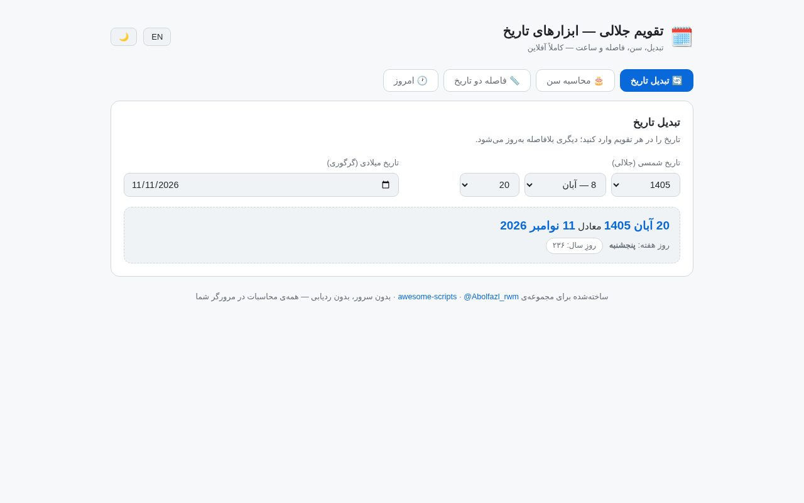

# 🗓️ Jalali Date Tools — تقویم جلالی

> 📬 **Telegram:** [@Abolfazl_rwm](https://t.me/Abolfazl_rwm)

A complete, single-file web toolkit for the Persian (Solar Hijri / Jalali) calendar —
converter, age calculator, date-diff and a live Tehran clock. Everything runs **fully
offline in the browser**: no server, no build step, no external libraries.

مجموعه‌ای کامل از ابزارهای تاریخ شمسی در یک فایل HTML — تبدیل تاریخ، محاسبه‌ی سن، فاصله بین دو تاریخ و ساعت زنده‌ی تهران. کاملاً آفلاین و بدون هیچ وابستگی خارجی اجرا می‌شود.

---



## ✨ Features — امکانات

| | |
| --- | --- |
| 🔄 **Converter** | Jalali ↔ Gregorian, synced live in both directions |
| 🎂 **Age calculator** | exact years/months/days, total days alive, birth weekday, next-birthday countdown |
| 📏 **Date diff** | exact distance between two Jalali dates (days, weeks + days) |
| 🐘 **Today panel** | live Tehran clock, both calendars, day-of-year and Jalali year progress bar |
| 🌓 **Dark / light theme** + 🌐 **فارسی / English (RTL-aware)** | persisted per visitor |
| ⌨️ Persian digits, Persian month/weekday names | locale-aware number formatting |

## 🧮 Correctness — دقت الگوریتم

The converter ports the well-known **jalaali-js** algorithm (Birashk/Aghili cycle table)
and was cross-checked against the reference Python library `jdatetime` on **1,700+
assertions** (707 random conversions across 1925–2124, plus leap-year and month-length
rules for every Jalali year 1304–1503) — **zero mismatches**.

الگوریتم تبدیل با کتابخانه‌ی مرجع `jdatetime` روی بیش از ۱۷۰۰ تاریخ (سال‌های ۱۳۰۴ تا ۱۵۰۳) مقایسه و تأیید شده است.

## 🚀 Run — اجرا

No installation at all — it is one HTML file:

```bash
# option 1: just open it
open src/jalali-date-tools/index.html

# option 2: serve it (recommended)
python3 -m http.server 8080
# → http://localhost:8080/src/jalali-date-tools/
```

**Live demo:** [abolfazlrwm.github.io/awesome-scripts/src/jalali-date-tools/](https://abolfazlrwm.github.io/awesome-scripts/src/jalali-date-tools/)

## 📁 Files — فایل‌ها

```
jalali-date-tools/
├── index.html      # the whole app (HTML + CSS + JS, zero dependencies)
└── README.md
```

## 🔧 Customization — شخصی‌سازی

- **Year range:** edit `J_YEAR_MIN` / `J_YEAR_MAX` (default 1300–1500).
- **Colors:** all design tokens are CSS variables at the top of the file.
- **Timezone:** the clock uses `Asia/Tehran`; change the `Intl` options to switch.

## 📄 License — لایسنس

MIT — see the repository root. ساخته‌شده برای جامعه‌ی توسعه‌دهندگان ایرانی 🇮🇷
