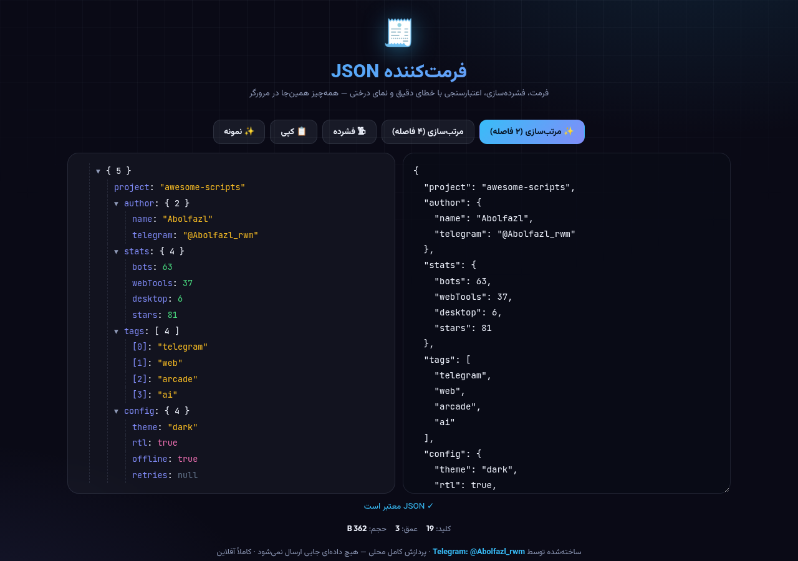

# 🧾 JSON Formatter — فرمت‌کننده JSON

<!-- Telegram: @Abolfazl_rwm -->

<p align="center"></p>

**A JSON formatter, minifier and validator with line-and-column precise errors and a collapsible tree viewer — in one offline HTML file.**

فرمت‌کننده و فشرده‌ساز JSON با خطای دقیق سطر/ستون و نمای درختی جمع‌شونده — همه در یک فایل HTML آفلاین.

[](https://abolfazlrwm.github.io/awesome-scripts/src/json-formatter-web/)

## ✨ Features

- ✨ **Pretty & minify** — re-indent with 2 or 4 spaces or compress to one line
- 🎯 **Precise errors** — parse failures report the message plus the exact line and column
- 🌳 **Tree viewer** — every object/array collapses with a click; keys, strings, numbers, booleans and nulls color-coded
- 📊 **Live stats** — key count, nesting depth and payload size update as you type
- 📋 **Copy button** and a ready-made sample document
- 🔒 Parsed 100% locally — nothing leaves the browser; works offline from `file://`

## 🚀 Demo / اجرا

```bash
cd src/json-formatter-web
python3 -m http.server 8080   # or just open index.html
```

## 📬 Contact — تماس

[https://t.me/Abolfazl_rwm](https://t.me/Abolfazl_rwm) — Abolfazl
