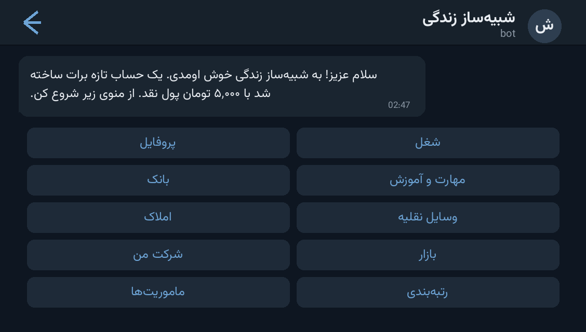

# 🌆 Life Simulator Bot — ربات شبیه‌ساز زندگی

> 📬 **Telegram:** [@Abolfazl_rwm](https://t.me/Abolfazl_rwm)

A complete **life-simulation economy game** for Telegram in a single Python file —
jobs and skill trees, banking with card numbers and loans, real-estate and vehicle
markets, companies, a player-driven free market, missions, crime & jail, marriage,
and a full admin panel. Everything runs on one SQLite file.

شبیه‌ساز زندگی کامل برای تلگرام در یک فایل پایتون — شغل و مهارت، بانک با کارت و وام،
املاک و ماشین، شرکت، بازار آزاد، ماموریت، جرم و زندان، ازدواج و پنل مدیریت کامل. همه‌چیز روی یک فایل SQLite.



---

## ✨ Features — امکانات

| | |
| --- | --- |
| 💼 **12 jobs & 9 skills** | skill-gated careers (worker → doctor → investor), job XP/levels, per-skill training cooldowns |
| 🏦 **Banking** | card numbers (16-digit, transferable), deposits, loans with credit score, card-to-card transfers between players |
| 🏠 **Assets** | 6 property types with daily income, 8 vehicles with work-income bonus, vehicle **shop with admin-managed price & stock** |
| 🏗 **Companies** | register a company, withdraw profits, hire employees by username |
| 🛒 **Free market** | players list items & vehicles at their own price, buyers pay sellers directly (with notification) |
| 🎯 **Daily missions** | rotating missions with cash + XP rewards, once-per-day tracking |
| ⚖️ **Crime & jail** | 3 crimes with risk/reward, jail time, bail-style fines, credit-score penalties |
| 👥 **Social** | friends, gifts, marriage & divorce |
| 📊 **Leaderboard** | top-10 richest players by net worth |
| 🛠 **Admin panel** | stats, give money, ban/unban, broadcast, world events, vehicle-shop management |
| ✨ **Premium UX** | Bot API 9.4 button styles (`primary`/`success`/`danger`) + real premium-emoji icons with automatic unicode fallback |
| 🔢 **Persian digits fix** | all inputs normalize ۰-۹ / ٠-٩ → ASCII so amounts & card numbers always parse |

## 🚀 Setup — نصب و اجرا

```bash
cd src/life-simulator-bot
python3 -m venv venv && source venv/bin/activate     # Windows: venv\Scripts\activate
pip install -r requirements.txt
```

Open `bot.py` and fill the config block at the top:

```python
BOT_TOKEN = "PUT_YOUR_BOT_TOKEN_HERE"   # از @BotFather
ADMIN_IDS = [111111111]                 # آیدی عددی ادمین‌ها (از @userinfobot)
```

```bash
python bot.py
```

Then send `/start` in Telegram — a fresh account is created with 5,000 تومان cash.
بعد از اجرا، در تلگرام `/start` بزنید — یک حساب تازه با ۵۰۰۰ تومان ساخته می‌شود.

## 📁 Files — فایل‌ها

```
life-simulator-bot/
├── bot.py              # the whole game (menus, economy, DB, admin panel)
├── requirements.txt    # python-telegram-bot
└── docs/preview.png    # demo screenshot
```

## 🧠 How it works — معماری

- **SQLite** (`life_sim.db`) with 13 tables — users, skills, properties, vehicles,
  companies, employees, market listings, missions, friends, marriages, history, world
  events and the vehicle shop.
- **Timing**: one in-game day = 1 real hour (`GAME_DAY_SECONDS`); needs decay on a
  10-minute timer (`DECAY_SECONDS`); work cooldown 10 min, training cooldown 5 min.
- **Money format**: amounts render as `100,000 تومان (100 هزار تومان)` — full + short form.
- **Buttons**: the central `sbtn()` helper attaches real colored styles and
  `icon_custom_emoji_id` when available, and falls back to plain unicode otherwise —
  it never crashes on non-premium clients.
- **Transfers** use generated card numbers + `normalize_digits()` so Persian-keyboard
  amounts and card numbers never break parsing.

## 🎮 Game loop — چرخه بازی

1. `/start` → main menu (profile, job, bank, skills, estate, vehicles, company,
   market, missions, leaderboard, social, crime).
2. Work & train to earn cash + XP, level up skills to unlock better jobs.
3. Buy assets for passive income; invest in a company; trade on the free market.
4. Or take the criminal path — higher reward, real jail risk.

## 📄 License — لایسنس

MIT — see the repository root.
