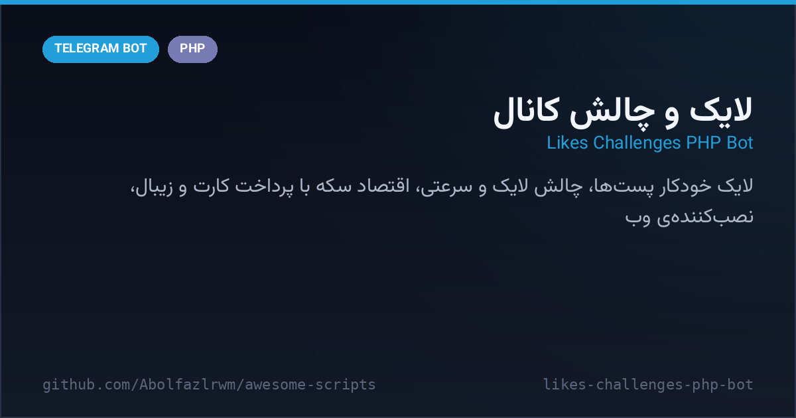

# ❤️ Likes & Challenges Bot — ربات لایک و چالش کانال

> 📬 **Telegram:** [@Abolfazl_rwm](https://t.me/Abolfazl_rwm)

A **PHP/MySQL channel-growth suite** — auto-likes under your channel posts, like-challenges, first-click speed-challenge links and polls, powered by a coin economy: users earn coins via referrals and daily dice rewards, buy coin packs with card-to-card receipts or the **Zibal** payment gateway, and spend them on likes and challenges. Ships with a web installer, schema migration/repair tools and dedicated Zibal bridge/callback endpoints.

مجموعه‌ی رشد کانال با PHP و MySQL — لایک خودکار زیر پست‌های کانال، چالش لایک، لینک چالش سرعتی و نظرسنجی، همه بر بستر اقتصاد سکه: کاربر با زیرمجموعه‌گیری و تاس روزانه سکه می‌گیرد، بسته‌ی سکه را با رسید کارت‌به‌کارت یا درگاه **زیبال** می‌خرد و برای لایک و چالش خرج می‌کند. همراه با نصب‌کننده‌ی وب، ابزار مهاجرت/ترمیم دیتابیس و فایل‌های پل و کال‌بک زیبال.



---

## ✨ Features — امکانات

| | |
| --- | --- |
| ❤️ **Auto-likes** | like one post or schedule likes for several upcoming channel posts |
| ⚔️ **Like challenges** | challenge links that count who reacts first to a post |
| 🏃 **Speed challenges** | one-time links — the first visitor wins and is reported to the creator |
| 🗳 **Polls** | channel polls created through the bot |
| 🪙 **Coin economy** | admin-defined packs (`50=50000`), manual top-up/deduct from the panel |
| 💳 **Two payments** | card-to-card receipts approved by admin + Zibal gateway via bridge/callback |
| 🎲 **Daily dice** | once-a-day dice roll pays coin prizes configured per face |
| 👥 **Join walls** | global admin channel join + personal join per link creator |
| 🧰 **Ops tools** | web installer, webhook setup/info, schema repair/migrate, auto-like diagnostics |
| 🔒 **Hardened by default** | `.htaccess` denies `config.php`, `db.php`, `functions.php`, `install.sql`, logs |

## 🚀 Setup — نصب و اجرا

1. فایل‌ها را روی هاست PHP 8 (با `curl` و `pdo_mysql`) آپلود و Extract کنید.
2. یک دیتابیس MySQL بسازید.
3. `install.php` را باز کنید و توکن ربات، آیدی ادمین، اطلاعات دیتابیس و آدرس `bot.php` را وارد کنید.
4. یک‌بار `setwebhook.php` را باز کنید تا وبهوک (با `channel_post`) تنظیم شود.
5. ربات را در تلگرام Start کنید.

```text
config.php          # توکن، ادمین‌ها، دیتابیس، ایموجی لایک، تایم‌زون
zibal_bridge.php    # روی دامنه‌ی درگاه زیبال آپلود می‌شود
```

- بسته‌های سکه، کارت، مرچنت زیبال و وضعیت روش‌های پرداخت از داخل ربات تنظیم می‌شوند (پنل مدیریت → تنظیم خرید سکه).
- برای آپدیت از نسخه‌ی قبلی: `repair_schema.php` و سپس `setwebhook.php` را یک‌بار باز کنید.

## 📁 Files — فایل‌ها

```
likes-challenges-php-bot/
├── bot.php                 # هسته‌ی وبهوک: منوها، لایک، چالش‌ها، پرداخت، پنل ادمین
├── functions.php           # توابع تلگرام، لینک‌سازی، عضویت اجباری، سکه
├── db.php                  # PDO/MySQL + تنظیمات پیش‌فرض
├── config.php              # ثابت‌های اصلی
├── install.php / install.sql / migrate_v5.sql / migrate_v7.sql / repair_schema.php
├── setwebhook.php / deletewebhook.php / webhook_info.php / setup_check.php
├── auto_like_diagnose.php / payment_notice.php
├── zibal_bridge.php / zibal_callback.php
├── .htaccess / VERSION.txt / README-fa.txt
└── docs/preview.png
```

## 🧠 How it works — معماری

- **Webhook core**: `bot.php` handles updates inline — commands, reply-keyboard text menus, inline callbacks and `channel_post` events for auto-likes.
- **Coin ledger**: every purchase, prize and manual adjustment goes through the same guarded balance helpers in `functions.php`, so coins can never double-spend.
- **Zibal bridge**: the gateway lives on its own domain; `zibal_bridge.php` signs requests with a shared secret and `zibal_callback.php` verifies and credits coins after payment.

## 📄 License — لایسنس

MIT — see the repository root.
