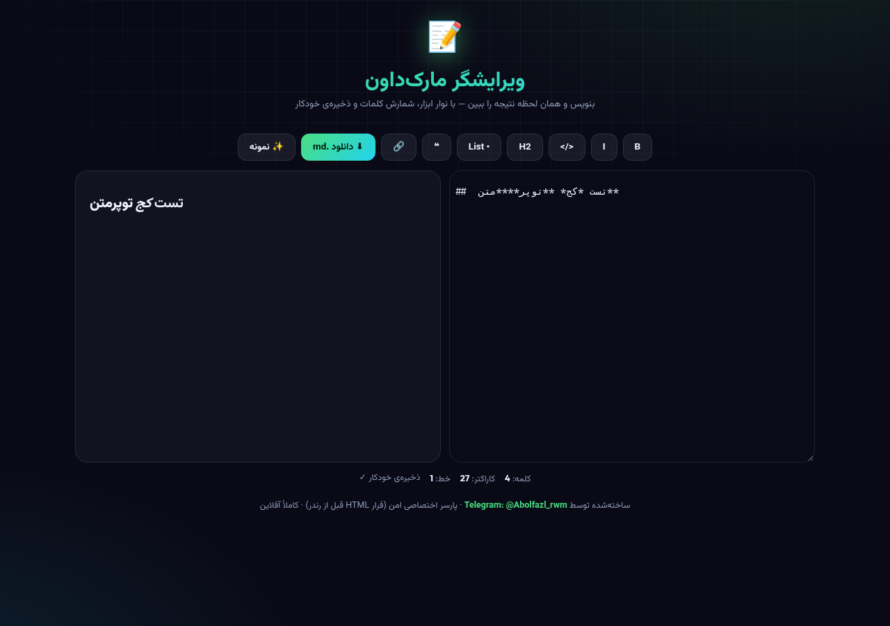

# 📝 Markdown Editor — ویرایشگر مارک‌داون

<!-- Telegram: @Abolfazl_rwm -->

<p align="center"></p>

**A live split-pane Markdown editor with a safe escape-first parser, formatting toolbar, autosave and `.md` export — in one offline HTML file.**

ویرایشگر مارک‌داون دو‌پنلی با پیش‌نمایش زنده، پارسر امن (فرار HTML قبل از رندر)، نوار ابزار، ذخیره‌ی خودکار و دانلود فایل — همه در یک فایل HTML آفلاین.

[](https://abolfazlrwm.github.io/awesome-scripts/src/markdown-editor-web/)

## ✨ Features

- 🪟 **Live split preview** — type on the left, rendered HTML on the right, updates on every keystroke
- 🛡 **Safe by construction** — all input is HTML-escaped *before* any Markdown transform, so raw HTML can never inject
- 📋 **Full Markdown subset** — headings, bold/italic, inline and fenced code, lists, quotes, links, images, tables and rules
- 🧰 **Toolbar** — one-click B / I / code / H2 / list / quote / link insertion around the selection
- 💾 **Autosave** to localStorage plus word/char/line counters and a one-click `.md` download
- 🔒 Zero dependencies, works offline from `file://`

## 🚀 Demo / اجرا

```bash
cd src/markdown-editor-web
python3 -m http.server 8080   # or just open index.html
```

## 📬 Contact — تماس

[https://t.me/Abolfazl_rwm](https://t.me/Abolfazl_rwm) — Abolfazl
