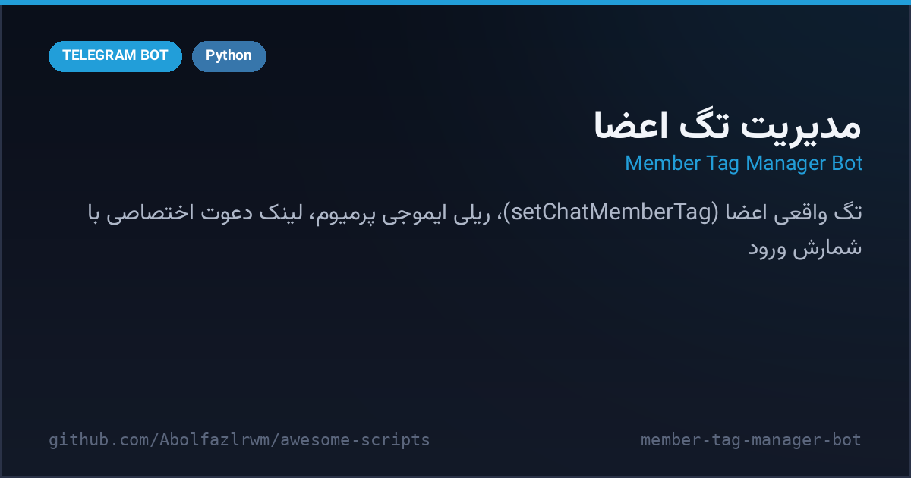

# 🏷 Member Tag Manager Bot — ربات مدیریت تگ اعضا

> 📬 **Telegram:** [@Abolfazl_rwm](https://t.me/Abolfazl_rwm)

A Telethon + Bot-API hybrid that gives your group **real member tags** (Telegram's `setChatMemberTag`), premium-emoji message relay, personal invite links with join counters, join-request approvals, and intro cards (`اسم - شهر - سن`). One Python file + SQLite.

ترکیب Telethon و Bot API برای گروه‌ها — تگ واقعی اعضا با متد setChatMemberTag تلگرام، ریلی پیام‌های ادمین با ایموجی پرمیوم، لینک دعوت اختصاصی هر کاربر با شمارش ورود، تایید درخواست عضویت و کارت معرفی (اسم-شهر-سن). یک فایل پایتون + SQLite.



---

## ✨ Features — امکانات

| | |
| --- | --- |
| 🏷 **Real member tags** | reply `set name اسم-شهر-سن` → tag saved to Telegram AND SQLite (owner/admin exempt) |
| 👑 **Tag admin delegation** | `set tager` (reply) promotes helpers who can also set names |
| 🧩 **Intro cards** | reply `اصل` → premium-emoji card: name, city (from code map), age |
| 🏙 **City codes** | `set TH = تهران` in bot PM registers city codes per group |
| 🔥 **Premium emoji relay** | `[123456]` codes and `em CODE = emoji` mappings become real premium emoji when the admin message hits the group |
| 🧪 **Test posting** | `تست متن` in-group: bot re-posts as itself, keeps formats & entities, deletes the command |
| 🔗 **Personal invite links** | `لینک بده` → per-user request-needed link + local join counter via raw `UpdateChannelParticipant` |
| 📥 **Join approvals** | requesters ping the owner with ✅/❌ inline buttons (`HideChatJoinRequest`) |
| ♻️ **Link rotation** | `حذف لینکا` revokes every personal link in Telegram and wipes the DB |

## 🚀 Setup — نصب و اجرا

```bash
cd src/member-tag-manager-bot
python3 -m venv venv && source venv/bin/activate
pip install -r requirements.txt
cp .env.example .env   # API_ID, API_HASH, BOT_TOKEN, ADMIN_ID, TARGET_GROUP_ID
python bot.py
```

> ربات باید در گروه هدف ادمین با دسترسی مدیریت تگ‌ها و دعوت کاربران باشد.

## 📁 Files — فایل‌ها

```
member-tag-manager-bot/
├── bot.py               # تگ، لینک اختصاصی، معرفی، ایموجی پرمیوم
├── requirements.txt
├── .env.example
└── docs/preview.png
```

## 🧠 How it works — معماری

- **UTF-16 entity math**: `build_new_text_and_entities` replaces `[code]`/emoji tokens with premium emoji while re-shifting every bold/italic entity offset — formatting survives.
- **Hybrid APIs**: MTProto (Telethon) for entities & raw updates; HTTP Bot API for the new `setChatMemberTag` / `getChatMember` calls Telethon does not cover yet.
- **Local join counters**: bots cannot list invite importers, so raw membership updates are trapped and counted per link in SQLite instead.

## 📄 License — لایسنس

MIT — see the repository root.
