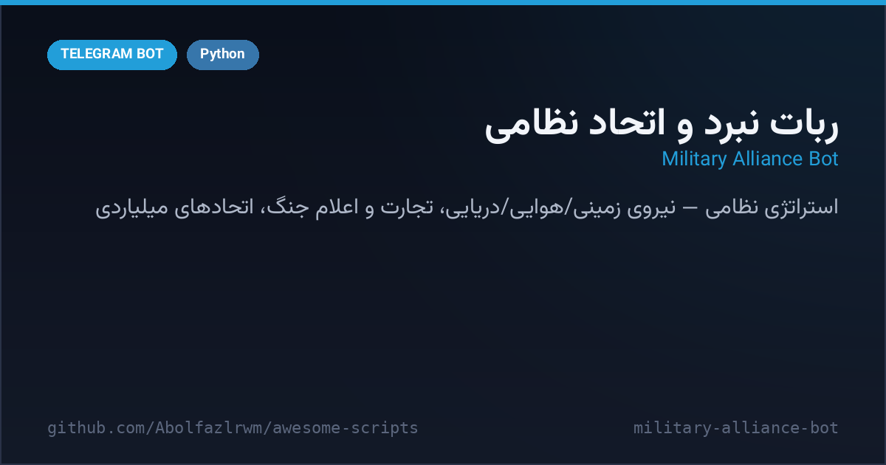

# 🎖 Military Alliance Bot — ربات نبرد و اتحاد نظامی

> 📬 **Telegram:** [@Abolfazl_rwm](https://t.me/Abolfazl_rwm)

A heavyweight **military strategy game** — pick a real country (USA, Iran, Turkey…), command land / air / naval forces, run arms shops and import-export trading, declare wars, launch percentage-based attacks, and form mega-alliances that cost billions. A 21-state ConversationHandler drives the whole flow in one Python file.

بازی استراتژی نظامی سنگین‌وزن — کشورت را انتخاب کن، نیروی زمینی/هوایی/دریایی فرمان بده، بازار تسلیحات و تجارت واردات/صادرات بساز، اعلام جنگ کن و اتحادهای میلیاردی تشکیل بده. همه‌چیز با یک ConversationHandler ۲۱ مرحله‌ای.



---

## ✨ Features — امکانات

| | |
| --- | --- |
| 🗺 **Real countries** | playable roster with per-country oil & VIP flags (🇺🇸 🇮🇷 🇹🇷 …) |
| 🪖 **Full arsenal** | infantry, snipers, RPG, tanks, fighters, aircraft carriers, submarines, cruise missiles |
| 🌊 **Three force branches** | ground / air / navy units with separate shop categories |
| 📦 **Trade module** | list offers, set quantity & price, trade between countries |
| 📜 **War declarations** | public declaration text + confirm step before hostilities |
| 🤝 **Mega alliances** | create (20,000,000,000 cost), join, max-2 alliances enforced |
| 🧭 **21-state wizard** | ConversationHandler walks menus → shop → trade → attack with clean cancel |
| 📢 **Force join** | required channels checked before play |

## 🚀 Setup — نصب و اجرا

```bash
cd src/military-alliance-bot
python3 -m venv venv && source venv/bin/activate
pip install -r requirements.txt
cp .env.example .env   # BOT_TOKEN و ADMIN_ID (و کانال‌های اجباری) را پر کن
python bot.py
```

## 📁 Files — فایل‌ها

```
military-alliance-bot/
├── bot.py               # کل بازی: کشورها، ارتش، تجارت، اتحاد
├── requirements.txt
├── .env.example
└── docs/preview.png
```

## 🧠 How it works — معماری

- **ConversationHandler state machine**: 21 named states (country pick → shop → trade → attack confirm) keep the giant menu tree debuggable.
- **Percentage attacks**: choose how much of your force to commit — bigger pushes hit harder but burn equipment.
- **Alliance economics**: creation cost (`ALLIANCE_CREATE_COST`) and `MAX_ALLIANCES` keep the end-game scarce.

## 📄 License — لایسنس

MIT — see the repository root.
