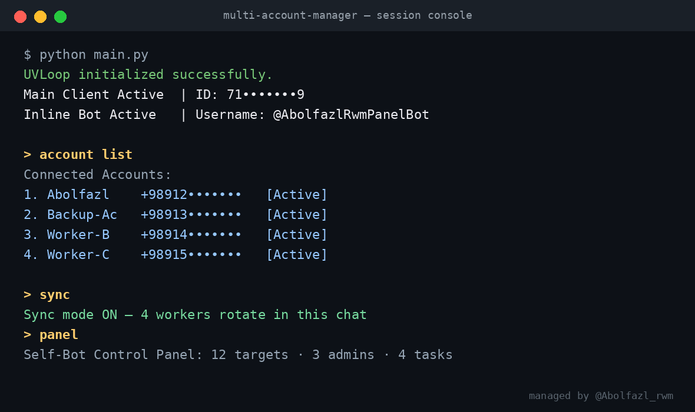
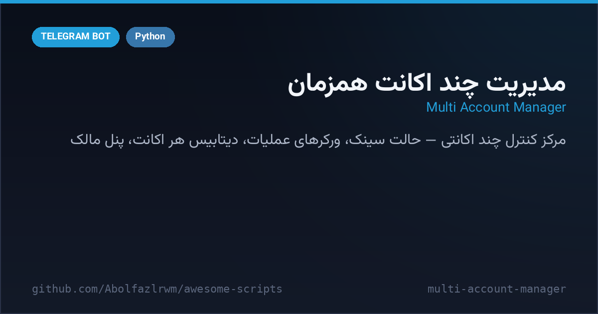

# 👥 Multi-Account Telegram Manager

A self-hosted **multi-account control center** for Telegram built with **Telethon**. One main owner account runs the show: add unlimited worker accounts by phone number, control them from a private chat, run synchronized group actions across all accounts at once, and manage everything through an in-Telegram panel (`panel` command).





## ✨ Highlights

- 👥 **Account management** — `add account +989…` walks you through code/2FA login, sessions are stored locally in `sessions/`; `account list`, `del account`
- 🎛 **Owner panel** — `panel` opens an inline control panel with stats, lists and speed settings
- 🔁 **Sync mode** — `sync` turns the current chat into a rotation queue: every worker takes its turn (round-robin) with per-operation delays
- ⚡ **Operation workers** — spam / kill / attack (mass mention) / burn / bom (fast forward) / ban-all, each with configurable delays (`set spam 0.2`, …)
- 📋 **Lists & databases** — targets, kill/attack/burn texts, fast replies & quick replies per account, JSON-per-account storage with atomic writes
- 🔇 **Mute system** — mute groups/PVs per account, force-PV mute
- 🧑‍💼 **Bot admins** — add sub-admins per account; accounts overview shows who is admin of what
- 🛠 **Utilities** — `ping`, `id`, join/leave chats (invite links, usernames, private links), profile controls (`set name/bio/profile` on reply), `save` to Saved Messages, purge N messages
- 🚀 **Performance extras** — optional uvloop, orjson and aiofiles are auto-detected with pure-Python fallbacks
- 🧯 **Robust runtime** — per-account DB locks, FloodWait/SlowMode handling everywhere, clean task cancellation on stop

## 🚀 Quick start

```bash
cd multi-account-manager
python3 -m venv .venv && . .venv/bin/activate
pip install -r requirements.txt
cp .env.example .env      # fill API_ID / API_HASH / SUPER_ADMIN_ID
python main.py
```

Then message your own account (or the optional inline bot) from the owner ID:

```text
add account +989123456789
code 12345          # reply to the "Code sent" message
password ****       # only if 2FA is on
account list
panel
```

## 📁 Layout (created at runtime)

| Path | What it stores |
| --- | --- |
| `data/accounts/accounts.json` | Registered accounts & string sessions |
| `data/settings/settings.json` | Global settings |
| `data/runtime/` | Ping & control-mode state |
| `databases/db_<id>.json` | Per-account lists/delays |
| `sessions/` | Telethon session files |
| `logs/`, `temp/` | Logs & temp media |

<details>
<summary><b>🇮🇷 نسخه فارسی</b></summary>

# 👥 مدیریت چند اکانت همزمان تلگرام

یک **مرکز کنترل چند اکانتی** سلف‌HOST با **Telethon**. یک اکانت مالک، همه‌چیز را کنترل می‌کند: اضافه کردن بی‌نهایت اکانت کارگر با شماره، فرمان از چت خصوصی، اجرای هماهنگ اکشن‌ها در گروه با همه اکانت‌ها و پنل کامل داخل تلگرام (دستور `panel`).


## ✨ قابلیت‌های مهم

- 👥 **مدیریت اکانت‌ها** — `add account +989…` با ورود کد/توجه ۲FA؛ سشن‌ها محلی در `sessions/` ذخیره می‌شوند؛ `account list` و `del account`
- 🎛 **پنل مالک** — `panel` پنل دکمه‌ای با آمار، لیست‌ها و تنظیمات سرعت باز می‌کند
- 🔁 **حالت سینک** — `sync` چت فعلی را به صف چرخشی تبدیل می‌کند؛ هر اکانت به‌نوبت پیام می‌فرستد (round-robin) با تاخیر جدا برای هر عملیات
- ⚡ **ورکرهای عملیات** — spam / kill / attack (منشن گروهی) / burn / bom (فوروارد سریع) / ban-all، هرکدام با تاخیر قابل تنظیم (`set spam 0.2` …)
- 📋 **لیست‌ها و دیتابیس** — تارگت‌ها، متن‌های kill/attack/burn، پاسخ‌های سریع هر اکانت، ذخیره JSON با نوشتن اتمیک
- 🔇 **سیستم میوت** — میوت گروه/پیوی برای هر اکانت، میوت اجباری پیوی
- 🧑‍💼 **ادمین‌های ربات** — برای هر اکانت ساب-ادمین تعریف کنید؛ نمای اکانت‌ها نشان می‌دهد چه کسی ادمین کجاست
- 🛠 **ابزارها** — `ping`، `id`، جوین/لفت گروه (لینک دعوت، یوزرنیم، لینک خصوصی)، کنترل پروفایل (`set name/bio/profile` روی ریپلای)، `save` به سیو، حذف N پیام (`purge`)
- 🚀 **بهینه‌سازی‌های اختیاری** — uvloop، orjson و aiofiles اگر نصب باشند خودکار فعال می‌شوند (فال‌بک پایتونی دارند)
- 🧯 **اجرای مقاوم** — قفل دیتابیس هر اکانت، مدیریت FloodWait/SlowMode در همه ورکرها، لغو تمیز تسک‌ها با توقف

## 🚀 راه‌اندازی سریع

```bash
cd multi-account-manager
python3 -m venv .venv && . .venv/bin/activate
pip install -r requirements.txt
cp .env.example .env      # API_ID / API_HASH / SUPER_ADMIN_ID را پر کن
python main.py
```

بعد از اجرا، از آیدی مالک به خودت پیام بده:

```text
add account +989123456789
code 12345          # روی پیام «Code sent» ریپلای کن
password ****       # فقط اگر 2FA روشن است
account list
panel
```

> ⚠️ این پروژه با **اکانت شخصی** کار می‌کند؛ اتوماتیک‌سازی اکانت خلاف قوانین تلگرام است و ریسک محدودشدن اکانت دارد — روی اکانت‌های آزمایشی و مسئولانه استفاده کن. ماژول‌های اجرایی (spam/attack/burn و…) **عیناً از سورس اصلی** منتشر شده‌اند؛ استفاده از آن‌ها علیه گروه‌ها یا افراد = مزاحمت و مسدود شدن سریع اکانت.

</details>

## ⚙️ Configuration (`.env`)

| Variable | Description |
| --- | --- |
| `API_ID` / `API_HASH` | Telegram API credentials from my.telegram.org |
| `SUPER_ADMIN_ID` | Numeric ID of the main owner (full control) |
| `MAIN_OWNERS` | Optional extra owner IDs, comma separated |
| `BOT_TOKEN` | Optional bot token to run an extra owner bot alongside |

<div align="center">

**Maintained by [@Abolfazl_rwm](https://t.me/Abolfazl_rwm)** · MIT License

</div>
