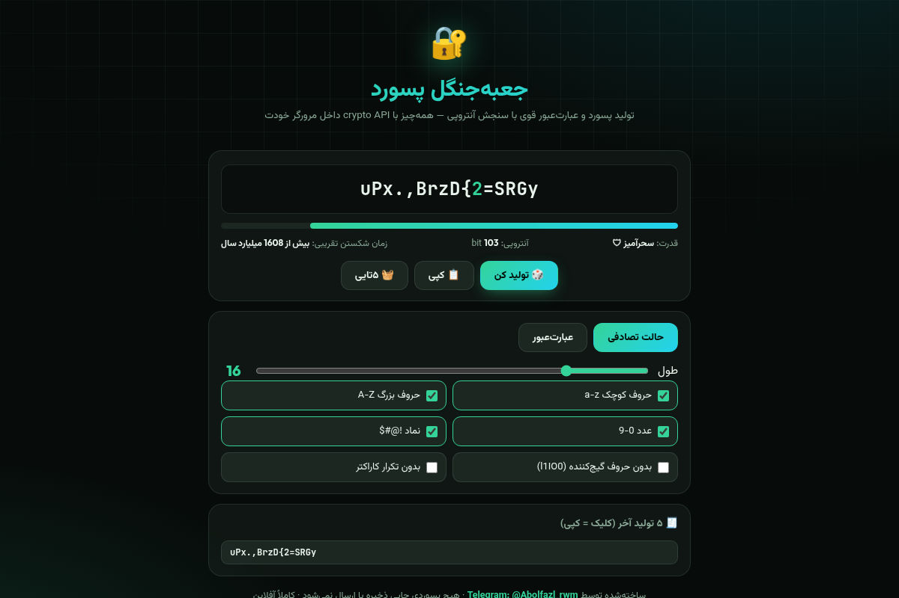

# 🔐 Password Forge — جعبه‌جنگل پسورد

<!-- Telegram: @Abolfazl_rwm -->

<p align="center"></p>

**A strong password & passphrase generator — live entropy scoring, crack-time estimates, bulk mode and a click-to-copy history — in a single offline HTML file powered by the Web Crypto API.**

تولید پسورد و عبارت‌عبور قوی — سنجش آنتروپی زنده، برآورد زمان شکستن و حالت گروهی؛ همه در یک فایل HTML آفلاین با Web Crypto API.

[](https://abolfazlrwm.github.io/awesome-scripts/src/password-forge/)

## ✨ Features

- 🎲 **Unbiased randomness** — `crypto.getRandomValues` with rejection sampling, never `Math.random`
- 🧩 **Random mode** — length 4–64, lowercase/upper/digits/symbols toggles, ambiguous-char filter (`l1IO0`), no-repeat option
- 🗣 **Passphrase mode** — hand-written 100+ word list, word count 3–8, `-` separator, numeric suffix, Capitalize
- 📊 **Live entropy meter** — bits computed from the actual character pool, gradient strength bar (ضعیف → سحرآمیز)
- ⏳ **Crack-time estimate** — years/months/days against a 10¹¹ guesses/sec offline rig
- 🧺 **Bulk mode** — 5 candidates at once, click any history row to copy
- 📜 **Last-5 history** — persisted in localStorage, click to copy
- 🌈 Glassmorphism UI, Vazirmatn + Outfit + JetBrains Mono typography, keyboard shortcuts (`Enter` = generate)
- 🔒 **Zero network** — nothing is stored or sent anywhere; works from `file://`

## 🚀 Demo / اجرا

```bash
cd src/password-forge
python3 -m http.server 8080   # or just open index.html
```

## 📬 Contact — تماس

[https://t.me/Abolfazl_rwm](https://t.me/Abolfazl_rwm) — Abolfazl
