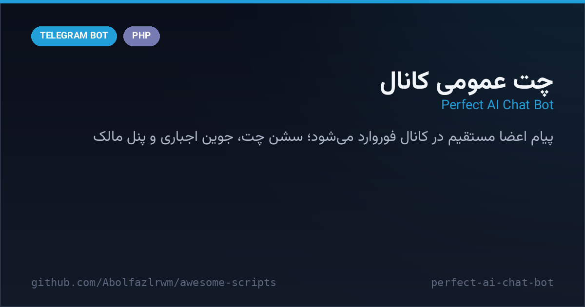

# 💬 Perfect AI Chat Bot — ربات چت عمومی کانال

> 📬 **Telegram:** [@Abolfazl_rwm](https://t.me/Abolfazl_rwm)

A structured PHP bot that turns your channel into a **live chat room**: members open a chat session with the bot and every message they send is instantly forwarded into the channel — with throttling, channel management, force join, broadcasts and an owner panel. Multi-file PHP (config / functions / handlers) with JSON storage.

ربات PHP چندفایلی که کانال شما را به اتاق چت زنده تبدیل می‌کند — کاربران با ربات چت می‌کنند و پیام‌هایشان بلافاصله در کانال فوروارد می‌شود؛ همراه با مدیریت کانال، جوین اجباری، پیام همگانی و پنل مالک. داده‌ها در JSON ذخیره می‌شود.



---

## ✨ Features — امکانات

| | |
| --- | --- |
| 💬 **Chat-to-channel bridge** | open a session → each user message is forwarded to the open channel (2s throttle) |
| ✅ **Session control** | «✅ پایان چت» button closes the session cleanly |
| 📢 **Channel management** | owner adds channels by forwarding a post; per-channel message counters |
| 🔒 **Force join** | membership gate before any chat |
| 📣 **Broadcast** | owner sends one message → delivered to every user |
| 📊 **Owner panel** | stats, channel list, user counts — inline keyboard driven |
| 🗂 **JSON storage** | users / channels / settings under `data/` — zero database setup |
| 🧩 **Clean structure** | config.php · functions.php · handlers.php · index.php (webhook) |

## 🚀 Setup — نصب و اجرا

```bash
cd src/perfect-ai-chat-bot
# توکن و ادمین‌ها را ست کن (متغیر محیطی یا مستقیم در config.php):
export BOT_TOKEN="123:ABC..."
export ADMIN_IDS="111111111,222222222"
# وبهوک:
curl "https://api.telegram.org/bot<TOKEN>/setWebhook?url=https://<host>/perfect-ai-chat-bot/index.php"
```

هاست PHP 7.4+ با HTTPS کافی است؛ `setup.php` هم برای تنظیم اولیه وبهوک وجود دارد.

## 📁 Files — فایل‌ها

```
perfect-ai-chat-bot/
├── config.php           # توکن، ادمین‌ها، کانال اجباری
├── functions.php        # توابع API و ذخیره‌سازی JSON
├── handlers.php         # منطق چت، کانال‌ها، پنل
├── index.php            # نقطه‌ی ورود وبهوک
├── setup.php            # تنظیم وبهوک
├── data/.gitkeep
└── docs/preview.png
```

## 🧠 How it works — معماری

- **State machine per user**: `state` field (none → waiting_forward …) drives admin wizards.
- **Forward pipeline**: `forwardMsg` relays the raw Telegram message object so media keeps its original quality.
- **Throttling**: 2-second sleep between relays keeps the bot under flood limits on busy channels.

## 📄 License — لایسنس

MIT — see the repository root.
