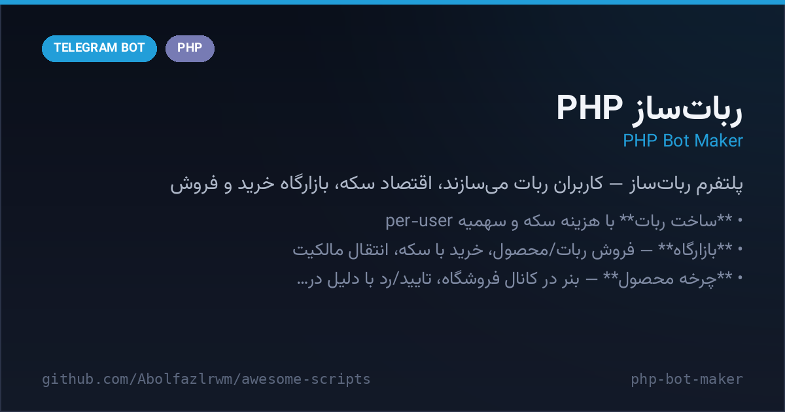

# 🏭 PHP Bot Maker (IR Creator)

A complete **"bot-maker platform"** written in classic PHP + MySQL: your users build their **own Telegram bots** inside your main bot, earn/ spend coins, invite friends (referrals), and **sell & buy bots and digital products** in a built-in marketplace with admin moderation. Ships with a captcha generator, chart renderer and a channel-post search API. A battle-tested Persian ecosystem script with years of field use — published here with PHP 7/8 compatibility fixes.

## ✨ What's inside

| File | Role |
| --- | --- |
| `Pedar.php` | **Main builder bot** (set webhook here) — create bots, marketplace (sell/buy bots & products with admin approve/reject), coin balance, referrals, likes, force-join, profile/account menu |
| `Haji.php` | **Member-bot webhook** — runtime handler for every bot created by users |
| `bot.php` | **Separate management bot** — owner tools: grant/revoke bot-creation quota per user, list bots, broadcast update notes |
| `connect.php` | MySQL connection + admin ID |
| `Function.php` | Helpers: Jalali dates (`jdate`), send/edit message wrappers, keyboard builders |
| `captha.php` | Captcha image generator (3 background styles + `font.ttf`) |
| `chart.php` | Bar-chart PNG generator (stats) |
| `search.php` | Channel-post search API (JSON/XML output via `t.me/s/` scraping) |
| `docs/SETUP-FA.txt` | Original Persian setup notes |

## 🧩 Platform features

- 🛠 **Bot creation** with a coin cost (`$emtiaz_create_bot`), per-user quota
- 🛍 **Marketplace** — list bots/products for sale, buyers pay with coins, seller earns coins, ownership transfer
- 📦 **Product flow** — banner posted to the shop channel, admin group approves/rejects with a reason, stock counters
- 👥 **Referral system** — coins per invited user (`$emtiaz_zirmaj`), welcome bonus
- 💰 **Coin economy** — earn on sales/referrals, spend on creation/purchases
- 📣 **Force join** — main + shop channels gate
- 🔐 **Captcha & charts** included as reusable endpoints

## 🚀 Setup (PHP 7.4 host required)

1. Upload the folder to your host and create a MySQL database.
2. **`Pedar.php` lines 7–27** — set domain, owner ID, support username, channel usernames, shop channel ID (`-100…`), log channel, admin group, coin values and the builder bot token + MySQL credentials (line ~29).
3. **`Haji.php` lines 16–23** — set builder token, domain, names, owner ID, channels.
4. **`connect.php`** — DB credentials (line 3) and admin ID instead of `USERID` (line 8).
5. **`bot.php` lines 10–14 & 640** — token, admin ID, DB credentials for the management bot.
6. Point the **builder bot webhook** to `https://your-domain/Pedar.php`:
   `https://api.telegram.org/bot<TOKEN>/setWebhook?url=https://your-domain/Pedar.php`
7. Open the owner panel in the builder bot with `/Panel_Panel_0`.

> The original Persian notes are kept in [`docs/SETUP-FA.txt`](docs/SETUP-FA.txt).

## 🛠 Fixes applied in this release

- ❌ `mysql_query`/`mysql_num_rows` (removed since PHP 7) → ✅ `mysqli_*` in `Pedar.php`
- ❌ `each()` (removed in PHP 8) → ✅ `array_key_first()` slice in `chart.php`
- 🧹 Runtime state files (`String.json`, `update.json`) reset to neutral defaults
- 🔒 Verified: no credentials or personal data in the tree

<b>🇮🇷 نسخه فارسی</b>

# 🏭 ربات‌ساز PHP (IR Creator)

یک **پلتفرم کامل ربات‌ساز** با PHP کلاسیک + MySQL: کاربرانت داخل ربات اصلی، **ربات تلگرامی خودشون** رو می‌سازن، سکه جمع می‌کنن، زیرمجموعه می‌گیرن و در **بازارگاه داخلی ربات و محصول می‌فروشن و می‌خرن** (با تأیید ادمین). به‌همراه ژنراتور کپچا، نمودار و API جستجوی پست کانال — بازنشر با فیکس‌های سازگاری PHP 7/8.

## 🧩 فایل‌ها

| فایل | نقش |
| --- | --- |
| `Pedar.php` | **ربات اصلی ساز** (وبهوک اینجا ست می‌شه) — ساخت ربات، بازارگاه خرید/فروش ربات و محصول با تأیید ادمین، سکه، زیرمجموعه، لایک، عضویت اجباری |
| `Haji.php` | **وبهوک ربات‌های اعضا** — هندلر اجرایی همه ربات‌های ساخته‌شده |
| `bot.php` | **ربات مدیریت جدا** — ابزار مالک: کم‌وزیاد کردن سهمیه ساخت ربات، لیست ربات‌ها، پیام آپدیت |
| `connect.php` | اتصال MySQL + آیدی ادمین |
| `Function.php` | توابع کمکی: تاریخ شمسی، ارسال/ویرایش پیام، کیبوردها |
| `captha.php` | تولید عکس کپچا (۳ پس‌زمینه + `font.ttf`) |
| `chart.php` | تولید نمودار میله‌ای PNG |
| `search.php` | جستجوی پست کانال (خروجی JSON/XML) |
| `docs/SETUP-FA.txt` | راهنمای فارسی اصلی |

## 🧩 امکانات پلتفرم

- 🛠 **ساخت ربات** با هزینه سکه و سهمیه per-user
- 🛍 **بازارگاه** — فروش ربات/محصول، خرید با سکه، انتقال مالکیت
- 📦 **چرخه محصول** — بنر در کانال فروشگاه، تایید/رد با دلیل در گروه ادمین، شمارنده موجودی
- 👥 **زیرمجموعه‌گیری** — سکه به‌ازای هر عضو معرفی‌شده + هدیه ورود
- 💰 **اقتصاد سکه** — کسب از فروش/زیرمجموعه، خرج در ساخت/خرید
- 📣 **عضویت اجباری** کانال اصلی + فروشگاه
- 🔐 **کپچا و نمودار** به‌عنوان اندپوینت قابل‌استفاده

## 🚀 راه‌اندازی (هاست PHP 7.4 الزامی)

1. پوشه را روی هاست آپلود و یک دیتابیس MySQL بساز.
2. **`Pedar.php` خطوط ۷ تا ۲۷** — دامنه، آیدی مالک، ادمین پشتیبانی، یوزرنیم کانال‌ها، آیدی کانال فروشگاه (`-100…`)، کانال گزارش، گروه ادمین، امتیازها و توکن ربات‌ساز + اطلاعات دیتابیس (خط ~۲۹).
3. **`Haji.php` خطوط ۱۶ تا ۲۳** — توکن ربات‌ساز، دامنه، اسم‌ها، آیدی مالک، کانال‌ها.
4. **`connect.php`** — خط ۳ اطلاعات دیتابیس، خط ۸ آیدی عددی ادمین.
5. **`bot.php`** — خطوط ۱۰، ۱۱ توکن/آیدی و خطوط ۱۴ و ۶۴۰ دیتابیس.
6. وبهوک ربات‌ساز را روی `https://دامنه-شما/Pedar.php` ست کن:
   `https://api.telegram.org/bot<TOKEN>/setWebhook?url=https://دامنه-شما/Pedar.php`
7. پنل مالک در ربات‌ساز: `/Panel_Panel_0`.

## 🛠 فیکس‌های این نسخه

- ✅ جایگزینی `mysql_*` (حذف‌شده در PHP 7) با `mysqli_*` در `Pedar.php`
- ✅ حذف `each()` (منسوخ در PHP 8) از `chart.php`
- 🧹 فایل‌های state اجرایی به مقادیر پیش‌فرض خنثی برگردانده شدند
- 🔒 بررسی‌شده: هیچ توکن یا داده شخصی در مخزن نیست

## ⚠️ Warning / Disclaimer

Classic-era script: keep it on an **isolated test host**, use a dedicated DB user, and review the code before production. Running a bot-creation platform is resource-heavy; the script was designed for PHP 7.4 (recommended per original docs).

**Maintained by [@Abolfazl_rwm](https://t.me/Abolfazl_rwm)** · MIT License

