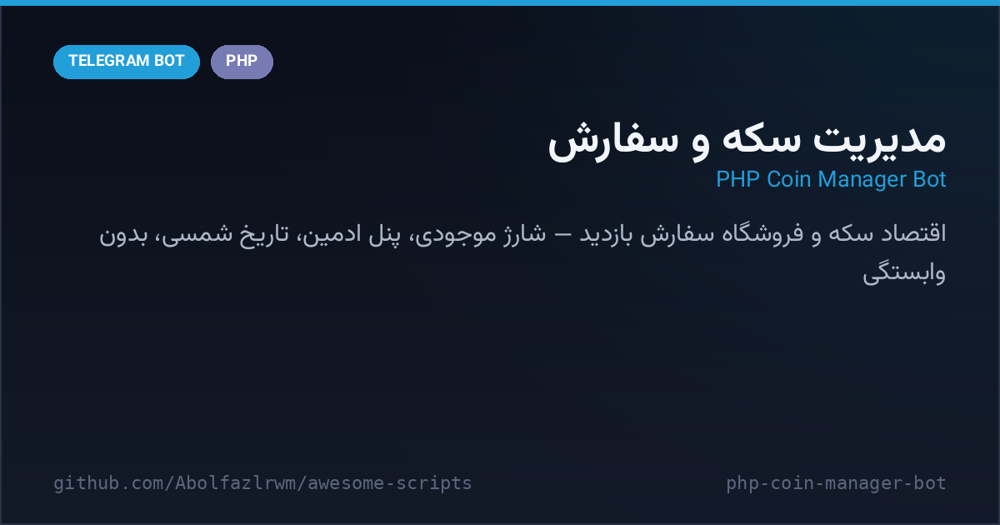

# 🪙 PHP Coin Manager Bot — ربات مدیریت سکه و سفارش (PHP)

A classic Persian **coin-economy bot** in pure PHP: users earn/spend coins, order real-view services, top up balances, and admins run the whole shop from an inline panel — user management, ban/unban, broadcasts, stats and gift coins. Ships with `jdf.php` (Jalali dates) and a shared helper class.

ربات اقتصادی سکه به زبان PHP — کاربرها سکه جمع می‌کنند، سفارش بازدید ثبت می‌کنند، موجودی شارژ می‌کنند و ادمین‌ها از پنل اینلاین همه‌چیز را مدیریت می‌کنند: مدیریت کاربران، بلاک/آنبلاک، پیام همگانی، آمار و هدیه سکه. همراه با jdf.php برای تاریخ شمسی.



---

## ✨ Features — امکانات

| | |
| --- | --- |
| 🪙 **Coin economy** | balances, top-ups (`افزایش موجودی`) and admin gifting (`هدیه مدیریت`) |
| 📦 **View orders** | users place/track real-view orders with validity checks |
| 👑 **Admin panel** | user management, stats, ban/unban, add admins, broadcasts |
| 📅 **Jalali dates** | bundled `jdf.php` for شمسی timestamps everywhere |
| 🧰 **Helper class** | `class.php` centralizes curl/API + formatting helpers |
| ⏳ **Flood & membership gates** | forced-channel join + rate limiting before actions |

## 🚀 Setup — نصب و اجرا

```bash
cd src/php-coin-manager-bot
# توکن‌ها را ست کن:
export BOT_TOKEN="123:ABC..."
export ADMIN_ID="123456789"
# وبهوک:
curl "https://api.telegram.org/bot<TOKEN>/setWebhook?url=https://<host>/bot.php"
```

هاست PHP 7+ (cURL فعال) کافی است — دیتابیس نیست، همه‌چیز فایل‌محور است.

## 📁 Files — فایل‌ها

```
php-coin-manager-bot/
├── bot.php              # کل ربات: پنل‌ها، سفارش‌ها، اقتصاد سکه
├── config.php           # توکن‌ها و ادمین‌ها (متغیر محیطی یا مستقیم)
├── class.php            # کلاس کمکی مشترک
├── jdf.php              # توابع تاریخ جلالی
└── docs/preview.png
```

## 🧠 How it works — معماری

- **Two-bot pattern**: `PARTNER_BOT_TOKEN` lets order services run on a separate bot account while the main bot handles users.
- **Menu-driven UX**: every panel is an inline keyboard with a home button — state lives in user rows, not sessions.
- **Zero-dependency**: no Composer, no DB server — copy the folder to any PHP host.

## 📄 License — لایسنس

MIT — see the repository root.
