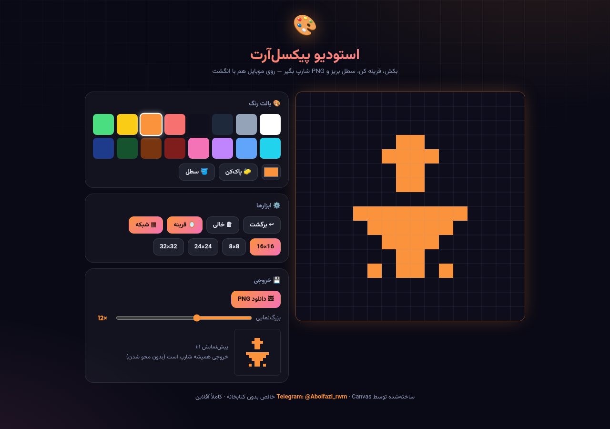

# 🎨 Pixel Art Studio — استودیو پیکسل‌آرت

<!-- Telegram: @Abolfazl_rwm -->

<p align="center"></p>

**A pixel art editor — 16-color palette + custom picker, flood-fill bucket, mirror-X symmetry, 40-level undo, four canvas sizes and crisp nearest-neighbor PNG export — in one offline HTML file.**

ادیتور پیکسل‌آرت — پالت ۱۶ رنگه + انتخابگر دلخواه، سطل رنگ، قرینه‌ی افقی، برگشت تا ۴۰ مرحله، چهار اندازه‌ی بوم و خروجی PNG شارپ با nearest-neighbor؛ همه در یک فایل HTML آفلاین.

[](https://abolfazlrwm.github.io/awesome-scripts/src/pixel-art-studio/)

## ✨ Features

- 🖌 **Draw & erase** — pointer events with live hover highlight, works with touch
- 🪣 **Flood fill** — BFS bucket that treats empty and colored cells alike
- 🪞 **Mirror symmetry** — every stroke mirrored across the vertical axis (toggleable)
- ↩ **Undo stack** — 40 levels, snapshots before every stroke / bucket / clear
- 📐 **4 canvas sizes** — 8×8, 16×16, 24×24, 32×32 with optional grid lines
- 🖼 **Sharp export** — offscreen canvas ×4–×24 with `imageSmoothingEnabled = false` + 1:1 live preview
- 🎨 16 curated colors + custom `<input type=color>`
- 🔒 Zero dependencies, works offline from `file://`

## 🚀 Demo / اجرا

```bash
cd src/pixel-art-studio
python3 -m http.server 8080   # or just open index.html
```

## 📬 Contact — تماس

[https://t.me/Abolfazl_rwm](https://t.me/Abolfazl_rwm) — Abolfazl
