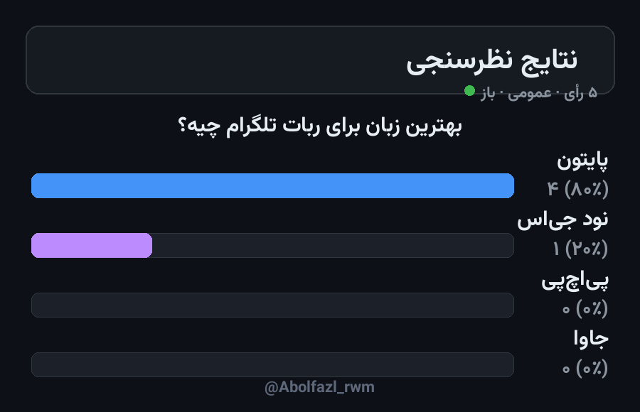

# 🗳 Poll & Vote Bot — ربات نظرسنجی و رأی‌گیری

A complete Telegram bot for building polls with **live counters and rendered result
cards** — no framework, plain `requests` long-polling, one SQLite file. Easy to audit,
easy to extend, works in groups and private chats.

ربات کامل نظرسنجی برای تلگرام با شمارش زنده و کارت تصویری نتایج — بدون فریم‌ورک، با `requests` خالص و یک فایل SQLite. هم در گروه و هم در چت خصوصی کار می‌کند.



---

## ✨ Features — امکانات

| | |
| --- | --- |
| 🧙 **Wizard** `/newpoll` | question → 2–10 options → settings → publish, in 3 messages |
| ☑️ / 🔘 **Single or multi choice** | multi-choice clicks toggle, single-choice clicks move the vote |
| 🕵️ / 🙋 **Anonymous or public** | names are stored only for public polls |
| ⚡ **Live buttons** | counters inside the vote buttons update after every click |
| 📊 **Rendered results** | RTL-aware bar chart PNG (Persian digits, Vazirmatn font bundled) |
| 🔒 **Owner controls** | close, delete, and `📄 CSV` export — owner only |
| 📋 `/mypolls` | your last 10 polls with open/closed status |
| 🧱 **Zero framework** | one file, plain `requests` + `sqlite3` + `Pillow` |

## 🚀 Setup — نصب و اجرا

```bash
cd src/poll-vote-bot
python3 -m venv venv && source venv/bin/activate     # Windows: venv\Scripts\activate
pip install -r requirements.txt
cp .env.example .env       # put your @BotFather token in BOT_TOKEN
python bot.py
```

Then open the bot in Telegram, send `/newpoll` and follow the wizard.

سپس در تلگرام دستور `/newpoll` را بزنید و مراحل را دنبال کنید.

## 📁 Files — فایل‌ها

```
poll-vote-bot/
├── bot.py                  # the whole bot (state machine, DB, rendering)
├── Vazirmatn-Bold.ttf      # bundled font for the result card (OFL license)
├── requirements.txt
├── .env.example
└── docs/demo-result-card.png
```

## 🧠 How it works — معماری

- **Long polling** via `getUpdates` — no webhook, no open ports, runs behind NAT.
- **SQLite** (`pollbot.db`) — `polls`, `options`, `votes` tables; unique constraints
  prevent double voting per option.
- **Vote semantics**: multi-choice = toggle on/off; single-choice = move.
- **Result card** is drawn with Pillow using the bundled Vazirmatn font (Raqm shapes
  the Persian text); counts and percentages use Persian digits.
- **Owner-only actions** (`close`, `delete`, `csv`) are checked against `polls.owner_id`.

- با **long polling** اجرا می‌شود — بدون وب‌هوک و پورت باز، پشت NAT هم کار می‌کند.
- **SQLite** با سه جدول و قید یکتایی برای جلوگیری از رأی تکراری.
- **منطق رأی**: چندانتخابی = خاموش/روشن، تک‌انتخابی = جابه‌جایی رأی.
- **کارت نتایج** با Pillow و فونت Vazirmatn همراه پروژه رندر می‌شود و اعداد فارسی دارد.

## 🔧 Customization — شخصی‌سازی

- Strings live in `TEXT_FA` / `TEXT_EN` at the top of `bot.py` — translate freely.
- Card palette: `ACCENT`, `BG`, `PANEL`… constants.
- Font: set `FONT_PATH` in `.env` or replace the bundled TTF.

## 📄 License — لایسنس

MIT — see the repository root. فونت Vazirmatn تحت لایسنس OFL منتشر شده است.
