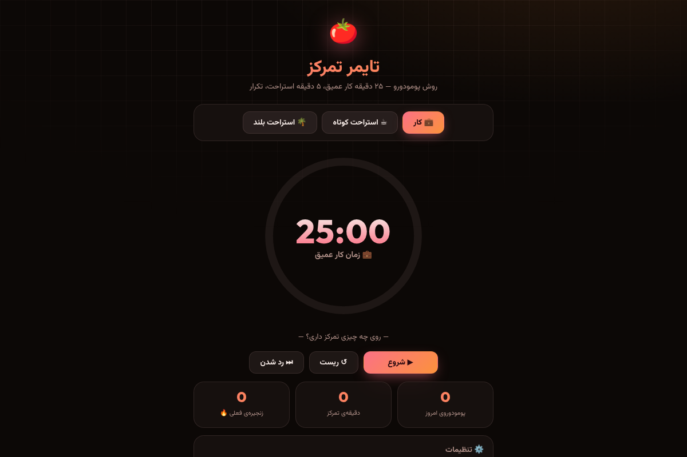

# 🍅 Pomodoro Focus — تایمر تمرکز پومودورو

<!-- Telegram: @Abolfazl_rwm -->

<p align="center"></p>

**A Pomodoro focus timer — gradient SVG progress dial, auto-cycling work/break phases, a Web Worker tick that survives background tabs, daily stats and a chime — in one offline HTML file.**

تایمر پومودورو با حلقه‌ی پیشرفت گرادینتی، چرخه‌ی خودکار کار/استراحت، تیک مبتنی بر Web Worker مقاوم در تب پس‌زمینه، آمار روزانه و زنگ؛ همه در یک فایل HTML آفلاین.

[](https://abolfazlrwm.github.io/awesome-scripts/src/pomodoro-focus/)

## ✨ Features

- ⏱ **Three phases** — کار / استراحت کوتاه / استراحت بلند، با دکمه‌های مستقل و چرخه‌ی خودکار پس از هر دوره
- 🎯 **SVG progress dial** — gradient ring with smooth stroke-dashoffset animation
- 🧵 **Web Worker tick** — the countdown stays accurate even when the tab is inactive
- 🔔 **WebAudio chime** — ascending notes for finished work, descending for finished breaks (toggleable)
- 📊 **Daily stats** — completed pomodoros, focused minutes, current streak 🔥 + a log of today's sessions (localStorage, auto-resets by date)
- ⚙️ **Adjustable** — custom work/short/long durations, auto-cycle on/off, task label ("روی چه چیزی تمرکز داری؟")
- 🏷 **Tab title countdown** — the remaining time follows you into other tabs
- 🌈 Glassmorphism UI, Vazirmatn + Outfit typography, RTL-first
- 🔒 Zero dependencies, works offline from `file://`

## 🚀 Demo / اجرا

```bash
cd src/pomodoro-focus
python3 -m http.server 8080   # or just open index.html
```

## 📬 Contact — تماس

[https://t.me/Abolfazl_rwm](https://t.me/Abolfazl_rwm) — Abolfazl
