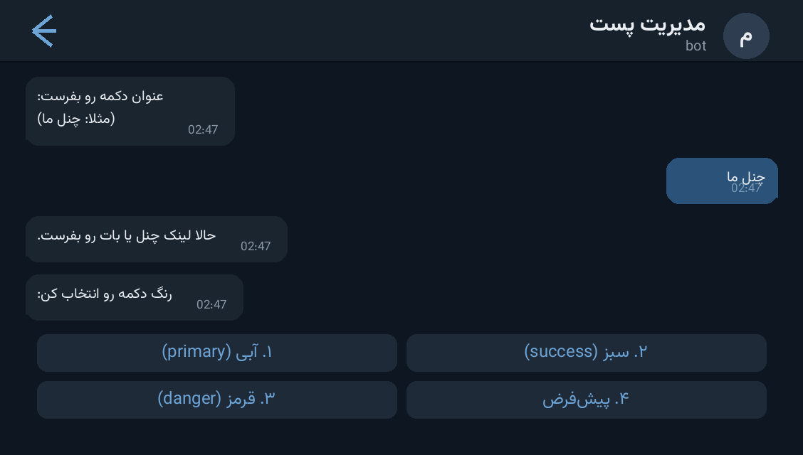

# 🎨 Post Manager Bot — ربات مدیریت پست با دکمه‌های رنگی

A tiny but sharp **channel post manager** for Telegram. Build a persistent library
of colored inline buttons (Bot API 7.10+ button styles), then compose a post and
publish it to your target channel with **all saved buttons attached** — with a live
preview before publishing. One Python file, `requests` only, no framework.

مدیر پست کانال با کتابخانه‌ی دکمه‌های رنگی دائمی (استایل‌های Bot API 7.10+)، پیش‌نمایش
زنده قبل از انتشار و ارسال نهایی به کانال هدف. یک فایل پایتون، فقط `requests`.



---

## ✨ Features — امکانات

| | |
| --- | --- |
| 🔵🟢🔴 **Real button colors** | `primary` / `success` / `danger` / default — per Bot API 7.10+ `style` field |
| 📚 **Persistent button library** | buttons saved to `buttons.json`, survive restarts, managed by number |
| 🧙 **Wizards** | `/addbutton` walks title → URL → color; `/removebutton` deletes by index |
| 👀 **Live preview** | `/newpost` shows the exact post with its buttons before you confirm |
| 📢 **Target channel** | public (`@username`) or private (`-100…`) channels — bot must be admin there |
| 🛡 **Admin-only** | every update is checked against `ADMIN_IDS` |
| 🪶 **Zero framework** | raw `getUpdates` long polling with `requests` — runs anywhere, no webhook/port |

## 🚀 Setup — نصب و اجرا

```bash
cd src/post-manager-bot
python3 -m venv venv && source venv/bin/activate
pip install -r requirements.txt
```

Fill the config block at the top of `bot.py`:

```python
BOT_TOKEN = "PUT_YOUR_BOT_TOKEN_HERE"       # از @BotFather
TARGET_CHANNEL_ID = "@your_channel_username"  # یا "-1001234567890"
ADMIN_IDS = [123456789]                     # از @userinfobot
```

```bash
python bot.py
```

Commands: `/start`, `/addbutton`, `/listbuttons`, `/removebutton`, `/newpost`, `/cancel`.
دستورات: شروع، افزودن دکمه، لیست دکمه‌ها، حذف دکمه، پست جدید، لغو.

## 📁 Files — فایل‌ها

```
post-manager-bot/
├── bot.py              # the whole bot (wizards, keyboard builder, polling loop)
├── requirements.txt    # requests
└── docs/preview.png    # demo screenshot
```

## 🧠 How it works — معماری

- **State machine in memory**: `sessions[chat_id]` tracks the active wizard step;
  every step validates input (URL scheme, color index) before moving on.
- **Keyboard builder**: `build_keyboard()` maps each stored button to one row and
  injects `style` only when a color was chosen, exactly matching the Bot API spec.
- **Publish flow**: preview → type `تایید` → `sendMessage` to the target channel with
  the full keyboard; raw API errors are surfaced back to the admin.
- **Persistence**: `buttons.json` is read/written atomically per change — safe to edit
  by hand too.

## 📄 License — لایسنس

MIT — see the repository root.
