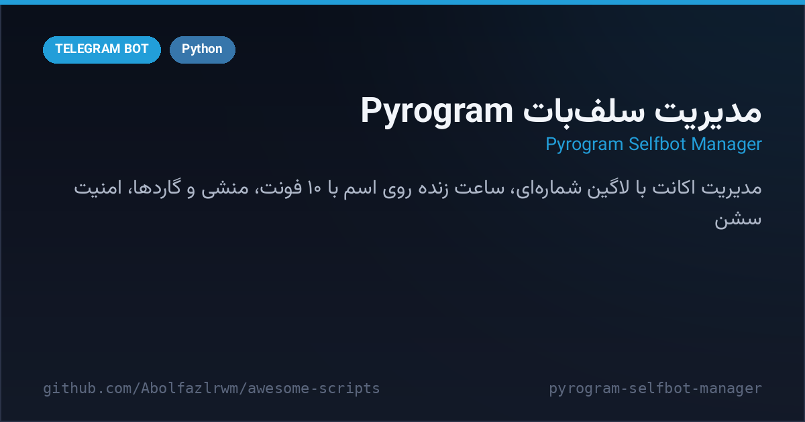

# 🎛 Pyrogram Selfbot Manager — مدیریت سلف‌بات

> 📬 **Telegram:** [@Abolfazl_rwm](https://t.me/Abolfazl_rwm)

A **Pyrogram-based account manager** — sign in with your phone number and control the session through a separate admin bot: live clock on your profile name in 10 stylized digit fonts, secretary auto-reply, enemy / block / mute guards, auto-reactions, message tools (save, repeat, purge), translation, session security (terminate other sessions, anti-login guard), an inline admin panel, broadcasts and dice/bowling games.

مدیریت‌گر اکانت مبتنی بر Pyrogram — با شماره تلفن وارد شوید و سشن را از طریق یک ربات مدیر کنترل کنید: ساعت زنده روی اسم پروفایل با ۱۰ فونت استایل‌دار، منشی خودکار، گاردهای دشمن/بلاک/سکوت، ری‌اکشن خودکار، ابزار پیام (ذخیره، تکرار، حذف)، ترجمه، امنیت سشن (خارج‌کردن سشن‌های دیگر، ضدورود)، پنل اینلاین، پیام همگانی و بازی تاس/بولینگ.



---

## ✨ Features — امکانات

| | |
| --- | --- |
| 🔑 **Phone login** | contact-button login flow; session strings persisted per user in `bot_data.json` |
| 🕐 **Live name clock** | bio/name clock ticking in Tehran time with 10 digit fonts (cursive, circled, fullwidth…) |
| 🤖 **Secretary mode** | auto-reply to incoming messages with an editable message, per-user toggle |
| 🛡 **Guards** | enemy auto-replies (polite texts), block, silence and auto-reaction per user |
| ✂️ **Message tools** | reply-based save, repeat N times, purge N messages |
| 🌍 **Translate** | instant translation through the public Google translate endpoint |
| 🔐 **Session security** | list & terminate other active sessions, anti-login watcher, status scheduler |
| 📣 **Admin bot** | inline `panel` query, broadcast to all sessions, live status, contact router |
| 🎲 **Fun** | dice and bowling mini-games with custom reply keyboards |
| 💾 **JSON storage** | users, sessions, enemies, mutes, reactions and states survive restarts |

## 🚀 Setup — نصب و اجرا

```bash
cd src/pyrogram-selfbot-manager
python3 -m venv venv && source venv/bin/activate
pip install -r requirements.txt
cp .env.example .env   # API_ID / API_HASH / BOT_TOKEN را پر کن
python bot.py
```

- `API_ID` و `API_HASH` از [my.telegram.org](https://my.telegram.org) و `BOT_TOKEN` از [@BotFather](https://t.me/BotFather).
- آیدی ادمین‌های اصلی را در `GOD_ADMIN_IDS` بالای فایل قرار دهید.
- شروع: به ربات مدیر `/start` بزنید و با دکمه‌ی «شماره و شروع» شماره را ثبت کنید؛ کد ورود را در همان چت بفرستید.
- ⚠️ استفاده مسئولانه: اتوماسیون اکانت ممکن است شرایط استفاده‌ی تلگرام را نقض کند؛ فقط روی اکانت شخصی و با مسئولیت خودتان.

## 📁 Files — فایل‌ها

```
pyrogram-selfbot-manager/
├── bot.py               # کل سیستم: لاگین، پنل، گاردها، ساعت اسم، امنیت سشن
├── requirements.txt
├── .env.example
└── docs/preview.png
```

## 🧠 How it works — معماری

- **Peer patch**: `patch_peer_id_validation()` relaxes Pyrogram's peer-type validation so `-100` channel IDs resolve correctly on old versions.
- **Single JSON store**: `DataManager` keeps users, sessions, guards and queues in one normalized JSON file with atomic writes.
- **Outgoing hook**: an outgoing-message modifier rewrites the clock digits in the profile name each minute and strips clock glyphs from user-typed text.

## 📄 License — لایسنس

MIT — see the repository root.
