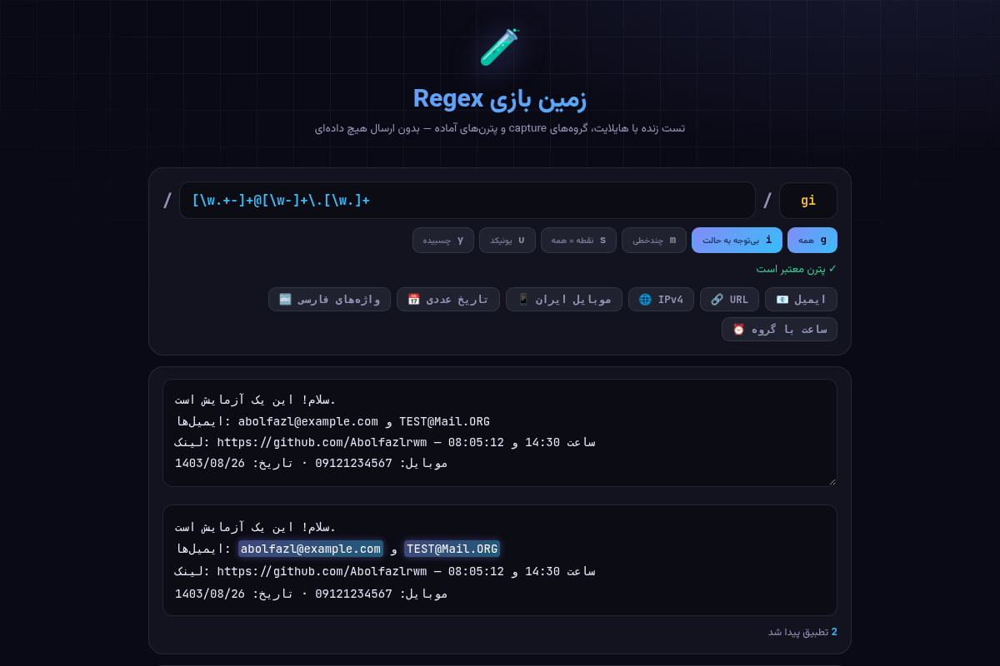

# 🧪 Regex Playground — زمین بازی عبارات باقاعده

<!-- Telegram: @Abolfazl_rwm -->

<p align="center"></p>

**A live regular-expression tester — glowing match highlighting, capture-group table, flag chips, ready-made patterns (email, URL, IPv4, Iranian mobile, Persian words) and a cheat sheet — in one offline HTML file.**

تست زنده‌ی Regex با هایلایت درخشان، جدول گروه‌های capture، پرچم‌ها، پترن‌های آماده و برگه‌ی تقلب؛ همه در یک فایل HTML آفلاین.

[](https://abolfazlrwm.github.io/awesome-scripts/src/regex-playground/)

## ✨ Features

- ⚡ **Live matching** — highlight updates on every keystroke, glowing `<mark>` spans over the sample text
- 🧩 **Capture-group table** — numbered groups and named groups side by side (up to 40 matches)
- 🚩 **Flag chips** — g / i / m / s / u / y toggles kept in sync with the flags input, invalid-flag validation
- 📚 **7 ready-made patterns** — ایمیل، URL، IPv4، موبایل ایران، تاریخ، واژه‌های فارسی (`\u0600-\u06FF`)، ساعت با گروه
- 🛡 **Infinite-loop guard** — zero-length matches advance `lastIndex`, capped at 5000 iterations
- ❗ **Real error messages** — invalid patterns show the engine's message instead of failing silently
- 📋 **Cheat sheet** — 12 commonly used tokens with Persian explanations
- 🌈 Glassmorphism UI, Vazirmatn + Outfit + JetBrains Mono typography, RTL controls with LTR code areas
- 🔒 Everything runs in your browser — no data ever leaves the page; works from `file://`

## 🚀 Demo / اجرا

```bash
cd src/regex-playground
python3 -m http.server 8080   # or just open index.html
```

## 📬 Contact — تماس

[https://t.me/Abolfazl_rwm](https://t.me/Abolfazl_rwm) — Abolfazl
