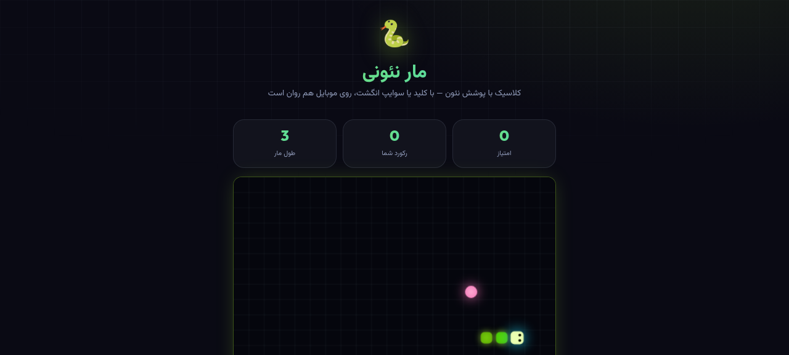

# 🐍 Neon Snake — مار نئونی

<!-- Telegram: @Abolfazl_rwm -->

<p align="center"></p>

**The classic snake with a neon glow — keyboard AND touch-swipe controls, accelerating speed, a pulsing gradient apple and a persistent personal best — in one offline HTML file.**

بازی مار کلاسیک با پوشش نئون — کنترل با کیبورد و سوایپ لمسی، سرعت فزاینده، سیب گرادینتی نبض‌دار و رکورد شخصی ماندگار؛ همه در یک فایل HTML آفلاین.

[](https://abolfazlrwm.github.io/awesome-scripts/src/snake-game-web/)

## ✨ Features

- 🕹 **Two control schemes** — arrows/WASD on desktop, swipe gestures on mobile (`touch-action:none` canvas)
- ⚡ **Accelerating loop** — every apple shaves 1.5ms off the tick, floor at 45ms; سه سطح سرعت شروع (آروم/معمولی/دیوانه)
- 🌈 **Neon rendering** — `shadowBlur` glow on body segments, gradient head with tracking eyes, pulsing radial-gradient apple
- 🧠 **Direction queue** — up to 3 buffered turns with 180°-reversal guard, so fast double-taps never self-kill
- 🏆 **Personal best** — persisted in localStorage, updated on game over
- ⏸ **Pause anywhere** — `Space` or button, with a frosted-glass pause overlay
- 🧱 **Crisp at any size** — fixed 21×21 logical grid scales fluidly to the viewport
- 🌈 Glassmorphism UI, Vazirmatn + Outfit typography, RTL-first
- 🔒 Zero dependencies, works offline from `file://`

## 🚀 Demo / اجرا

```bash
cd src/snake-game-web
python3 -m http.server 8080   # or just open index.html
```

## 📬 Contact — تماس

[https://t.me/Abolfazl_rwm](https://t.me/Abolfazl_rwm) — Abolfazl
