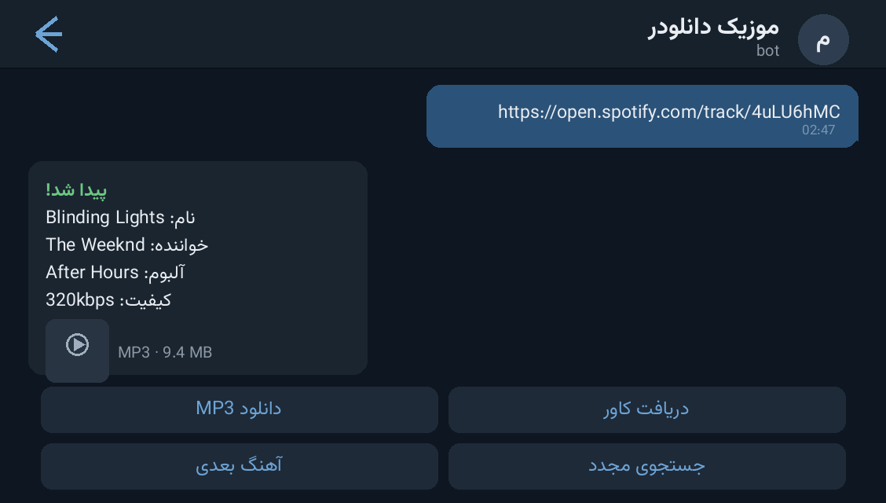

# 🎧 Spotify Music Bot — ربات دانلود موزیک اسپاتیفای

> 📬 **Telegram:** [@Abolfazl_rwm](https://t.me/Abolfazl_rwm)

A full **music downloader** for Telegram: paste a **Spotify link** (track, album or
playlist) or just type a song name, and the bot finds the track, downloads it in
**320 kbps** via `yt-dlp`, stamps the **original cover art + ID3 metadata** and sends
it back with inline download buttons.

ربات دانلود موزیک برای تلگرام: لینک اسپاتیفای (تک‌ترک، آلبوم یا پلی‌لیست) بفرست یا اسم
آهنگ را بنویس — ربات پیدا می‌کند، با `yt-dlp` در کیفیت **۳۲۰kbps** دانلود می‌کند، **کاور
اورجینال + تگ ID3** می‌زند و با دکمه‌های شیشه‌ای می‌فرستد.



---

## ✨ Features — امکانات

| | |
| --- | --- |
| 🔗 **Spotify parser** | single tracks, full albums and playlists — album/playlist replies list every track with individual download buttons |
| 🔎 **Smart text search** | powered by **YouTube Music** (`ytmusicapi`) — search by title, artist or even lyric fragments |
| ⬇️ **Real downloads** | `yt-dlp` audio extraction with bitrate targeting (default `320kbps` in `config.json`) |
| 🖼 **Original cover art** | high-resolution APIC cover embedded into the MP3 ID3 tag + shown with the file |
| 🏷 **ID3 metadata** | title / artist / album written into the file (`mutagen`) |
| 🛒 **Per-user state** | pending track lists, quality preference and history in SQLite |
| 🧩 **Modular** | `spotify_parser.py` + `search_engine.py` + `downloader.py` — clean, testable units |
| ⚙️ **JSON config** | `config.json` for token, admins, channel and quality — no code edits needed |

## 🚀 Setup — نصب و اجرا

```bash
cd src/spotify-music-bot
python3 -m venv venv && source venv/bin/activate
pip install -r requirements.txt      # نیاز به ffmpeg هم دارد (روی PATH)
```

Edit `config.json`:

```json
{
  "bot_token": "YOUR_BOT_TOKEN_HERE",
  "admin_ids": [123456789],
  "channel_username": "",
  "download_quality": "320kbps"
}
```

```bash
python bot.py          # یا: bash run.sh
```

سپس در تلگرام لینک اسپاتیفای بفرستید یا اسم آهنگ را تایپ کنید.

> 📌 `yt-dlp` + `ffmpeg` must be available on the system for actual downloads.
>
> 📌 برای دانلود واقعی، `yt-dlp` و `ffmpeg` باید روی سیستم نصب باشند.

## 📁 Files — فایل‌ها

```
spotify-music-bot/
├── bot.py               # bot wiring, keyboards, user states (telebot)
├── spotify_parser.py    # Spotify track/album/playlist resolver
├── search_engine.py     # YouTube Music search
├── downloader.py        # yt-dlp download + mutagen tagging
├── config.json          # token / admins / quality
├── run.sh               # venv bootstrap + run
├── requirements.txt
└── docs/preview.png     # demo screenshot
```

## 🧠 How it works — معماری

- **Two-stage resolution**: Spotify metadata (name, artist, album) is fetched from
  the Spotify link first, then the actual audio is sourced by searching that title
  on YouTube Music — the best of both catalogs.
- **Tagging pipeline**: downloaded audio → ID3 title/artist/album → APIC cover at
  original resolution → final file size checked against Telegram limits.
- **Album/playlist flow**: one message with a scrollable button list; each track can
  be downloaded individually so chats never get flooded.

## 📄 License — لایسنس

MIT — see the repository root.
