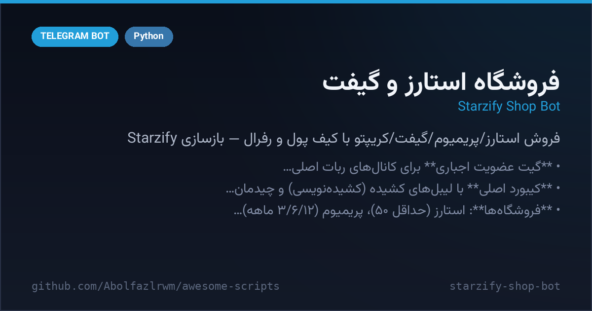

# Abolfazl Stars Shop — built from scratch

A clean-room stars/premium/gifts shop implementation,
built in one file (`bot.py`, aiogram 3.x + SQLite). The original bot's real
source/server is not accessible; its supplier and payment backends are TODO
stubs here (see "What is stubbed" below). See `REPORT.md` for the full
exploration report.



## Setup

```bash
cd starzify-shop-bot
python3 -m venv .venv && . .venv/bin/activate
pip install -r requirements.txt
cp .env.example .env   # put BOT_TOKEN and ADMIN_IDS in .env
python3 bot.py
```

## What's inside

- **Forced-join gate** for `@Abolfazl_rwm` + `@Abolfazl_rwm` (configurable via
  `.env` / settings table; admins exempt) with the «🔍 بررسی عضویت 🔍» check
  button.
- **Main reply keyboard** with the original's stretched (kashida) labels and
  the same row layout, using Bot API button styles (green row / blue rows /
  red row).
- **Shops**: ⭐️ Stars (min 50), 💎 Premium (3/6/12 months), 🪙 Crypto
  (TON ×3 methods, TRX, DOGS, USDT), 🎁 Gifts (11 gifts, quantity +/−,
  hide-from-profile toggle, comment ≤128 chars), ❤️ Reactions (min 5),
  🚀 Boost (disabled alert, as in the original).
- **Shared invoice system**: discount-balance application, discount codes
  (seeded `WelcomeCode` = 5%), remove-code, cancel, wallet payment,
  insufficient-balance error, tracking code per order.
- **Wallet top-up**: rial (verification-required + gateway-maintenance alert,
  as observed) and crypto (amount → TRX/TON → invoice with deposit address +
  per-user memo + Tonkeeper link + Payment Check stub).
- **Account**: profile, phone verification via contact share, bank-card
  management (stored masked, pending approval), recent/pending orders,
  daily dice 🎲 & bowling 🎳 challenges with stored per-day limits.
- **Referral**: 5%/6%/8% levels, stats, invite banner, withdrawal
  (min 100,000 Toman), personal discount-code creation for 30 points.
- **Support / trust / order tracking** screens with the original's usernames.
- **Waiting-state rule**: pressing any main-menu button, `/start` or `/cancel`
  always exits the current flow and the new button works immediately.
- **Admin panel** (`/admin`): stats, pending orders approve/reject (reject =
  auto-refund), full price/settings editor, discount-code CRUD, user list,
  balance adjustment, broadcast with preview + confirm.

## Prices

All prices were captured on 2026-11-06 and **float with the market**. They
live in the `settings` table (seeded from the report) and are editable in
`/admin → ⚙️ تنظیمات قیمت‌ها`. Per-star seed: 4,523.24 Toman (50 stars =
226,162 Toman at capture time).

## Coloured buttons & custom emojis — how they work

Telegram Bot API (9.x) buttons accept:

- `style`: `"success"` (green), `"primary"` (blue/teal), `"danger"` (red).
  There is **no brown style** — in the original bot the brown buttons are the
  Back/secondary/cancel buttons, so this replica maps brown → default (no
  style). See the `COLOR_MAP` comment at the top of `bot.py`.
- `icon_custom_emoji_id`: shows a Telegram custom (premium) emoji on the
  button.

The helpers `btn()` (inline) and `kbtn()` (reply keyboard) in `bot.py` accept
`style=` and `emoji_key=`. They use the real fields when the installed aiogram
supports them (aiogram ≥ 3.22 works natively; verified on 3.31) and silently
fall back to plain buttons on older versions.

**Honest note about custom emoji IDs:** the original bot's premium-emoji IDs
*cannot be extracted from Telegram Web*, so `CUSTOM_EMOJI_IDS` at the top of
`bot.py` ships empty and labels use the standard emoji prefixes (⭐️ 💎 🪙 🎁
❤️ 🚀 …). To use the real premium emojis: send each premium emoji to your own
bot, read its `custom_emoji_id` from `message.entities`, paste the IDs into
`CUSTOM_EMOJI_IDS`, and the buttons will render them automatically.

## What is stubbed (TODO)

- `deliver_order()` — marks the order delivered, credits points/referral
  commission and notifies admins; replace with the real supplier (Fragment /
  Stars / Premium / gift delivery) API.
- "Payment Check" for crypto top-ups — chain/provider lookup not connected.
- Rial gateway — the original itself shows a maintenance alert; the replica
  mirrors that.
- Referral payout — registers an admin notification; real card payout is a stub.
- Invite banner — text banner; image rendering is a stub.
- Reaction unit price — derived (`price_per_star / 10`); set the real supplier
  price before production use.

---

## 🇮🇷 نسخه فارسی

# فروشگاه استارز ابوالفضل — ساخته‌شده از صفر

بازسازی کامل منوها و جریان خرید با aiogram 3.x و SQLite در یک فایل `bot.py`. سورس اصلی ربات در دسترس نیست؛ بخش تأمین‌کننده و درگاه پرداخت این نسخه **استاب (TODO)** است — فهرست کامل در بخش "What is stubbed" و گزارش کامل در `REPORT.md`.

## نصب

```bash
cd starzify-shop-bot
python3 -m venv .venv && . .venv/bin/activate
pip install -r requirements.txt
cp .env.example .env   # توکن ربات و آیدی ادمین‌ها را در .env بگذار
python3 bot.py
```

## امکانات اصلی

- **گیت عضویت اجباری** برای کانال‌های ربات اصلی (قابل تنظیم از `.env` یا جدول تنظیمات؛ ادمین‌ها معاف) با دکمه «🔍 بررسی عضویت 🔍»
- **کیبورد اصلی** با لیبل‌های کشیده (کشیده‌نویسی) و چیدمان ردیف‌های ربات اصلی + استایل رنگی دکمه‌ها (ردیف سبز/آبی/قرمز)
- **فروشگاه‌ها**: ⭐️ استارز (حداقل ۵۰)، 💎 پریمیوم (۳/۶/۱۲ ماهه)، 🪙 کریپتو (TON ×۳ روش، TRX، DOGS، USDT)، 🎁 گیفت (۱۱ گیفت، تعداد +/−، مخفی از پروفایل، کامنت ≤۱۲۸)، ❤️ ری‌اکشن (حداقل ۵)، 🚀 بوست (هشدار غیرفعال مثل ربات اصلی)
- **سیستم فاکتور مشترک**: اعمال تخفیف از موجودی، کد تخفیف (`WelcomeCode` = ۵٪)، حذف کد، لغو، پرداخت از کیف پول، خطای موجودی ناکافی، کد پیگیری هر سفارش
- **شارژ کیف پول**: ریالی (تأیید دستی + هشدار درگاه مثل ربات اصلی) و کریپتو (مبلغ → TRX/TON → فاکتور با آدرس واریز + مموی اختصاصی + لینک Tonkeeper + استاب «بررسی پرداخت»)
- **حساب کاربری**: پروفایل، تأیید شماره با اشتراک مخاطب، مدیریت کارت بانکی (با ماسک، در انتظار تأیید)، سفارش‌های اخیر/در انتظار، چالش روزانه تاس 🎲 و بولینگ 🎳 با سقف روزانه
- **رفرال**: سه سطح ۵٪/۶٪/۸٪، آمار، بنر دعوت، برداشت (حداقل ۱۰۰٬۰۰۰ تومان)، کد تخفیف شخصی با ۳۰ امتیاز
- **صفحات پشتیبانی/اعتماد/پیگیری سفارش** با یوزرنیم‌های ربات اصلی
- **قانون وضعیت انتظار**: زدن هر دکمه منو، `/start` یا `/cancel` از فلو جاری خارج می‌شود و دکمه جدید فوراً کار می‌کند
- **پنل ادمین** (`/admin`): آمار، تأیید/رد سفارش‌های در انتظار (رد = اتو-رفاند)، ویرایش کامل قیمت‌ها/تنظیمات، CRUD کد تخفیف، لیست کاربران، تغییر موجودی، پیام همگانی با پیش‌نمایش + تأیید

## نکته درباره ایموجی پرمیوم

ID ایموجی‌های پرمیوم ربات اصلی از تلگرام‌وب قابل استخراج نیست؛ برای همین `CUSTOM_EMOJI_IDS` خالی منتشر شده و لیبل‌ها از ایموجی استاندارد استفاده می‌کنند. برای فعال‌سازی ایموجی پرمیوم واقعی، هر ایموجی را به ربات خودت بفرست، `custom_emoji_id` را از `message.entities` بخوان و در `CUSTOM_EMOJI_IDS` بالای `bot.py` بگذار.

---

<div align="center">

**Maintained by [@Abolfazl_rwm](https://t.me/Abolfazl_rwm)** · MIT License

</div>
