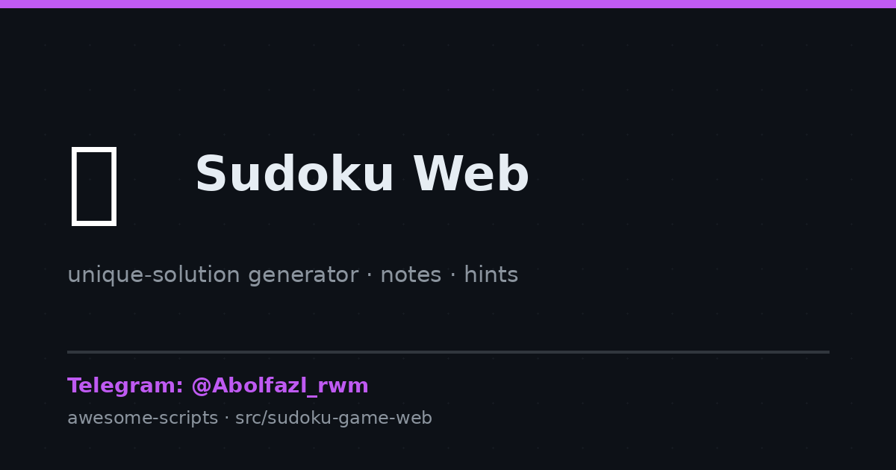

# 🔢 Sudoku Web — سودوکو

<!-- Telegram: @Abolfazl_rwm -->

<p align="center"></p>

**A complete offline Sudoku game — hand-written backtracking generator with a *unique-solution* guarantee, four difficulties, pencil notes, hints, error tracking and a timer. Single file, no libraries.**

بازی کامل سودوکو آفلاین — سازنده‌ی بازگشتی دست‌نویس با تضمین **جواب یکتا**، چهار سطح سختی، یادداشت مدادی، راهنما، شمارش خطا و تایمر. تک‌فایل و بدون کتابخانه.

[](https://abolfazlrwm.github.io/awesome-scripts/src/sudoku-game-web/)

## ✨ Features

- 🧬 **Real generator** — random full grid + cell removal that keeps exactly ONE solution (`countSolutions ≤ 2` check)
- 🎚 **4 difficulties** — آسان / متوسط / سخت / خفن (38 → 56 holes)
- ✏️ **Pencil notes** — 3×3 mini-grid per cell, plus 🪄 **auto-notes** that fill every candidate at once
- ↩️ **Undo** — full move history (up to 200), `Ctrl+Z`
- 🔢 **Digit pad with counters** — remaining count under every digit, completed digits fade out
- 📊 **Progress bar** — filled-cell percentage in a gradient bar
- 🏆 **Per-difficulty records** — best time saved per level, confetti + shake animations on win/mistake
- 💡 **Smart hint** — reveals a random missing cell from the stored solution
- ⚠️ **3-mistakes limit** — conflict highlighting (row/box/peer/same-number shading), pop animation on entry
- 🧠 **Solver built in** — watch the backtracking solve the current board
- 🌗 dark & light glassmorphism themes, Vazirmatn + Outfit typography
- ⌨️ full keyboard support: 1–9, arrows, Backspace, `Ctrl+Z`

## 🚀 Demo / اجرا

```bash
cd src/sudoku-game-web
python3 -m http.server 8080   # or just open index.html
```

## 📬 Contact — تماس

[https://t.me/Abolfazl_rwm](https://t.me/Abolfazl_rwm) — Abolfazl
